# Voxel-Sandbox devlog

What landed in Voxel-Sandbox, by day and newest first, with the pictures taken on the way, the
captures the repository keeps under `.github/assets` and the pictures made while an item was built,
kept under `.github/devlog` as WebP files named by their day, each on the day its name says, and the
notes written beside them as Markdown files named the same way. A line under Done names the item of
.github/REVIEW.md or .github/REVIEW-ARCHIVE.md and the commit that closed it.

## 2026-10-31

Done that day

- Item 150 at `8a1e308`. The play job keeps clear of its time limit.

## 2026-10-30

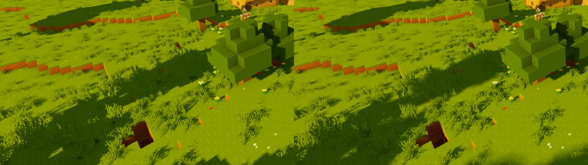
Seed 1's plains village at hour 16, the oaks' shadows in a window of 2560 by 1440 run as `dotnet
run` runs it with the player's options file, Soft Shadows kept at 0 from an older file, on the left,
and with a fresh options file at the default of 1.5 degrees, at 1280 by 720 shown twice its size, on
the right, the window's frame and an offscreen capture of each alike within 1 percent.

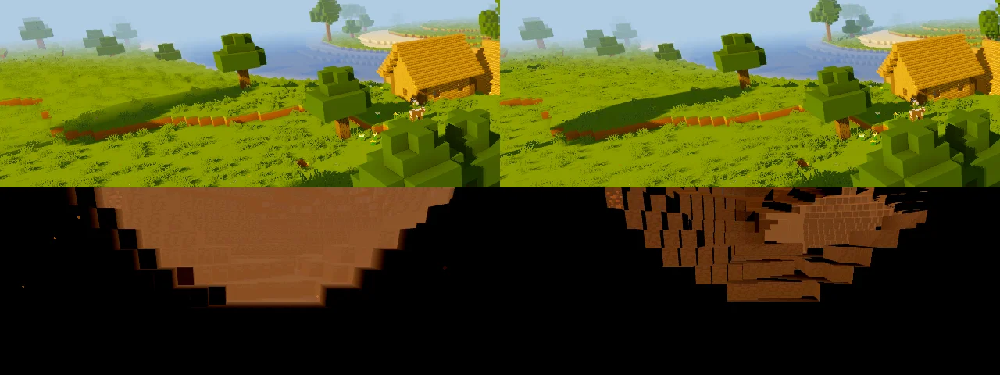
Above, seed 1's plains village at hour 16 with the sun's shadows reaching 64 blocks on the left and
128 on the right, the far oak's shadow faint where the contact shadows give it and dark where the
shadow map does, and below, seed 1's deep cave at -59.5, -4, -91.5 at noon at Low, brightened six
times, its far wall lit evenly by the sky's light with the far cascade off on the left and its
blocks lit only by their faces' own share with it on at the right.

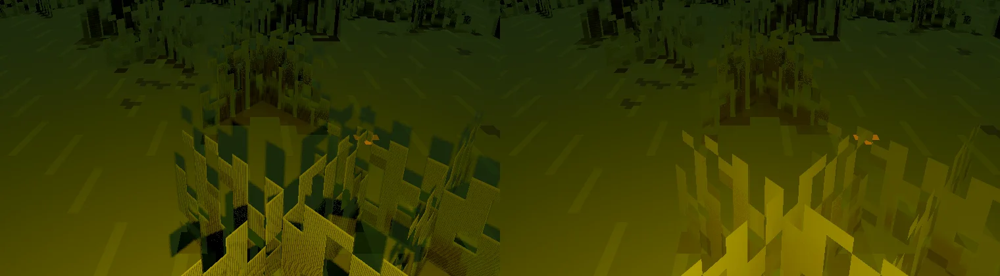
Seed 1's plains village's meadow at midnight from 560.5, 66, -350.5 with a torch in hand, on the
left its light casting shadows on 3DEngine 5.2.326, the grass's blades shading each other in dark
patches and a seam of the light's shadow down the middle, and on the right a plain point light with
no shadow on 5.2.333, the grass lit evenly about the player.

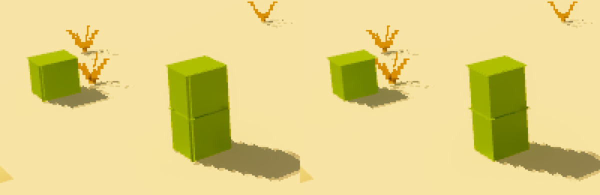
Two cacti on the sand of seed 1's desert by its village at 687, 57, -725 in the game's own pictures,
shown four times their size, on the left each side a pixel in and as wide as the whole cell, its
edges showing a pixel past the sides beside them as a line down each corner, and on the right a
plain box, each side a pixel in and as wide as the box.

# Item 141, the far cascade on and the shadows at 128 blocks

The far cascade on by default and the sun's shadows reaching 128 blocks, read in a Debug build with
the three default packs, offscreen at 1280 by 720, flying at a height of 90 over seed 1's spawn at
noon looking east, on tuned's power-saving profile with the processor's energy preference at power.
Each reading waited for a GPU no other program used and took a profile over ten seconds. An options
file of an older version that holds the far cascade off or the shadows at 64 blocks takes the new
defaults, the file's version 3.

## At 12 columns, one setting at a time

| | Frame | GPU's passes | CPU's passes | GPU's shadows | CPU's shadows | Cascades' draws |
|---|---|---|---|---|---|---|
| Shadows 64, far cascade off | 16.68 | 11.88 | 12.84 | 0.81 | 2.01 | 389 |
| Shadows 128, far cascade off | 17.13 | 13.79 | 13.91 | 2.68 | 3.05 | 1,294 |
| Shadows 128, far cascade on | 16.98 to 17.12 | 15.65 to 15.78 | 13.88 to 14.10 | 2.57 to 2.61 | 3.02 to 3.07 | 1,276 to 1,311 |

The shadows at 128 blocks draw three times the cascades' sections, 1.8 ms more of the GPU and 1 more
of the CPU, and the far cascade 1.9 ms more of the GPU, 1.1 of it the scene pass and 0.75 global
illumination.

## By distance at the defaults

The quiet readings of nine, 8, 12 and 16 columns up, down and up.

| Columns | Frame | GPU's passes | CPU's passes | GPU's shadows | Draws | Memory as first reached |
|---|---|---|---|---|---|---|
| 8 | 16.67 and 16.67 | 11.03 and 12.94 | 7.85 and 7.99 | 2.12 and 2.54 | 1,883 and 1,913 | 1,117 MB |
| 12 | 16.80, 16.96 and 17.42 | 15.53 to 15.60 | 13.25 to 14.01 | 2.50 to 2.54 | 3,129 to 3,179 | 1,455 MB |
| 16 | 26.51 and 26.78 | 20.97 and 21.20 | 22.21 and 22.25 | 2.56 and 2.57 | 4,734 and 4,758 | 2,266 MB |

Two readings with another program on the GPU, 8 columns at 23.88 ms and 16 at 57.05, are left out.

## The pictures

The plains village at hour 16, its far oak's shadow faint from the contact shadows at 64 blocks and
dark from the shadow map at 128, the frames otherwise alike. Seed 1's deep cave at -59.5, -4, -91.5
at noon at High is black with the far cascade off and on, as item 27 read it. At Low its far wall
takes the sky's light evenly with the far cascade off and only its blocks' own share with it on.

# Item 142, the game as it is run by hand

The game run as `dotnet run` runs it, Debug, in a shown window on the development machine, with
the player's options file and packs copied into a scratch data folder, against offscreen captures of
the same views, on tuned's power-saving profile with the processor's energy preference at power.

## The device and the window

The log of a plain windowed `dotnet run` names the NVIDIA GeForce RTX 4070 Laptop GPU, a discrete
GPU, on SDL's x11 driver, a swapchain of `B8G8R8A8Unorm` and the present mode Immediate. No variable
of the environment picks a Vulkan driver. The window opened at 2560 by 1440 from its options file,
and the swapchain stayed 1280 by 720 from the loading screen's first frame at 2.35 s until the
first present after the load at 10.86 s, an entry of the engine's ASKS.md.

## The options file

The player's file, written on 2026-10-26, holds every setting. Against the defaults it keeps Soft
Shadows at 0 where the default is 1.5, which the player did not choose, the window at the monitor's
fifth mode, 2560 by 1440, and the shadows at 128 blocks with the far cascade on, the defaults of
item 141. The packs are the three default packs, as the captures' are.

## Window against capture

The plains village and the cherry grove at hour 16 and the spawn's open view at noon, the frame
settled after 600 frames, the window's frame read by `./e3d shot` against an offscreen run's of the
same view at the same size and options. The root mean square of their difference is 0.0043 to
0.0070 of the full range with the player's options at 2560 by 1440 and 0.0009 to 0.0020 with a fresh
file at 1280 by 720, the clouds' edges most of it. The window's path draws what the captures draw.

## Settling

At the village at 2560 by 1440 with the player's options, the camera turned away and back, the
frame differs from the settled one by 0.0118 five frames after the turn and by 0.0003 from 22 frames
on, the clouds and a few far patches. The frame takes 46.1 ms in Debug and 46.4 in Release, the GPU
bounding both, so the frame and its settling are the same in either.

## What differs from the pictures

The pictures are taken at 1280 by 720 with the time held, the mobs still and the frame settled. The
player's window draws four times the pixels at about 22 frames a second, its Soft Shadows at 0 left
the shadows' edges stepping where the pictures' soften, and the specks of the engine's item 97 wait
on its next package. The file's version line lets a changed default stand over a value the
player never chose.

# Item 143, the sections drawn in groups

The opaque and cut-out parts of four sections, two by two across and one high, drawn as one entity
each, the glass and the water a section's own. Read in Debug builds with the three default packs,
offscreen at 1280 by 720, flying at a height of 90 over seed 1's spawn at noon looking east, on
tuned's power-saving profile with the processor's energy preference at power, each reading waiting
for a GPU no other program used, a profile over ten seconds, the build before and after read in
turns.

## The shape

At 12 columns, quiet readings of each shape, the frame, the GPU's passes and the CPU's in ms:

| Shape | Draws | Frame | GPU | CPU |
|---|---|---|---|---|
| Each section's part | 3,155 to 3,167 | 16.82 to 17.50 | 15.66 to 16.48 | 13.38 to 13.57 |
| Two high | 2,740 | 16.79 | 16.73 | 12.16 |
| Two by two across | 1,356 | 16.71 | 16.73 | 7.10 |
| Two by two by two | 1,165 to 1,195 | 18.89 to 20.47 | 18.88 to 20.41 | 7.45 to 8.56 |

A group two sections high draws the sections of the caves under the land seen beside it, which the
flood leaves out on their own, the depth, shadow, mirror and scene passes each 25 to 35 percent more
of the GPU for 10 percent more triangles. Two by two across keeps the flood's cut between the land
and the caves under it.

## Two by two across against the build before

| Columns | Draws | Frame before | Frame after | GPU before | GPU after | CPU before | CPU after |
|---|---|---|---|---|---|---|---|
| 8 | 1,883 to 1,913 and 853 to 864 | 16.67 | 16.67 | 11.03 to 12.94 | 12.21 to 12.38 | 7.85 to 7.99 | 4.18 to 5.87 |
| 12 | 3,149 to 3,167 and 1,376 to 1,382 | 16.82 to 23.07 | 17.11 to 17.34 | 15.66 to 22.29 | 17.09 to 17.28 | 13.38 to 17.62 | 7.37 to 9.51 |
| 16 | 4,716 to 4,770 and 1,928 to 1,960 | 26.88 to 31.16 | 23.32 to 25.57 | 21.24 to 25.47 | 22.09 to 23.36 | 22.37 to 25.90 | 11.08 to 17.82 |

At the views of the devlog's pictures, settled, the draws fall from 2,734 to 1,279 at the plains
village, 2,980 to 1,148 at the cherry grove, 3,155 to 1,376 at the spawn, 2,307 to 975 at the
ravine and 226 to 113 in the deep cave, the triangles 9 to 12 percent more. The frames before and
after differ by a root mean square of 0.0003 to 0.0016, at most 15 of 921,600 pixels past 3 percent.

## Memory

The game held 1,626, 1,884 and 2,353 MB as 8, 12 and 16 columns were first reached, against 1,066
to 1,101, 1,419 to 1,473 and 2,249 to 2,296, and as much after a collection. By the process's map
at 8 columns the driver's mapped memory is 499 MB against 244. The engine keeps a mesh whose stream
is written in place in a ring of mapped buffers from then on, and a group's ring is four sections'.
Uploading a relit group again held 371 MB, but gives the scene's field a new mesh to settle, so the
light is written in place, and the ring is an entry of the engine's ASKS.md.

# Item 145, the stream's budget

Flights of ten seconds east over land not yet loaded on seed 1, flying at sprint from 0, 4000 and
-4000, Debug, offscreen at 1280 by 720, the frames unlimited, on tuned's power-saving profile with
the processor's energy preference at power. A build taking in the workers' finished columns within
3 ms a frame, nearest first and those ahead first within a ring of two columns, and meshing in that
order, against the same build taking every finished column in at once and meshing nearest first,
read in turns by a new `voxel.frames`, the median, the 99th part and the slowest of the last 600
frames. Test runs of other sessions held 2 to 31 percent of the GPU during most flights.

| | Median | 99th part | Slowest |
|---|---|---|---|
| 12 columns, all at once | 22.81 to 26.34 ms | 85.83 to 104.63 ms | 112.55 to 250.00 ms |
| 12 columns, the budget | 25.60 to 28.11 ms | 92.07 to 109.86 ms | 122.71 to 250.00 ms |
| 8 columns, all at once | 16.54 to 21.96 ms | 49.48 to 72.29 ms | 56.28 to 250.00 ms |
| 8 columns, the budget | 16.14 to 17.54 ms | 46.69 to 54.60 ms | 56.55 to 250.00 ms |

The budget moves neither part past the other programs' noise. The slowest frames of the flights
read 64 to 79 ms with the engine's scene field taking 7.8 to 30.2 ms of the CPU and the game's own
drawing up to 20 ms, in either build. Stepping the eye a section over land already loaded, with no
column to take in, read 32 to 82 ms frames, the scene field 12 to 42 ms of the CPU at every step and
the game's drawing 9 to 15 ms at a section first crossed, its flood of the open cells and its casters
of the sun's shadow found again, and a still frame 17.3 ms. The flights' slow frames are the eye's
crossings, not the columns joining, so the budget and the order are left out and `voxel.frames`
kept. The scene field's work as the eye crosses is an entry of the engine's ASKS.md, and the
flood's and the casters' is the game's to move off the main thread.

# Item 147, the held light without a shadow

The light of a torch, a lantern or glowstone in the hand or dropped is a plain point light with no
shadow map, and the game is pinned to 3DEngine 5.2.333, which carries the engine's mend of the
specks of its item 97. Read in Debug builds with the three default packs, offscreen, on tuned's
power-saving profile with the processor's energy preference at power.

## The cost

Seed 1's cherry grove at 1920 by 1080 at hour 16 with a torch in hand, a profile over eight
seconds, two readings to a session, sessions taken in turns. Another program used the GPU during
some readings, which put the frame at 31 to 32 ms in either build, so those are left out.

| | Frame | GPU's shadows | CPU's shadows |
|---|---|---|---|
| The light casting shadows, 5.2.326 | 22.87 and 23.24 ms | 3.95 and 4.09 ms | 1.60 and 1.93 ms |
| A plain point light, 5.2.326 | 21.84 and 22.60 ms | 3.31 and 3.34 ms | 1.32 and 1.35 ms |
| A plain point light, 5.2.333 | 21.77 and 24.61 ms | 3.43 and 3.89 ms | 1.29 and 1.29 ms |

The held light's shadow map cost about 0.7 ms of the GPU and 0.3 to 0.5 ms of the CPU.

## The specks

The meadow by the plains village at midnight from 560.5, 66, -350.5 looking north and 20 down, a
torch in hand, at 1280 by 720 on the RTX 4070 Laptop GPU. The pixels under 6 of 255 whose 5 by 5
neighbors read over 40 number 17 with the light casting shadows, 13 of them a seam of its shadow
down the middle of the view below the eye, and 4 with a plain point light on 5.2.326 and on 5.2.333
alike, the edges of two stars and a cloud against the sky and a tree's crown against the sky. No
speck lies on a lit surface before or after the pin on this GPU, as the engine read. The grass's
blades shaded each other in dark patches under the light's shadow and are lit evenly without it.

# Item 148, the cactus a plain box

A cactus whose side picture cuts nothing out, the game's own pictures, is a plain box, its sides a
pixel in from the cell's and as wide as the box, showing the picture's middle fourteen pixels
across, its top and bottom across the whole cell as before. A pack's side picture that is clear at
its edges, as the source's is for its thorns, keeps the source's model, each side as wide as the
cell. The mesher chooses by the atlas, a shape's plain pieces standing where none of its pictures
cuts anything out.

Read at seed 1's desert by its village, two cacti set on the sand at 687, 57, -725 and 685, 57,
-724, seen from 690.5, 63, -722.5 looking northwest and 12 down at 15:00 with no pack. With the
source's sides each vertical edge shows a line, the side's edge a pixel past the side beside it,
and with the plain box the edges are clean, the top's pixel past the sides as in the source.
MesherTests reads the plain box's sides a pixel in and none past the box, and CutoutTests the
source's sides across the whole cell under a pack whose side picture is clear at its edges.

# Item 149, the flood spread over frames

The flood of the open cells as the eye steps into the next section takes 2 ms a frame and goes on
in the frames after, the last whole flood drawn meanwhile, and the sun's casters are found in the
frame after a flood finishes. A jump of more than a section floods at once. Read in Debug builds
with the three default packs, offscreen at 1280 by 720, on tuned's power-saving profile with the
processor's energy preference at power, the build with the flood and the casters in one frame and
the build spreading them read in turns.

Timed through eval at seed 1's spawn at 12 columns, a flood over the 9,700 to 9,900 sections it
reaches took 3.8 to 4.4 ms with each section's joins kept and 7.7 to 32 ms where it worked them out,
the casters' search 3.2 to 4.1 ms and the placing of the sections 0.8 to 1.6 ms.

The step test flew the eye at a height of 100 over the spawn's loaded land 16 blocks east and back
six times, then a jump of 48 and a step back twice, a `voxel.frames` read after each step giving the
most a frame's flood, casters and placing took since the step, and `profile.slowest` the engine's
scene field in the step's slowest frame, set apart since it is the engine's item 146.

| Step | Placing, all in one frame | Placing, spread | Scene field |
|---|---|---|---|
| One section, six steps, two runs | 9.24 to 17.70 ms | 4.90 to 7.14 ms | 2.8 to 39.9 ms in both |
| A jump of three sections | 24.67 to 36.93 ms | 21.93 to 29.07 ms | 28.3 to 57.9 ms in both |
| One section after a jump | 16.36 to 17.14 ms | 6.97 to 8.15 ms | 14.8 to 31.7 ms in both |

The scene field's work as the eye crosses stays the frame's largest part, 12 to 58 ms of the CPU,
and the frames' 99th part with it.

# Item 150, the play job's time

The build workflow's play job, `build/play.sh` on Mesa's lavapipe on a hosted runner, read from the
logs of the run of `b25e668` on 2026-10-26, 77 minutes, and of `b5626c6` on 2026-10-30, 84 minutes,
each check's time as the walk writes it. The checks took 4,568 s and 4,983 s in all, 415 s more,
most checks growing by 5 to 20 percent and three by none, the far cascade and the shadows to 128 blocks of
items 141 and 143 giving lavapipe more to draw each frame.

| Check | 2026-10-26 | 2026-10-30 | Growth |
|---|---|---|---|
| the rain's splashes | 734 s | 795 s | 61 s |
| the held torch | 293 s | 306 s | 13 s |
| the pack's pictures | 222 s | 242 s | 20 s |
| the seed's field | 196 s | 217 s | 21 s |
| the swim to the bank | 175 s | 192 s | 17 s |
| the jungle's floor | 177 s | 188 s | 11 s |
| the options | 157 s | 173 s | 16 s |
| the fire's top | 155 s | 167 s | 12 s |
| the block's bits | 141 s | 152 s | 11 s |
| the water's depth | 128 s | 142 s | 14 s |
| the open | 132 s | 138 s | 6 s |
| the pool's reflection | 111 s | 122 s | 11 s |
| the item's name | 95 s | 115 s | 20 s |
| the jungle | 101 s | 108 s | 7 s |

The other 34 checks took 0 to 95 s each and grew by at most 14 s.

The rain's splashes took the longest, 795 s, of it about 530 s for 300 frames waited with Rain
Splashes at none before its count was read, at 1.8 s a frame. The count eases toward none by about
a twentieth a frame, the game's step held to 0.05 s, so it falls under one drop in about 80 frames,
and the walk reads it every 20 frames until it does, up to 300. The seed's field held Control for
120 frames where V follows within a few once `input.state` reads Control down, which held its check
about 90 frames longer than it reads anything on lavapipe. It holds about a second's frames by the
median frame `voxel.frames` reads, 30 at least, since a fixed 30 ended before V came on the GPU. No check reads only what a cheaper
one reads, so none is dropped. The job's limit is 150 minutes, where 90 left 6 minutes to spare.

On the development machine's lavapipe the walk took 1,840 s, the rain's splashes 154 s and the
seed's field 40 s, the seed read as 12345.

Done that day

- Item 140 at `5c80c99`. The window opens at its saved size and mode.
- Item 141 at `2c458b0`. The far cascade is on by default and the shadow distance is 128 blocks.
- Item 142 at `7508d5e`. The window shows what the devlog's pictures show.
- Item 143 at `5f31bdf`. Sections are drawn in groups of several, so a frame makes a quarter of its
  draws.
- Item 145 at `a272e45`. Streaming spends a time budget a frame.
- Item 147 at `b5626c6`. The held light casts no shadow.
- Item 148 at `5d96667`. The cactus without a pack is a plain inset box.
- Item 149 at `17704ca`. The flood and the casters' search at a crossing leave the frame.

## 2026-10-26

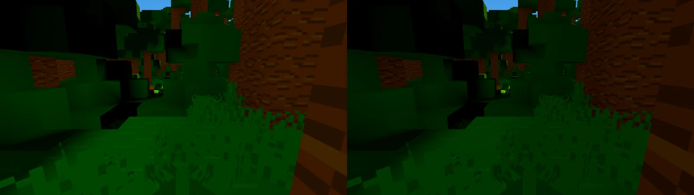
Seed 1's rain forest floor at -640, 55, 638 at noon at sky level 13, seen along it from its grass,
under the whole floor of the sky's light on the left and on the right under the engine's light
through the leaves with 0.65 of that floor, a little darker and closer to the source's level 13.

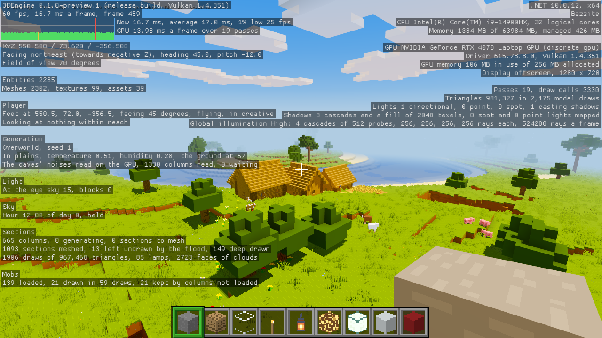
The engine's debug overlay F3 shows over seed 1's plains village at noon, the engine's lines of the
system, the camera, the frame, the memory and the GPU, and under them on the left the game's
sections of the player, the world's generation, the light, the sky, the sections and the mobs.

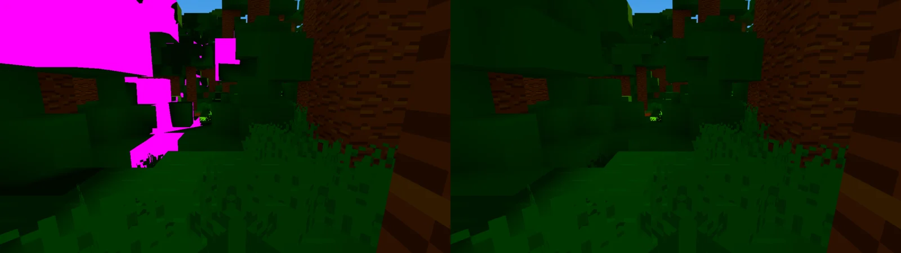
Seed 1's rain forest at -640, 55, 638 at noon seen east along its floor, the leaves' sides in the
canopy's pockets near black on the left, marked in magenta, 13 percent of the view, and on the right
lit by the floor of the sky's light, the leaves carrying a sky level of 14 at most.

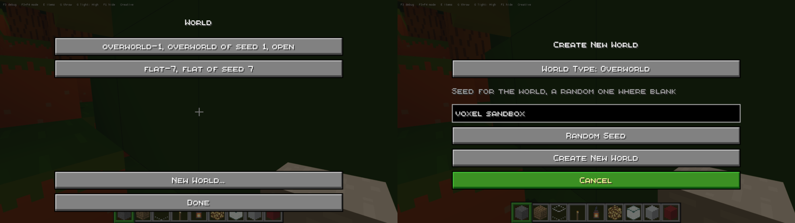
The pause menu's World screen on the left, two worlds saved, overworld-1 open and flat-7 beside it,
and on the right its New World screen with the overworld chosen and the seed voxel sandbox typed
into its field.

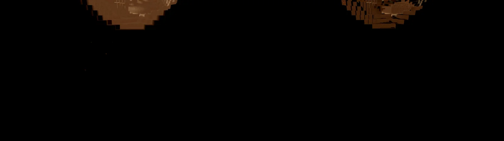
Seed 1's deep cave at -59.5, -4, -91.5 at noon at Low, brightened four times to show it, its far
walls lit by the sky's light its rays reach past the four cascades on the left and darker with the
far cascade on the right, where those rays meet the rock.

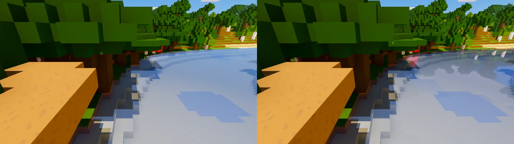
Seed 1's nearest river at 104, 46, -72 at noon from over its bank, the water showing the sky's light
alone on the left and on the right mirroring the far bank's trees and a pig through the engine's
planar reflection, its plane at the water's top at 48.875.

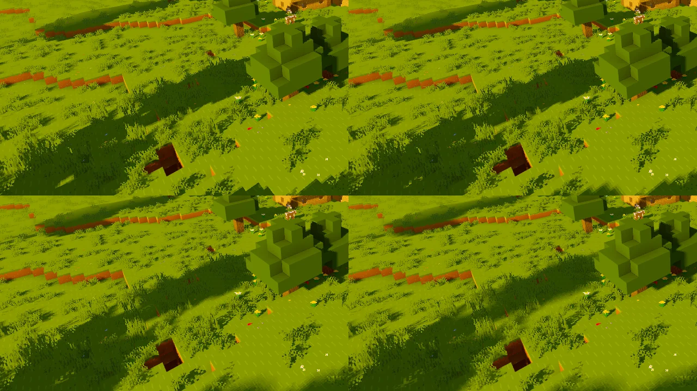
Seed 1's plains village at hour 16 from 550.5, 72, -356.5, the oaks' long shadows on the grass with
the sun 0 degrees across at the top left, 0.53 at the top right, 1.5, the default, at the bottom
left and 3 at the bottom right, the edges stepping along the blocks' pixels at 0 and softening
toward each shadow's far end as the sun widens.

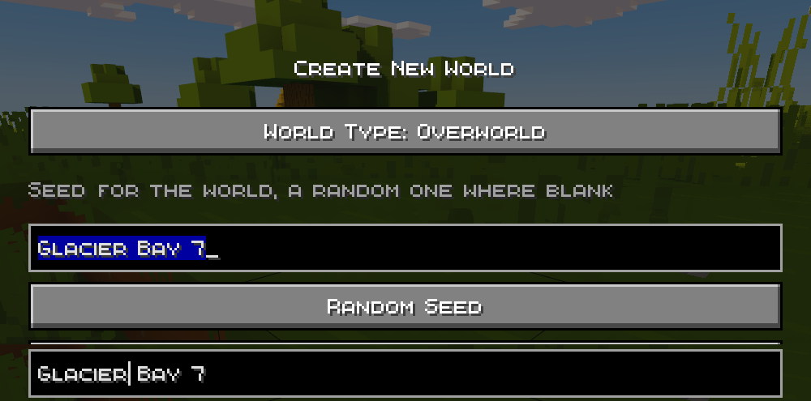
The New World screen at 1280 by 720 in the default packs' font, the seed Glacier Bay 7 typed into
its field and selected whole with Control and A above, and below it the caret a click placed between
Glacier and the space after it, the engine's text edit measuring in a font built from the pack's
sheet.

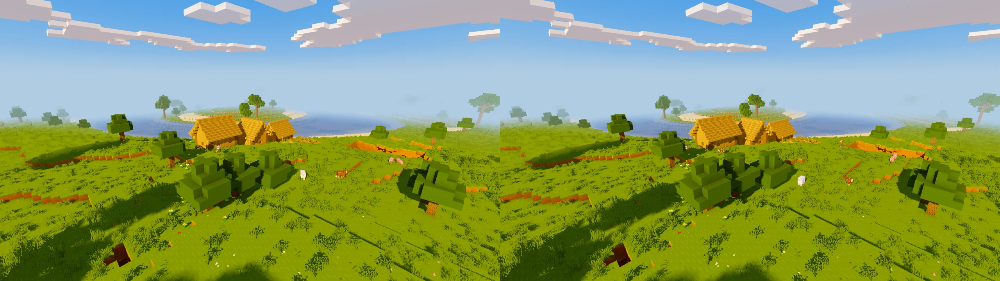
Seed 1's plains village at hour 16 from 550.5, 72, -356.5 at 12 columns, the engine's shadow fill of
the land past the shadow map on at the left and off at the right, the land's shadows alike in both,
the contact shadows shading the far land, where the fill drew 2,085 sections a frame.

# Item 133, the canopy's floor on 3DEngine 5.2.319

On 5.2.319 the merge of the cascades sees past the leaves and a ray's reach stops where it does, so
the engine's light through a canopy reaches its floor. Read with the three default packs at noon, in
Release, on tuned's power-saving profile with the processor's energy preference at power, no other
program on the GPU but where said.

The grass on the flat world under jungle leaves two deep and under oak leaves two deep, against the
grass in a wall's shade on open ground, a pixel's luminance each, with the leaves passing half of
global illumination's light a block or none, and with item 117's floor of the sky's light at a share
of its strength.

| Floor's strength | Jungle, leaves pass half | Oak, leaves pass half | Jungle, leaves pass none | Oak, leaves pass none | Open shade |
|---|---|---|---|---|---|
| 1 | 46.4 | 46.4 | 46.4 | 46.4 | 44.4 |
| 0.75 | 38.6 | 38.6 | | | 44.4 |
| 0.6 | 34.1 | 33.9 | | | 44.4 |
| 0.5 | 32.9 | 32.7 | | | 44.4 |
| 0 | 32.9 | 32.7 | 24.5 | 26.1 | 44.4 |

The engine alone lights the canopy's floor to 0.74 of the open shade, the whole floor lifted it to
1.05, past the open ground's own, and the floor at 0.65, the game's from this item, lifts it to 35.4
and 35.1, 0.80 of the open shade, as the source lights level 13 against 15. Seed 1's jungle at -624,
53, 616 reads a capture's mean of 141.3 where the whole floor read 143.7, its forest at 0, 75, 0
147.0 where it read 151.8, and the rain forest's floor at -640, 55, 638 138.2 where it read 141.6.

The cost at seed 1's cherry grove at 1920 by 1080 at High, a profile over 300 frames, read in turns
with the leaves and the plants passing their shares and passing none.

| | Frame | Global illumination | Scene pass | Shadows |
|---|---|---|---|---|
| Passing their shares | 19.58, 19.51 ms | 6.14, 6.09 ms | 7.13, 7.18 ms | 4.55, 4.49 ms |
| Passing none | 16.70, 16.64 ms | 3.44, 3.42 ms | 7.06, 7.05 ms | 4.46, 4.44 ms |

Two more readings of each ran while another program held 56 to 77 percent of the GPU and are left
out. The rays crossing the grove's leaves cost global illumination about 2.7 ms at 1080p, which goes
to the engine.

# Item 133, the leaves let the light through on 3DEngine 5.2.316

The leaf blocks' faces are a part of their own whose material lets 0.5 of global illumination's light
through a unit of depth, the three default packs' leaves being whole, and the plants' material lets
through 0.71, the share of their tiles left clear. Read with the three default packs at noon, in
Release, on tuned's power-saving profile with the processor's energy preference at power.

| | Before | After |
|---|---|---|
| Flat world, grass under jungle leaves two deep | 46.4 | 46.4 |
| Flat world, grass under oak leaves two deep | 46.4 | 46.4 |
| Flat world, grass in a wall's shade on open ground | 43.5 | 43.7 |
| Seed 1's jungle at -624, 53, 616, sky level 13, the capture's mean | 143.6 | 143.7 |
| Seed 1's forest at 0, 75, 0, sky level 15, the capture's mean | 151.7 | 151.8 |
| Entities drawn at the cherry grove | 1,690 | 2,271 |
| Entities drawn at the plains village | 1,569 | 1,925 |

The floors under the leaves read the same, each a pixel's luminance or a capture's mean, since on
this package a ray crosses the leaves and the merge of the cascades does not yet see past them, and
item 117's floor of the sky's light holds the floor where it stood.

The frame at the grove at 1920 by 1080 at High could not be read cleanly. Another program held up to
81 percent of the GPU by turns while the GPU's clock stood at 2,490 MHz, and the same build read 20.8,
31.7 and 42.3 ms. The two readings with no other program on the GPU gave the frame 20.8 ms before and
22.7 after and global illumination 3.6 ms and 7.0, the rays crossing leaves where they stopped.

# Item 136, soft shadows

The sun's width through the engine's `SetShadowSoftness` on 3DEngine 5.2.322, read in one session in
Release with the three default packs on tuned's power-saving profile with the processor's energy
preference at power.

Seed 1's plains village from 550.5, 72, -356.5, looking at 45 degrees and 17 down, at noon and at
hour 16, the sun 0, 0.53, 1.5 and 3 degrees across, a capture of each at 1280 by 720. At noon the
oaks' shadows lie under them, short, and the four widths differ little. At hour 16 the shadows run
long, and at 0 their edges step along the pixels of the blocks they cross the whole way. At 0.53 the
far ends soften a little and the steps show along most of each edge. At 1.5 each shadow is sharp at
the trunk and soft toward its far end, the steps gone there, the crown's shape still read in it. At 3
the far half of each crown's shadow is a smear, as a cloud's shadow is.

Seed 1's cherry grove at 1920 by 1080 at hour 16, a profile over 300 frames for each width, in two
rounds. Where another program used the GPU during a reading, it is named.

| | Frame | Scene pass | Shadow maps |
|---|---|---|---|
| Low, 0 | 16.46 and 17.25 ms, the second with a test run at 14% | 6.73 and 7.28 ms | 4.69 and 4.95 ms |
| Low, 0.53 | 16.94 and 17.39 ms | 7.50 and 7.75 ms | 4.75 and 4.75 ms |
| Low, 1.5 | 16.87 and 16.80 ms | 7.51 and 7.41 ms | 4.62 and 4.68 ms |
| Low, 3 | 17.00 and 16.77 ms, the first with a test run at 12% | 7.54 and 7.47 ms | 4.68 and 4.59 ms |
| High, 0 | 19.69 and 19.81 ms | 7.27 and 7.29 ms | 4.65 and 4.69 ms |
| High, 0.53 | 20.78 and 20.14 ms | 7.94 and 7.85 ms | 4.85 and 4.61 ms |
| High, 1.5 | 20.40 and 20.38 ms | 7.91 and 7.90 ms | 4.69 and 4.63 ms |
| High, 3 | 21.30 and 20.66 ms, both with a test run at 12% | 8.29 and 7.94 ms | 4.91 and 4.72 ms |

Any width costs the scene pass, where each point looks over the shadow map for what shades it, about
0.6 ms at High against 0, and 3 up to 1 ms. The shadow maps cost the same at every width. The frame
at High grows by about 0.6 ms at 1.5, and at Low it moves less than the rounds differ.

1.5 is the default, the width nearest a warm low sun's long soft shadows at under a millisecond of
the frame, where 0.53 keeps most of the steps and 3 loses the crowns' shapes. Render Settings sets it
from 0 to 5 degrees, and the options file keeps it.

# Item 138, the README's costs read again

The README's table of the frame by render distance, read on `b25e668` with 3DEngine 5.2.326 and
every setting at its default (the sun 1.5 degrees across, the water's mirror on), in a Debug build
with the three default packs, offscreen at 1280 by 720, on tuned's power-saving profile with the
processor's energy preference at power. One session read 8, 12 and 16 columns in four passes, up,
down, up and down, each reading waiting for a GPU no other program used, a profile over ten seconds,
marked quiet where no other program used the GPU at its end either.

## The view

The table's view is seed 1's spawn at noon looking east over the forest to the sea. The script the
table was read with before, at `cc49c81`, teleported to 0.5, 79, 0.5 without flying, so the player
stood in the spawn oak's crown with a leaf block a block and a half ahead, which a capture showed
filling much of the frame. These readings fly at a height of 90 at the same place, the view a
capture shows open over the forest to the shore and the sea.

## Readings

Frame, the GPU's passes and the CPU's passes in milliseconds, the sea's mirror of the CPU and the
GPU, with the other programs on the GPU at a reading's end where any were.

| Columns | Frame | GPU | CPU's passes | Mirror, CPU and GPU | Others |
|---|---|---|---|---|---|
| 8 | 16.74 | 10.77 | 7.66 | 0.76 and 0.55 | a test run at 9% |
| 8 | 16.69 | 11.11 | 8.07 | 0.78 and 0.52 | a test run at 23% |
| 8 | 16.69 | 11.43 | 9.11 | 0.88 and 0.51 | none |
| 8 | 16.67 | 10.92 | 10.34 | 0.97 and 0.52 | none |
| 12 | 20.44 | 16.08 | 16.65 | 1.96 and 1.34 | none |
| 12 | 18.61 | 16.91 | 15.19 | 1.86 and 1.41 | a test run at 12% |
| 12 | 17.50 | 16.55 | 14.47 | 1.80 and 1.43 | none |
| 12 | 21.49 | 16.58 | 17.39 | 2.10 and 1.38 | none |
| 16 | 30.31 | 24.70 | 25.11 | 3.51 and 2.89 | a test run at 33% |
| 16 | 29.24 | 24.34 | 24.80 | 3.54 and 2.88 | none |
| 16 | 30.16 | 24.58 | 25.59 | 3.62 and 2.97 | none |
| 16 | 34.56 | 24.62 | 29.10 | 4.07 and 2.93 | none |

The README takes the middle of the quiet readings, at 8 columns the mean of two, which gives 16.7,
11.2 and 9.7 ms at 8, 20.4, 16.6 and 16.7 ms at 12, and 30.2, 24.6 and 25.6 ms at 16. The game held
1,083, 1,477 and 2,255 MB as each distance was first reached, and the frame made 1,097 draws of 0.63
million triangles at 8, 2,252 of 1.24 million at 12 and 3,742 of 2.02 million at 16. The sun's
shadows took 2.5, 4.7 and 7.4 ms of the GPU and global illumination 3.7 to 4.2 at every distance.

At 8 columns the frame keeps 60 a second, held there by the frame's pacing. At 12 the GPU's work and
the CPU's passes each take about 16 ms, and the frame 17.5 to 21.5 ms. Readings on the same build an
hour before, from the oak's crown, gave 16.7 to 17.0 ms at 12 with nothing on the GPU, so the open
view costs the frame about 3 ms there. The flights over unloaded land and lavapipe's line stand as
read at `bb0b9bb`.

# Item 139, the frame at 12 columns

Where the frame's time went since item 90, read in Debug builds with the three default packs,
offscreen at 1280 by 720, flying at a height of 90 over seed 1's spawn at noon looking east over the
forest to the sea, on tuned's power-saving profile with the processor's energy preference at power.
Each reading waited for a GPU no other program used and took a profile over ten seconds. Item 90's
build is `ba60ae4` on 3DEngine 5.2.215, the defaults' build `b25e668` on 5.2.326, and the mended
build the same with the engine's shadow fill left off.

A first round of these readings ran with a session of the game left open beside them, drawing at
69 percent of the GPU, and doubled every pass. It is left out, and the readings below are those
taken with it stopped.

## At 12 columns

Milliseconds a frame, the CPU's recording of each pass and the GPU's work in it, two or three
readings each.

| | Item 90 | Defaults, the fill on | Mended, the fill off |
|---|---|---|---|
| Frame | 16.84 to 16.99 | 17.05 to 22.77 | 16.71 to 17.08 |
| CPU, the depth pass | 2.07 to 2.18 | 2.22 to 2.75 | 2.31 to 2.40 |
| CPU, the shadows | 1.98 to 2.06 | 3.95 to 5.04 | 2.06 to 2.12 |
| CPU, the mirror | none | 1.74 to 2.11 | 1.81 to 1.87 |
| CPU, the scene pass | 3.11 to 3.36 | 3.05 to 3.50 | 3.08 to 3.28 |
| CPU, global illumination | 1.18 to 1.46 | 1.69 to 2.42 | 1.69 to 1.78 |
| CPU, the model batches | 0.77 to 0.79 | 0.84 to 1.30 | 0.90 to 0.96 |
| The main thread's Last stage, the render graph's | 10.20 to 10.44 | 14.60 to 18.67 | 12.92 to 13.23 |
| GPU, the depth pass | 1.93 to 2.02 | 1.51 to 1.90 | 1.57 to 1.74 |
| GPU, the shadows | 1.53 to 1.57 | 4.50 to 5.81 | 0.79 to 0.90 |
| GPU, the mirror | none | 1.27 to 1.90 | 1.51 to 1.80 |
| GPU, the scene pass | 7.22 to 7.63 | 4.30 to 6.17 | 4.16 to 5.43 |
| GPU, global illumination | 2.38 to 2.49 | 3.71 to 4.66 | 3.71 to 4.01 |
| Draws, all passes | 1,891 to 1,943 | 4,331 to 4,380 | 2,226 to 2,322 |

At 12 columns item 90's passes drew 713 to 761 sections in the camera's, 600 to 648 in the depth's
and 572 to 578 in the cascades'. The defaults' drew 1,180 to 1,204, 653 to 675 and 389 to 413, and
the fill 2,085 to 2,112. The mended drew 1,185 to 1,228, 658 to 699 and 383 to 407. The camera's
count holds the mirror's draws, 1,185 with the mirror and 762 with it off, so the mirror draws about
420 sections.

Since item 90 the engine's shadow fill drew the land past the shadow map, 2,085 more draws for 2 to
3 ms of the CPU and 3.5 to 5 more of the GPU, the mirror took 1.8 ms of the CPU and 1.5 of the GPU,
and global illumination 0.3 to 0.5 ms more of the CPU and 1.3 to 1.5 more of the GPU, which these
readings do not divide further, where the scene pass took 2 to 3 ms less of the GPU.

## The fill

The fill on and off at seed 1's spawn, the plains village and from 120 over the spawn looking
southwest at the hills, at hour 16 and at noon, at 12 columns. Of 921,600 pixels, 50 to 1,393
differed by more than 4 percent, the clouds' edges and the mobs as they moved, and no shadow. The
contact shadows past the shadow map shade the far land with the fill off. It is left off.

## The mended frame by distance

Twelve readings in one session, 8, 12 and 16 columns up, down, up and down, the quiet ones.

| Columns | Frame | GPU | CPU's passes | Last stage | Draws | Memory as first reached |
|---|---|---|---|---|---|---|
| 8 | 16.67 and 16.78 | 8.71 and 9.58 | 8.07 and 8.48 | 8.38 and 8.79 | 1,173 to 1,215 | 1,100 MB |
| 12 | 16.71, 16.94 and 17.08 | 12.29 to 13.34 | 12.60 to 12.91 | 12.92 to 13.23 | 2,226 to 2,322 | 1,476 MB |
| 16 | 25.33, 25.48 and 25.99 | 16.40 to 18.10 | 20.54 to 21.51 | 20.92 to 21.92 | 3,837 to 3,901 | 2,206 MB |

The passes' recording at 12 columns, the depth's 2.3 ms for 670 draws, the camera's 3.1 for about
780, the mirror's 1.85 for about 420 and the cascades' 2.1 for about 400, are 3 to 5 µs a draw, 9.4
ms of the main thread's 13. At 16 the CPU's passes bound the frame at 21 ms against the GPU's 16.5.
The recording a draw costs is the engine's, an entry in its ASKS.md, and the frame at 12 stands at
the edge of 16.7 ms until it falls.

## The mirror and the plains

The mirror's plane is set at none of seed 1's cherry grove, plains village, jungle and the plains
view at -288, 64, where no ray of the fifteen meets water, and at the spawn the sea fills the view's
right. The plains view, 20 blocks over the ground at -288, 64 looking east and 15 down, savanna
hills by the generator's climate, takes the frame 16.71, 16.88 and 17.03 ms on the mended build,
the GPU's passes 10.15 to 10.85 and the CPU's 10.75 to 11.10, with 1,983 draws of 0.92 million
triangles.

# Item 27, the far cascade

The engine's far cascade on 3DEngine 5.2.319, set through `SetSceneField` past the four counted
cascades to reach the render distance, 192 blocks at 12 columns, read in one session in Release with
the three default packs on tuned's power-saving profile with the processor's energy preference at
power.

Seed 1's deep cave at -59.5, -4, -91.5 at noon, the tops of the blocks 45 and 90 blocks ahead, each
a pixel's red, green and blue.

| Quality | Far cascade off | Far cascade on |
|---|---|---|
| Low | 22, 13, 7 and 22, 13, 7 | 17, 9, 3 and 18, 10, 4 |
| Medium | 0, 0, 0 and 22, 13, 7 | 0, 0, 0 and 22, 13, 6 |
| High | 0, 0, 0 and 0, 0, 0 | 0, 0, 0 and 0, 0, 0 |

Seed 1's cherry grove at 1920 by 1080 at hour 16, a profile over 300 frames, the readings with no
other program on the GPU.

| | Frame | Global illumination | Scene pass |
|---|---|---|---|
| Low, off | 17.2 ms | 3.06 ms | 6.92 ms |
| Low, on | 19.4 and 19.1 ms | 4.16 and 4.11 ms | 8.03 and 7.94 ms |
| High, off | 21.6 ms | 6.35 ms | 7.80 ms |
| High, on | 23.2 and 24.6 ms | 7.50 and 7.30 ms | 8.35 and 8.28 ms |

The far cascade darkens the cave's far walls at Low by about a quarter, its rays meeting the rock
where they met the sky, changes nothing seen at Medium and High, and costs 1.6 to 2 ms of the frame
at both, so it is off by default and Render Settings turns it on.

# Item 95, every part of a section an entity

The frame at item 93's views, seed 1's cherry grove and plains village at hour 16, the three default
packs, render distance 12, High with the screen's probes, unlimited frames, offscreen on the RTX 4070
Laptop GPU, each a profile over 300 frames in a Release build, read in the order before, after,
after, before. The machine ran tuned's power-saving profile with the processor's energy preference
at power, no other program used the GPU, and the processor's load from other programs ran from 7 to
22. Before is `cc49c81` on 3DEngine 5.2.313 with the plants, the glass, the ice, the water and the
glass a pack cuts out drawn through `DrawMesh`, after is the same on 5.2.316 with them as entities.
Times are in milliseconds.

| View | Frame before | Frame after | Scene pass before | Scene pass after | Global illumination before | Global illumination after |
|---|---|---|---|---|---|---|
| grove at 1920 by 1080 | 19.9, 20.1 | 19.1, 18.8 | 9.3, 9.4 | 9.4, 9.1 | 4.2, 4.3 | 3.4, 3.4 |
| grove at 1280 by 720 | 15.8, 16.2 | 16.1, 16.3 | 6.0, 6.3 | 7.0, 7.0 | 3.6, 3.7 | 3.0, 3.2 |
| village at 1920 by 1080 | 19.4, 33.7 | 19.4, 19.4 | 10.6, 15.5 | 10.9, 11.0 | 3.0, 5.7 | 2.9, 2.6 |
| village at 1280 by 720 | 15.1, 30.7 | 15.5, 15.6 | 6.7, 11.6 | 7.6, 7.7 | 2.7, 5.9 | 2.6, 2.4 |

The second reading of the village before ran while the load rose, every pass at once. The engine
draws 1,690 entities at the grove and 1,569 at the village where it drew 1,059 and 976, the game's
draws and triangles the same. The captures at the grove, the village and the ravine match the
builds' within an RMSE of 0.0016, the lava lake's with its animation held at one tick within 0.0015,
and a glass pane two blocks over a pool of water matches to the pixel seen from above and from under
the water.

Done that day

- Item 27 at `f1aa450`. Caves as the source's newer ones, cheese, spaghetti and noodle, with
  aquifers.
- Item 42 at `7c36ec8`. Water that mirrors the sky and the shore, with the bed seen through it
  (Decision 21).
- Item 54 at `7f59530`. The game takes the engine's F1 and F3, its HUD in the hidden scope and its
  developer's parts as overlay sections (Decision 26).
- Item 95 at `a4d383c`. The world's sections become mesh entities the engine draws (Decision 43).
- Item 133 at `1944378`. The leaves let the engine's light through, and item 117's floor is read
  again beside it.
- Item 134 at `5145d2f`. A world screen in the pause menu, the saves listed to open and a new world
  begun.
- Item 135 at `0ba4cb4`. A leaf block's faces take the sky floor at level 15 as at 14.
- Item 136 at `6001eed`. The sun's shadows soften with the distance from their caster.
- Item 137 at `b25e668`. The seed field edits through the engine's EditText.
- Item 138 at `9c07673`. The README's costs table is read again at the defaults on 5.2.326.
- Item 139 at `fc0937a`. The frame at 12 columns comes back under 16.7 ms at the defaults.

## 2026-10-25

Seed 6's snowy village before and after three minutes of snow, the spruces' and the bushes' tops and
the ground laid with a layer an eighth deep, the stairs of the roofs taking none.

A dark room of stone laid under seed 1's forest round a pool of lava, embers rising from it as they
cool, with the cave's dust lit only where the lava's light reaches.

Leaves falling and turning under a canopy of oak leaves laid over seed 1's forest, with Falling
Leaves at 200%.

A river of seed 1 from over its bank under the rain, before on the left and after on the right,
rings spreading on the water and drops leaping from the bank where the rain meets them.

Seed 1's cherry grove at 1920 by 1080 at High on the 3DEngine 5.2.283 package and on 5.2.291, alike
to the pixel but for 129 of them, the frame 19 to 21 ms on the first and 18 to 21 ms on the second.

The top 200 rows of seed 1's deep cave at -59.5, -4, -91.5 looking 0 -30 at noon with the shadows
reaching 96 blocks, brightened two and a half times, before above with the sun lighting the tops and
their edges through 70 blocks of rock left undrawn, and after below with that rock drawn into the
shadow maps alone and the tops dark.

Seed 1's cherry grove at 1920 by 1080 at High with the sun's stepped shadow read three times a pixel
on the left and once on the right, alike to the pixel but for 96 of them.

Seed 1's plains at nine in the morning seen from behind the player as it walks, on the left, and
from in front of it looking back, on the right, the camera four blocks from the eye and the player
in the game's own colors.

The player's poses on seed 1, mid-stride from behind as it walks sideways on a floor of stone in the
sky and mid-swim from behind in a pool, above, and from in front holding a block on the plains and
the empty right hand from the eye, below.

The lantern and the soul lantern of that room with no bloom on the left and a bloom of 0.6 on the
right, a halo about each flame's glass.

A room of stone in the sky over seed 1 at midnight, a lantern and a soul lantern on its white floor
and glowstone in its ceiling, each block's light its own color on the left and white as bright on
the right.

The oaks of seed 1's coast at noon without a rim on the left and with a rim of 100% on the right, a
lit line along each block's edges.

The same coast as the game shades it on the left and unshaded on the right, every open face taking
the sun's light as one facing it does.

Seed 1's nearest mineshaft under the forest, a corridor with its rails, its posts of oak under beams
of planks and a lantern hanging from one, on the left, and a chest in a niche of another, lit by the
torch held and one set on its floor, on the right.

Seed 1's nearest of the new kinds at noon, a mossy temple in the jungle, a witch's hut on posts in
the swamp and a pillagers' tower on open land above, and under the sea a ruin of broken walls and a
wrecked ship with its mast below.

Seed 1's nearest village of each kind at ten in the morning, the desert's of sandstone with corners
of yellow terracotta and the savanna's of acacia on floors of orange terracotta above, the taiga's
of spruce and the snowy plains' under roofs of snow below.

Rain over seed 1's plains village at noon seen against the sky through its nearest columns, twice as
large, its streaks standing upside down with their faint ends below on the left and the right way up
on the right, faint at their tops and brighter at their feet.

A villager, a chicken, a sheep, a pig and a cow at noon with a zombie, a skeleton, a creeper and a
spider under a roof behind them, in the game's own models above and in Fresh Animations' models
under Bare Bones' pictures below, walked by the game's own gait.

Seed 1's lava lake at noon seen from in its cave, the far wall at the top left in the sky's haze on
the left and black on the right, where the haze follows the sky's light that reaches the wall or the
eye.

Seed 1's plains village at noon with the screen's probes off on the left and on, as the game starts,
on the right, the light much the same in the open at noon.

# Item 29, the sections meshed on the workers

The main thread's meshing (`update.mesh`, eased over about a second) and the frame, before with every
section meshed on the main thread within a budget of 4 ms a frame and after with the sections meshed
on worker threads, half the processor's cores to 16 at once and 64 copied at most, the main thread
copying each section's blocks and taking its faces in. Other programs held the machine's load at 6
to 12 through the readings, so the ranges are wide.

Three ten-second flights east at sprint from 0, 4,000 and -4,000 on seed 1 at render distance 12,
Release, offscreen at 1280 by 720 on the RTX 4070 Laptop GPU, one after the other.

| | `update.mesh` | Frame |
|---|---|---|
| Before | 0.26, 3.28, 3.71 ms | 25.4, 37.7, 45.1 ms |
| After | 0.32, 0.23, 0.46 ms | 25.9, 31.5, 30.0 ms |

New land settling after a teleport to 4,000, -4,000 and 8,000, read every 10 frames until nothing is
left to generate or mesh, the means over those readings.

| | Settled in | `update.mesh` | Frame |
|---|---|---|---|
| Release, before | 6, 5, 5 s | 6, 4, 4 ms | 62, 30, 32 ms |
| Release, after | 5, 3, 3 s | 3, 3, 2 ms | 71, 35, 36 ms |
| Debug on lavapipe on four cores at 4 columns, before | 59, 74 s | 12, 10 ms | 243, 248 ms |
| Debug on lavapipe on four cores at 4 columns, after | 64, 73 s | 4, 4 ms | 246, 249 ms |

A first version lent a mesher to each section and took one round a frame, eight at once, and
settled in 9 to 13 seconds where the main thread settled in 2 to 3, since each section of air above
the land waited a frame for a worker. Air is let go at once, and the workers build what is copied
as fast as they can, so the land settles as fast as before.

# Item 95, the README's costs read again

The README's table of the frame by render distance and its line of lavapipe's frame, read again on
`bb0b9bb` with the sections drawn as entities, meshed on the workers and the screen's probes on, in
a Debug build with the three default packs, offscreen at 1280 by 720, seed 1's spawn at noon looking
east. Other programs held 5 to 22 percent of the GPU before each part and the machine's load was 5
to 7, so the GPU's sums may read a little high.

| Columns | Frame | GPU | CPU's passes | Resident | Draws | Triangles |
|---|---|---|---|---|---|---|
| 8 | 16.7 ms | 12.1 ms | 6.5 ms | 1,029 MB | 865 | 0.63 million |
| 12 | 16.7 ms | 16.6 ms | 11.0 ms | 1,308 MB | 1,739 | 1.20 million |
| 16 | 23.8 ms | 23.8 ms | 17.7 ms | 1,942 MB | 2,870 | 1.94 million |

Read again an hour later on the power-saving profile the machine usually runs on, another program
holding 20 to 27 percent of the GPU, the frame took 16.7, 17.6 and 21.1 ms, the GPU 12.4, 17.7 and
19.4, the CPU's passes 5.7, 10.4 and 16.0, and the game held 1,016, 1,393 and 1,960 MB. The first
reading's power profile is not known, since it was switched to performance for a time that day, and
the two lie within the other programs' noise of each other, so 12 columns stands at the edge of 60
frames a second with the GPU bounding it.

The table read before, with the probes off and every section a `DrawMesh`, gave the frame 16.8,
17.5 and 40.3 ms, the GPU 10.8, 14.3 and 18.4 ms and the CPU's passes 7.4, 10.1 and 22.6 ms.

On lavapipe the GPU's passes sum to 0.85, 1.13, 1.60 and 2.18 s a frame at 4, 8, 12 and 14 columns,
where they read 0.49, 0.82, 1.20 and 1.42 with the probes off. Global illumination reads 0.25 to
0.27 s of each and the scene pass 0.40 to 1.52, by lavapipe's timestamps.

The flights over unloaded land, Debug, three of ten seconds at each distance, read the frame 10.0 to
22.1 ms at 8 columns, 16.6 to 26.8 at 10, 21.6 to 32.5 at 12 and 38.6 to 41.2 at 14, with the main
thread's meshing 0.15 to 1.86 ms. The README keeps its flights read with the probes off until a
quiet GPU reads them again, since the load and the probes cannot be told apart in these.

# Item 95, the sections as entities

The frame at item 93's views, seed 1's cherry grove and plains village at hour 16, the three default
packs, render distance 12, High with the screen's probes, unlimited frames, offscreen on the RTX 4070
Laptop GPU, each a profile over 300 frames in a Release build, read twice for each build in the order
5.2.291, 5.2.313, entities, entities, 5.2.313, 5.2.291. Another program held 10 to 50 percent of the
GPU through the runs, so the ranges are wide and the frames longer than a quiet GPU's.

The builds are the game on 5.2.291 drawing every section through `DrawMesh`, the game on 5.2.313
drawing the same way, and the game on 5.2.313 with each section's solid faces, its faces a pack cuts
out that cast a whole shadow and its lava as entities. `draw.sections` is the game's main thread
drawing the sections each frame. Times are in milliseconds.

| Build | View | Frame | Scene pass | Shadows | Global illumination | `draw.sections` |
|---|---|---|---|---|---|---|
| 5.2.291 | grove at 1920 by 1080 | 41.5 to 46.6 | 19.8 to 23.6 | 5.8 to 8.9 | 4.5 to 6.4 | 1.81 to 5.96 |
| 5.2.291 | grove at 1280 by 720 | 29.7 to 31.0 | 14.4 to 15.7 | 7.3 to 7.7 | 4.3 to 5.0 | 1.59 to 1.85 |
| 5.2.291 | village at 1920 by 1080 | 33.5 to 34.8 | 19.8 to 19.9 | 6.9 to 7.1 | 4.1 to 4.4 | 1.48 to 1.68 |
| 5.2.291 | village at 1280 by 720 | 27.5 to 29.5 | 14.7 to 15.2 | 7.1 to 7.2 | 3.8 to 4.5 | 1.27 to 1.59 |
| 5.2.313 | grove at 1920 by 1080 | 35.1 to 45.7 | 19.8 to 21.2 | 6.2 to 6.4 | 4.5 to 4.8 | 3.64 to 5.66 |
| 5.2.313 | grove at 1280 by 720 | 29.1 to 32.8 | 13.0 to 14.1 | 5.2 to 6.3 | 3.6 to 4.5 | 1.45 to 3.46 |
| 5.2.313 | village at 1920 by 1080 | 27.9 to 33.4 | 17.3 to 19.4 | 4.7 to 7.2 | 3.2 to 4.4 | 1.42 to 1.50 |
| 5.2.313 | village at 1280 by 720 | 20.3 to 29.2 | 11.5 to 13.0 | 4.7 to 6.5 | 2.7 to 3.9 | 1.22 to 3.43 |
| Entities | grove at 1920 by 1080 | 23.2 to 24.0 | 9.8 to 10.3 | 5.5 to 5.6 | 4.7 to 4.8 | 0.68 to 1.50 |
| Entities | grove at 1280 by 720 | 19.6 to 20.0 | 6.5 to 6.6 | 5.2 to 5.7 | 3.9 to 4.0 | 0.78 to 0.93 |
| Entities | village at 1920 by 1080 | 23.5 to 27.1 | 11.6 to 12.0 | 5.0 to 5.8 | 3.6 to 3.9 | 0.65 to 1.77 |
| Entities | village at 1280 by 720 | 19.2 to 20.0 | 7.1 to 7.5 | 4.8 to 5.5 | 3.1 to 3.6 | 0.71 to 1.54 |

The entities draw the same frame. At the grove, the village, the lava lake and the ravine the
sections, draws and triangles `voxel.state` counts are the same in both 5.2.313 builds, 1,673 draws
of 1.15 million triangles at the grove, and the captures differ by an RMSE of 0.0002 to 0.0011 with
at most five pixels more than 3 percent apart. The engine draws 1,059 entities at the grove and 976
at the village, and its `MeshEntityDraws` takes 0.25 to 0.33 ms a frame. With them the scene pass
takes about half its time on the GPU and the passes' recording on the CPU less than half, the
shadows' 4.5 to 6.1 ms against 8.6 to 11.9 at the grove. 5.2.313 alone takes 1 to 2 ms off the
shadows and up to 1.5 ms off global illumination against 5.2.291 within the noise of the load.

Done that day

- Item 28 at `79ad110`. The looks Shine shows, done as the game's own, bloom on emissive blocks,
  colored light from emissive blocks, a rim around blocks, and an unshaded look.
- Item 30 at `87d089e`. Entity models, textures and animations read from the player's packs in
  OptiFine's form, the game's own the fallback (Decision 13).
- Item 31 at `057011a`. Structures as the source's, more kinds and the modpack's taste (Decision
  15).
- Item 32 at `7443bdc`. Weather and the ambient particles, rain and snow by biome, falling leaves,
  cave dust and wakes (Decision 15).
- Item 33 at `e433e5c`. Ambient sound, footsteps by the block and the sound's occlusion and reverb
  by the room (Decision 15).
- Item 34 at `85c3ff6`. Connected textures from the packs' properties (Decision 15).
- Item 35 at `ce693af`. A zoom key (Decision 15).
- Item 36 at `6a56e0f`. The player seen in third person, with their own animations (Decision 15).
- Item 94 at `3275e76`. The things that move become entities with behaviors (Decision 43).
- Item 105 at `fb04f6b`. The stepped sun's shadow is read once a pixel through the engine's hook.
- Item 123 at `c7c1b41`. The sections the flood culls still cast the sun's shadow.
- Item 128 at `6a7e5b1`. The entities' tests step the real game through the engine's headless app,
  the twins gone.
- Item 129 at `bbe814c`. The rain's particle texture is drawn upside down.
- Item 130 at `0babebb`. The fog does not light a dark cave's far walls.
- Item 131 at `f97a4c9`. The screen probes are on, with no setting for a player.
- Item 132 at `1767348`. The tree's documents and comments keep N 4.7 and STYLE.md.

## 2026-10-24

Breaking stone in survival, Bare Bones' destroy stage on the left and the game's own cracks with no
pack on the right, with the bits cut from the stone's side.

The plains village under the modpack's own tonemap curve at three saturations, beside today's
Reinhard look and the modpack.

The hand in view under Bare Bones, holding stone, holding a stick a pixel deep, and the empty arm
wearing Steve's sleeve.

A fire lighting a closed stone room at night, its flames the source's models over the pack's
animated fire.

The fires a TNT's blast leaves in its crater.

A dragged stack over the inventory, its shares lit on the slots it passes (item 67).

An oak before and after felling, its logs taken and a log landed (item 69).

Fire spreading over planks by the source's odds, from the first flame to the burn-out (item 72).

The hand in view in four states, with stone, with a stick, empty and with the HUD hidden (item 75).

The creeper's swell and flash before it goes off, and its blast's cloud (item 73).

TNT from its placing to its crater, the fuse, the flash, the swell and the blast (item 73).

The world views retaken at a field of view of 40, the village views moved (item 46).

The world views at a field of view of 70, before the retake (item 46).

Trees before and after the caves and ravines carve ahead of them, the coast by seed 1's first ravine
in the middle row where leaf clusters floated before, and the ravine's magma under the canopy below
(item 99).

A fire under a resource pack at night, read while a carried texture's place came to be kept half a
texel inside its tile, so a fire's walls draw no line along their tops.

A jungle's floor under its canopy before and after the sky's light lost a level on the way in and
one past the first layer, and with no scene field.

The clouds before and after they reached twice the render distance, a change taken back, since they
read better covering the land about the player than reaching the horizon.

The cactus as the source's model, its sides a pixel in and the thorns standing out at its edges,
from its corner and from above.

Grass broken in the plains and in the savanna, its bits taking each climate's grass as its faces do.

A felled tree 8 and 16 ticks after the cut, before and after its crown was read as it fell and its
leaves went one after another over the second.

A river's valley before and after it widened with the depth it sinks and its floor fell to the water
as a bank of about a block down for two across.

The rivers about the spawn before and after, the water in blue and the banks still too steep in red.

A wall torch from the front and the side before and after its wood came to lean up to its upright
lit head.

The iron tools held before and after each was turned half about its handle, which brings an axe's
blade ahead of the handle.

The jungle's and the plains' floors before and after a face's light was kept no less than the sky's
light at its sky level on the source's curve.

A held item's picture close up before and after each pixel became a cube whose faces share their
corners with the faces they meet, the cracks between them gone.

The deep cave's lines of light along its blocks' edges, the sun's map and not the mesh, since a test
holds that no corner of a section's faces lies inside another face's edge.

The chosen item's name over the hotbar, which shows as the choice changes, stays a second and a half
and fades over half a second.

A tree's shadow on a village's grass at noon before and after the sky's light on the land was drawn
toward a white of its own brightness, the shadow then the ground darker and not blue.

The loading screen a world opens behind in the red of the source's own loading screen.

The deep cave at noon on the 3DEngine 5.2.215 and 5.2.281 packages, its block tops 45 blocks off lit
by the sun's map on both.

Seed 1's cherry grove at 1920 by 1080 at High on the 3DEngine 5.2.215 package and on 5.2.281.

The cherry grove with the sun's shadows reaching 48, 64 and 96 blocks from left to right.

The hills with the sun's shadows reaching 48, 64 and 96 blocks from left to right.

The plains village with the sun's shadows reaching 48, 64 and 96 blocks from left to right, read to
choose 64, which keeps the trees' shadows in view.

A broken block's bits in a short tunnel, lit as the engine lit them beside lit at each bit's middle,
read while the bits came to take the shadow and the probes at their middles.

Seed 1's cherry grove at 1920 by 1080 at High on the 3DEngine 5.2.281 package and on 5.2.283, alike
to the pixel but for 324 of them, the frame 33 to 35 ms on the first and 19 to 22 ms on the second.

The loading screen in the source's red and in black, the white words and the green bar reading
plainly on the black.

The options with a button to each area's screen, Render Settings, Post Processing, Sky and Visuals,
the sky's colors and the noon sunlight's own screen, each in the source's buttons and sliders.

The F3 window before and after the settings moved to the options' screens, keeping what the frame
holds and costs, the toggles of debugging and the world's kind, seed and mode.

The options with Video Settings among the areas' screens, and the screen of the window's mode, its
resolution, the frame limit and vsync.

A skeleton at night in the flat world, whose arrows, since then entities of the engine's ECS, took
eight of the player's twenty points of health in five seconds.

A TNT lit in the flat world a half second after it popped up from its cell, burning as an entity of
the engine's ECS, which blew its crater five seconds on.

A block of planks forty seconds into a burn from three fires, each fire an entity of the engine's
ECS, its top's 41 fires out of the view but for one.

A wall of grass blocks at noon seen from the player's height, as bright above the eye's line as
below it, the same texel of each block reading 186 to 192 in red from the line up.

The plains village as the README showed it beside the same view taken again, its shadows the
ground's darker color and its river's banks widened since.

The plains village at a quarter past six, at noon and at half past five in the evening, above before
the haze thinned with height and thickened toward dawn and below after, the dawn's mist hiding more
of the island.

The plains village at noon and at 17 with the grading's saturation of 1.4 on the left, which crushes
the dirt's blue to 0, and 1.2 on the right, the choice between them open.

The sea by an island at noon and at 17, a lush cave's pools and a laid pool of three depths seen
low, before on the left and after on the right, the sea deep and pale toward the horizon, the
seabed's steps gone under it, the cave's pools clear and the shallow lane's bed showing.

Seed 1's forest from over its trees and seed 6's snowy village, clear on the left and under the
weather's full turn on the right, rain over the forest and snow on the village under a grayed sky.

The plants cast the shadows of their blades and flowers on the 3DEngine 5.2.215 package, the terrain
shader cutting each wall's shadow by its picture while glass a pack cuts out still casts none, the
engine's own F2 and F3 are turned off since the game takes those keys, and the play script reads
across a poppy's shadow. (`d7c4892`)

Caves fill from the source's aquifers with water and lava to levels of their own and with lava under
-54, through a lava block meshed with its own emission, and play.sh keeps far land off but for one
check of it. (`9cb81ad`)

Lush caves lie under the wettest ground as the source's do, with moss and grass, cave vines whose
glow berries light them, and clear pools in rims of clay. (`c8dbbee`)

Done that day

- Item 26 at `a528c79`. The world's layout, sections streamed, meshed and saved in three dimensions
  with a taller world, and far land drawn at a coarser level by distance, the blocks' size kept.
- Item 43 at `4b398bd`. The sun's look, warm and low with long soft shadows, and a blue haze over
  distant land (Decision 21).
- Item 55 at `d7c4892`. The plants cast shadows, cut by their texture (Decision 27).
- Item 67 at `073d84b`. The inventory screens take no player key, draw a dragged stack every frame,
  and dropped items wear the pack's pictures.
- Item 68 at `8bc0796`. Breaking a block shows the cracks, throws particles of its side texture, and
  keeps its progress across jumps.
- Item 69 at `cc4f29a`. Felling a tree takes its logs and leaves, some logs falling, and gravity
  blocks fall (Decision 35).
- Item 70 at `8bcbfde`. The land's light is the same above the eye's height as below it.
- Item 72 at `ee557b3`. Fire, a block that burns, animated and emissive (Decision 34).
- Item 73 at `cba35ca`. TNT and the creeper's blast.
- Item 74 at `2aea2bf`. A held light lights the ground around the player.
- Item 75 at `1dce7b7`. The player's hand and held item in view.
- Item 76 at `7a0d61d`. The stepped shadows move in whole steps as the day passes.
- Item 78 at `b032e76`. Grass as the source places it, with the two-block grass.
- Item 79 at `526f20b`. Swimming as the source has it, no launch out of the water.
- Item 80 at `9b25aa3`. Villages spaced as the source spaces them.
- Item 81 at `8da806a`. Biomes placed by the source's climate, so a badlands does not border a
  forest.
- Item 83 at `dd64fd0`. Glass without the diagonal streaks, its borders connecting across neighbors.
- Item 88 at `b730088`. The play job comes back under 40 minutes.
- Item 89 at `cfdc298`. The clouds are not drawn black by the fire's uniform.
- Item 90 at `ba60ae4`. The frame at a render distance of 12 comes back under 16.7 ms with the
  taller world, the main thread's draws read first.
- Item 91 at `23aa4ff`. The screen probes stay off by default (Decision 42).
- Item 92 at `2263618`. Far land goes (Decision 41).
- Item 93 at `4a2cd7b`. The frame's cost on the development machine with the taller world, read and
  brought down.
- Item 96 at `2926dda`. The player and the game's states live in the ECS (Decision 43).
- Item 98 at `ccf6fcf`. The particles keep their light at every angle of looking.
- Item 99 at `dc2ad9f`. No tree stands cut by a cave or a cliff, and no leaves hang with no trunk.
- Item 100 at `54fc848`. Felling takes every log of the tree, and the crown decays within a second
  or two.
- Item 101 at `ad3499f`. Grass and the other plants give way to a block placed where they stand.
- Item 102 at `1f07038`. A held light shines from the player, not from the hand.
- Item 103 at `3236b56`. The flames' top row is the picture's own, with no stair-stepped line.
- Item 106 at `e82d965`. The corner shade stands at a half by default.
- Item 107 at `aaeaa2a`. The rain forest's floor is shaded, not dark, the canopy taking its levels
  at its edges.
- Item 109 at `02abb9d`. The cactus is the source's model, its sides a pixel in and their clear
  edges cut out so the thorns stick out.
- Item 110 at `2a399af`. The bits of a tinted block carry the biome's tint.
- Item 111 at `f00f649`. A felled tree's crown drops as its logs fall, not after they land.
- Item 112 at `fd17371`. Felling wears the axe by the logs it drops as items, the falling logs not
  counted.
- Item 113 at `031d169`. Pyramids are as rare as the source's.
- Item 115 at `65eec11`. A wall torch's wood leans up to its head's foot, and the lit head alone
  stands straight.
- Item 116 at `cce1536`. A held axe faces the right way, its blade forward.
- Item 117 at `f480dbf`. A face under a canopy is lit at least by the sky's light at its level.
- Item 118 at `9a3d746`. A held tool's pixels meet with no gap along its borders.
- Item 119 at `ffa7a7b`. The terrain's faces meet with no crack, so no light shines through a dark
  cave's walls in pixel-wide lines.
- Item 120 at `7ece2c1`. The selected item's name over the hotbar fades away.
- Item 121 at `4142a32`. A shadow darkens the ground and keeps its warmth, the sky's blue out of it.
- Item 122 at `e04a1a5`. The overworld's loading screen is the red of the source's loading overlay.
- Item 124 at `5f7bad8`. The settings live in the game's own screens, by area, and F3 keeps only
  what is read.
- Item 125 at `e643539`. The loading screen is pure black.
- Item 126 at `80d149e`. A Video Settings screen holds the resolution, the window mode, the frame
  limit and VSync.
- Item 127 at `d6532d1`. The settings are kept across runs.

## 2026-10-23

The grass before and after its tint followed the biome (item 70).

A lantern beside a glowstone block, the small emitters' light (item 39).

A pool before and after its surface stopped reflecting the scene field, the water rough for the
present (item 86).

A village before and after the grass and the paths were mended (item 70).

Done that day

- Item 39 at `710fe0d`. Cutout textures, a texture a face for the lamp's kind, and animated
  textures.
- Item 71 at `fd276d3`. The stars are points of light with no dark backing, faded by the sky's
  light.
- Item 77 at `532e45c`. The distance fog takes the sky's color at the ray's height, so a mountain's
  top is not the horizon's color.
- Item 82 at `f9ab3bb`. No plant stands in the air where a cave was carved.
- Item 84 at `a9b0fcf`. A loading screen while the world generates.
- Item 85 at `2f9ed14`. No line on a grass plant's top.
- Item 86 at `10cf3f3`. Glass and water reflect nothing for the present (Decision 36).
- Item 87 at `6454b80`. The game's own plant masks show only where no pack gives the plant's
  picture.

## 2026-10-21

At a render distance of 4, from high, from low and at night, the land fades into a dome of the
haze's color below the horizon, with no dark band.

The game's own art with no pack. The planks in this sheet are the first try; they became boards
after.

With the packs Bare Bones, Recolorful Containers and qrafty's font, Bare Bones' HUD and buttons,
Recolorful's inventory and furnace, and the pack's font.

Plants as flat crossed planes, lit as brightly as the ground, the game's own art on the left and
Bare Bones on the right.

Acacias in the savanna, the cherry grove's pink crowns, the dark forest with giant mushrooms, and
the jungle floor under its canopy, all with Bare Bones.

The new interface, the inventory, furnace and creative windows, the Escape menu and options, and the
HUD with its hearts fading when full and returning after a hit.

Bare Bones from above, the cliffs and the sea (item 24).

A door, a trapdoor and a furnace among the blocks (item 39).

The inventory's crafting grid making planks (item 20).

The creeper before and after its face was redrawn (item 61).

The zombie and the villager with their faces at a sixteenth (item 62).

The grade compared on the plains village, the greens under the candidate settings (item 58).

The HUD with the hotbar, the hearts and the held block's name (item 23).

Survival and creative told apart by the HUD, the hearts and the hunger (item 19).

The block outline on a stair, a slab and a fence (item 21).

The game's own crafting table art with no pack (item 24).

Views of the world as the pictures were first chosen.

A lantern's room before the lamps' light was read again (item 39).

A room's lamps under two packs (item 24).

The villagers in their professions' robes (item 65).

Lamps in the open and in a room, the readings of the global illumination's faults (item 38).

The README's world pictures as a sheet, the first set at a field of view of 70.

The zombie's and the villager's skin layers as the pack lays them (item 62).

The stars at night in three readings against the source's (item 52).

The villager is drawn at the 0.9375 that Minecraft's layer gives it and the cow has the nose and
horns of Minecraft 26.3, with each mob beside Minecraft's outline through the same camera, standing
and mid-stride, in the assets. (`7fe7639`)

The captures of the faults global illumination shows at 28eb41c, a light block's light leaking
through the edge where two blocks meet, the zig-zag edges of its light and of a lamp's shadow, and
forty glowstones with the screen's probes and without, for the engine's entry that links them.
(`404ab74`)

The mobs are drawn through a shader of the game's own that takes the color out of the light from all
around them and floors each face at Minecraft's flat shade of its top's light, so a white sheep's
side in the shade reads gray, with the scripted run reading it, the nine in daylight and the pairs
drawn again. (`e3d9a74`)

The README opens on an animated GIF of ten views of seed 1 and shows the biomes, plants, villages,
lamps, sky and interface in its sections, all taken with the three default packs by
build/pictures.sh, which fetches them, sets the windows at a scale of 2 through voxel.scale and
raises the eye out of any block voxel.state finds it in. (`7039d5a`)

A capture of the plants' shadows drawn as whole quads, which the engine's ask on masked surfaces
drawn through a program's shader links. (`bc02459`)

With a pack loaded, the villager wears its body's picture with the clothes of its biome laid over it
where they are not clear and the sheep its body's picture under its wool's tinted by its color, the
pig's, cow's and chicken's pictures are found by the names Minecraft 26 gives them, and the daylight
row is taken again wearing the default packs. (`9ce44d7`)

Done that day

- Item 17 at `5cd1521`. Out of the water onto the shore, swimming while any of the body is in it.
- Item 18 at `28eb41c`. The mobs' proportions toward the source's, the villager first, with some
  character kept.
- Item 19 at `d9c2f8d`. Four game modes and the switcher, F3 with F4 opening the row of icons in
  boxes, F4 stepping, spectator among them.
- Item 20 at `9bd58e3`. The inventory's quick moves as the source has them.
- Item 21 at `baf26b9`. Stairs join at corners, place by the hit, and the aim picks the shape and
  not its cell.
- Item 22 at `bf13ff6`. The baked ambient occlusion has a strength.
- Item 23 at `8722725`. The interface drawn as the game's own, in the source's style, ImGui kept for
  the debug windows.
- Item 24 at `e14134d`. Texture packs read from the player's own resource packs, shipping no one's
  textures.
- Item 25 at `a6ec820`. More biomes, more blocks and more trees.
- Item 37 at `e3d9a74`. A mob's faces away from the sun read blue-grey, lit by the sky alone.
- Item 38 at `404ab74`. The screen probes off by default, and the cascades' faults given to the
  engine with repros (Decision 16).
- Item 40 at `5064479`. F2 takes a screenshot, as the source does (Decision 19).
- Item 41 at `236763d`. A pack's blockstate variants give a surface several tiles picked per block
  by its position, and Simple Grass Flowers is a fourth default pack (Decision 20).
- Item 44 at `cc46f25`. The land's fading edge meets a sky of the haze's color below the horizon.
- Item 45 at `8261308`. The look without a pack takes Bare Bones' colors (Decision 23).
- Item 47 at `f7df279`. The haze dome no longer cuts the sun, the moon and their glows (Decision
  25).
- Item 48 at `0c93d3e`. No tunnel mouth and no ravine under a village (Decision 25).
- Item 49 at `f7df279`. The sun and the moon in the source's default look, square with a dithered
  glow, and a pack's own where it has one (Decision 25).
- Item 50 at `a96cea5`. The block's texture over the whole window while the eye is inside a block,
  as the source draws it (Decision 25).
- Item 51 at `e4483af`. The sun's and the moon's glow smooth as Bare Bones' is, in the game's own
  art too (Decision 25).
- Item 52 at `f7bcf26`. The stars as plain squares, the game's layout and the source's compared for
  the choice (Decision 25).
- Item 53 at `6845654`. The bloom at a tenth (Decision 25).
- Item 56 at `d32ee21`. More plants, the source's counts read and the modpack's look matched
  (Decision 27).
- Item 57 at `815e4ca`. The plants stand offset in their block as the source places them (Decision
  27).
- Item 58 at `b56fa0b`. The light and the grade after the modpack's shader settings as chosen, read
  as numbers (Decision 28).
- Item 59 at `fa7fba0`. Each biome's grass and foliage color from the source's fixed values, not a
  blend of the game's own climate (Decision 28).
- Item 60 at `9a13c54`. The lamps' light falls off smoothly, the eight-a-block grid taking the sun's
  light and shadow alone.
- Item 61 at `92112c5`. A mob's side faces take no bands from their own shadow at noon.
- Item 62 at `9ce44d7`. Every mob wears the pack's entity picture (Decision 30).
- Item 63 at `e6a2c55`. A mob's face is lit evenly from top to bottom, the turned-up light seen from
  straight above.
- Item 64 at `69ecb49`. The zombie's own face is the source's archetype and the villager's eyes sit
  lower (Decision 31).
- Item 66 at `f45b75e`. The creeper keeps the game's own vanilla-style art with any pack (Decision
  33).

## 2026-10-20

Each mob in the game after the walk fix, with Minecraft 26.3's outline in red, standing and mid-
stride.

Each mob in the game with Minecraft 26.3's outline in red, standing and mid-stride, through the same
camera. The villager at full size second.

A lamp's light on the walls as the engine's glow light draws it, two frames apart (item 15).

Done that day

- Item 10 at `35696e2`. Some of the animals' feet do not show (Decision 6).
- Item 15 at `cc334ab`. The section's mesh keeps the stone's faces against a lamp block, so the
  scene field reads the stone as solid.
- Item 16 at `435b2de`. The terrain's shaders are marked as keeping their positions, and the render
  distance rises to what the frame then affords (items 12 and 36 of the engine).

## 2026-10-19

The mobs from the side, the pig, the cow, the sheep, the chicken, the villager, the zombie, the
skeleton, the creeper and the spider.

The sun over the plains at the global illumination's qualities, the halo read against the sky.

Done that day

- Item 6 at `6d71cd1`. The sun, the moon and the stars fixed on the sky's sphere with textures, the
  moon with phases, the glow around the sun and the moon as particles parented to them (Decisions 6
  and 7).
- Item 9 at `1477e82`. The icons of the block and item types are made anew (Decision 6).
- Item 11 at `569b5fb`. The README's picture shows the world's life, structures, a village and
  animals, and not terrain alone (Decision 6).
- Item 12 at `9158df8`. The render distance is read and set by what the frame affords (Decision 6).
- Item 13 at `a31d456`. The mobs' models take the other game's sizes and boxes (Decision 8), the
  textures the game's own.
- Item 14 at `bde1fc1`. The game's tonemapping is the engine's somewhat boring curve (Decision 9).

## 2026-10-18

Done that day

- Item 7 at `4fc4809`. The sun's shadows are pixelated (Decision 6).
- Item 8 at `344ef5b`. The sun's surround in the sky is pixelated and the rest of the sky stays
  smooth (Decision 6).

## 2026-10-17

Done that day

- Item 1 at `c08d259`. The replacement, one commit (Decision 1).
- Item 2 at `e0f4e66`. The names, one commit after item 1.
- Item 3 at `105bdd1`. The first pack run's proof, its known failure mended at `105bdd1`; done on
  the pack run of 2026-10-17.
- Item 4 at `b87e386`. The register, STYLE.md's rule and the sweep (Decision 5).
- Item 5 at `4358f3b`. The register widens to likenesses and figures of speech (Decision 5),
  README.md:3 and AGENTS.md:3 and 5.
