# Voxel Sandbox

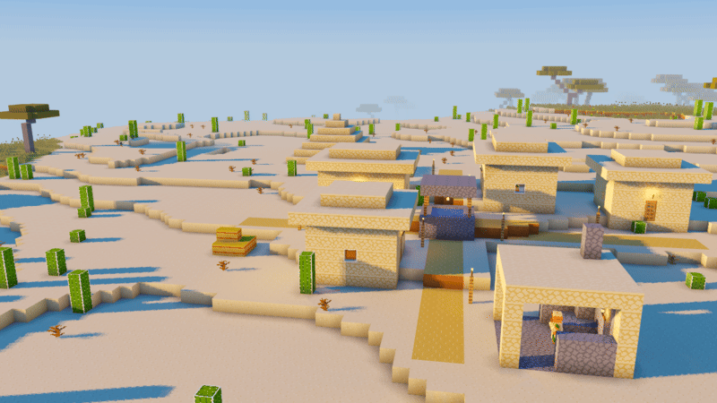

A voxel game written in C# on [3DEngine](https://github.com/EggyStudio/3DEngine) through its package
on nuget.org, set in an endless generated world whose blocks are placed and broken, with its light,
its water, its mobs and the items they drop. Its first use is to test the engine's global
illumination, radiance cascades traced through the scene's distance field, with emissive blocks. The
world is held in columns of colored blocks 16 by 16 from a height of -64 to one of 320, as
Minecraft's overworld stands, with animals that graze it, villagers in its villages and hostile mobs
where it is dark. The game has a first-person player with Minecraft's sizes and speeds, building and
breaking with an outline on the block looked at, in creative mode or in survival with health and
hunger, an inventory, tools and crafting, Minecraft's light levels with smooth lighting and shaded
corners, a sky whose sun, moon and stars cross it behind drifting clouds, and an ImGui window of the
light's settings.

The pictures show the game drawn with the three resource packs it fetches at its first start, [Bare
Bones](https://modrinth.com/resourcepack/bare-bones) by RobotPants, [Recolourful Containers GUI +
HUD](https://modrinth.com/resourcepack/recolourful-containers-gui) by Vi_Tul and [qrafty's
Capitalized Font](https://modrinth.com/resourcepack/qraftys-capitalized-font) by qrafty and Drqad,
each fetched from its maker's page and none of their files held here, and `build/pictures.sh` takes
them again. The section on resource packs sets a view in the game's own art beside the same with the
packs.

## Running it

The game needs the .NET 10 SDK, a Vulkan device and `slangc`, which `build/fetch-slang.sh` fetches
into `build/tools` once per checkout (`build/fetch-slang.ps1` on Windows), since its terrain shader
is compiled when the game loads it.

```bash
build/fetch-slang.sh
dotnet run --project VoxelSandbox                      # the hills of seed 1
dotnet run --project VoxelSandbox -- --flat --seed 7   # a flat world to build a test on
dotnet run --project VoxelSandbox -- --world house     # a save of its own name
dotnet run --project VoxelSandbox -- --pack pack.zip   # drawn with a resource pack's textures
dotnet test VoxelSandbox.Tests                         # its light, meshes, mobs, saves and land
```

A world is saved under `~/.local/share/VoxelSandbox/saves` on Linux, and the matching local
application data folder elsewhere, in a folder named by its kind and seed, `overworld-1` or
`flat-7`, unless `--world` names it. Its mode, inventory, health and food are saved with it. It is
saved every 30 seconds, on opening another world and on quitting, and opened where it was left.
`--transient` keeps nothing on disk, as a test run scripted through `./e3d` should, so it leaves the
saves as they were and takes no screenshot. Screenshots go in a `screenshots` folder beside the
saves, made the first time F2 is pressed, each named by its time as `2026-10-21_03.45.12.png`, with
`_2` after it where two fall in one second. The engine's package opens its performance window with
F2 as well, so the game keeps that window out of sight until the package gives it a key of its own.
The builds made in the engine's repository saved under `3DEngine.Game/saves` in the same folder, and
a world moved from there into `VoxelSandbox/saves` opens where it was left.

`./e3d` controls the running game from a terminal through the engine's command line, run out of
the engine's checkout that `ENGINE_CHECKOUT` names, or the folder above this repository
([.github/E3D.md](.github/E3D.md)):

```bash
dotnet build VoxelSandbox.slnx
./e3d open VoxelSandbox/bin/Debug/net10.0/VoxelSandbox --hidden --transient
./e3d command voxel.state
./e3d stop
```

The pictures in this file are taken by `build/pictures.sh`, each from the seed, the place, the hour
and the heading the script names, with the mobs and the clouds held where it puts them, so running
it again shows a change to how the world is drawn in the same pictures. It fetches the three default
packs by the addresses and the SHA-512 sums `VoxelSandbox/resources/packs.json` names into
`captures/packs`, which git leaves out, and opens the game with them. Each view of the world is
encoded at 800 by 450, each window of the interface is drawn at 2 of the screen's pixels to each of
its own and cut out at 800 by 450 so its pixels keep their edges, the eye is raised out of any block
it lands in before a capture, and ten of the views make the animation at the head, a GIF of 1.7 MB
with a palette of its own for each frame, kept over an animated WebP of the same frames at 0.3 MB
since a GIF plays wherever a README is read.

## Builds to play

A run of the pack workflow, started by hand, publishes the game as native code for Linux, Windows
and macOS on Apple silicon, each a zip of the program, its resources, the README and the license,
and with its `publish` input set makes a GitHub release of the three. A zip needs no .NET and no
`slangc`, since it carries every shader compiled. The game's version is `build/version.sh`'s, the
major and minor in `build/version.txt` and as the patch the commits since that file changed.

## The game this repository held before

The `legacy` branch keeps the voxel sandbox this repository held before, written on Direct3D 12,
with its history.

## Controls

| Input | Does |
|---|---|
| Mouse | Look |
| W, A, S, D | Walk |
| Space | Jump, or rise while flying or swimming. Twice quickly in creative, start or stop flying |
| Left Shift | Sneak, which keeps the player from walking off an edge, or sink while flying |
| Left Control | Sprint |
| Left button | Hit the mob looked at or break the block, at once in creative, slowly in survival |
| Right button | Place the chosen block or eat the food held, or open a door, a table or a furnace |
| Middle button | Pick the block looked at into the hotbar, in survival from the inventory |
| 1 to 9, wheel | Choose a slot of the hotbar |
| E | In creative every item, to put any of them in the chosen slot, in survival and adventure the inventory, and in spectator nothing |
| Q | Throw one of the chosen slot's items, or with Left Control its stack |
| F2 | Saves a screenshot of the frame as a PNG in the `screenshots` folder beside the saves, named by the time, as Minecraft's does, and says so at the lower left |
| F3 | The F3 window, with what the frame holds and costs, the toggles of debugging and the world's kind, seed and mode, opened as F3 is let go |
| F3 with F4 | The mode switcher, F4 stepping through creative, survival, adventure and spectator while F3 is held, and the mode chosen played as F3 is let go |
| F3 with T | Reads the resource packs again from their files, as Minecraft's does |
| G | The next quality of global illumination, Off after High |
| C, held | Zoom, the view narrowed to a quarter over a tenth of a second and the mouse's turn with it, the wheel narrowing it further to a tenth, the key set in the options |
| F1 | Hide the crosshair, the hotbar and the outline |
| Escape | Shut the window open, go back a menu, or open the menu, which holds the world still |

The player is an entity of the engine's ECS, its controller, its body, its vitals and its hand its
components, and the controller a behavior that turns and moves it from the frame's input. The game's
frame runs in the engine's stages, begun in the first after the frame's commands, the player moved
in the one before the update and the rest of the game played in the update, so the player is drawn
in the frame it moved in. The world's loading, the game mode, whether the player lives by it and the
menu open are the engine's states, and the behaviors run by them, the frame played while the world
stands, the vitals and the hostile mobs' spawning while the player lives, and the cursor freed as a
menu opens and taken back as the last shuts.

## Commands

Each is a line of `./e3d list` and runs with `./e3d command`, so a test of the light is built and
looked at from the terminal. A closed room lit by one lamp, at night:

```bash
./e3d command voxel.world flat
./e3d command voxel.room 10 4 -22 22 11 -10 stone
./e3d command voxel.set 16 5 -16 glowstone
./e3d command voxel.tp 16.5 5 -11.8
./e3d command voxel.look 0 -20
./e3d command voxel.time 23
./e3d shot room.png
```

`voxel.state` says where the player stands and looks, what is loaded and drawn, the hour, the day
and the light, and the block the eye is inside where it is in one. `voxel.fill`, `voxel.room` and
`voxel.set` change blocks, `voxel.tp`, `voxel.look` and `voxel.fly` move the player, `voxel.break`
and `voxel.place` act as the mouse buttons do, `voxel.time`, `voxel.day` and `voxel.cycle` set the
sky, `voxel.clouds` shows or hides the clouds and places their drift, `voxel.distance` the render
distance, `voxel.light` reads a block's light levels, `voxel.shade` turns the light levels and the
shaded corners on or off, `voxel.corners` sets how far the corners darken, `voxel.world` saves the
world and opens or begins another of a kind and seed, `voxel.loading` holds its loading screen up
for a capture, `voxel.save` saves at once, and `voxel.blocks` lists the blocks by number and name.
`voxel.mobs` counts the mobs and lists the nearest, `voxel.spawn` places one where the crosshair
rests, `voxel.attack` hits the one it rests on as the left button does, `voxel.still` stops them
where they stand and holds the clouds and the bits of broken blocks for a capture, `voxel.bits` says
where the bit nearest a place flies, and `voxel.kill` takes the mobs away. `voxel.fires` counts the
fires and lists the nearest with their ages. `voxel.mode` plays in creative, survival, adventure or
spectator mode, `voxel.select` puts an item in the chosen slot, `voxel.give` puts items in the
inventory, `voxel.craft` makes an item from what the inventory holds, `voxel.furnace` fills and
reads a furnace, `voxel.inventory` lists what it holds, `voxel.items` lists every item,
`voxel.throw` throws as Q does, and `voxel.drop` lays one of an item on the ground at a place.
`voxel.weather` says, holds or frees the weather, `voxel.packs` says or sets the resource packs on,
and `voxel.reload` reads them again. `voxel.vitals` says or sets the health and food, `voxel.hurt`
harms the player, and `voxel.respawn` gives a new life. `voxel.gi`, `voxel.field` and
`voxel.shadows` set global illumination, the scene's distance field and the sun's shadows,
`voxel.options` says or sets any setting of the options' screens by its screen and name, `voxel.hud`
hides what is drawn over the world for a capture, `voxel.scale` sets the interface's scale, at which
`build/pictures.sh` takes the windows, and `voxel.fov` sets the field of view, which the script
narrows to 40 degrees for its views of the world, as a zoom does for a screenshot. Three measure the
light. `voxel.flicker` records each frame's change in the picture around a turn or a step into a
file, with the first frame after it, the settled one and their difference beside it, `voxel.ring`
reads the last frame's light around a circle on the ground by angle, and `voxel.depth` says how far
the block under a pixel is. The engine's own `gi.*` and `field.*` commands show and measure global
illumination.

## Biomes

<table><tr>
<td>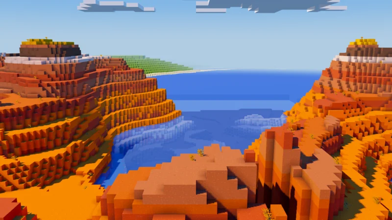</td>
<td>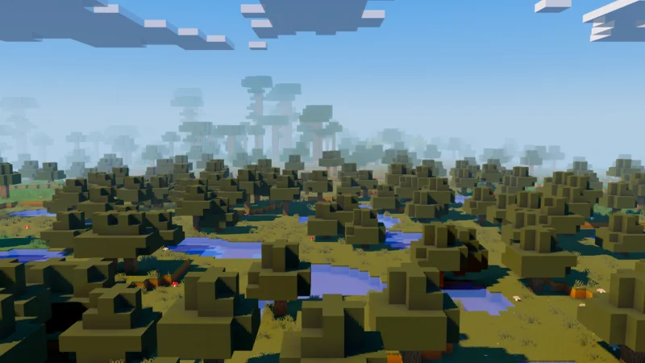</td>
</tr><tr>
<td>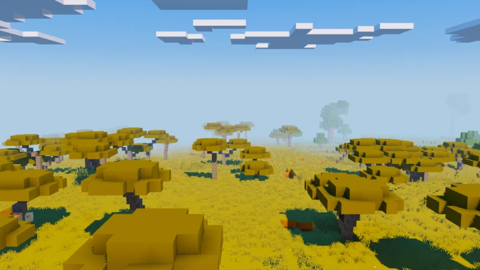</td>
<td>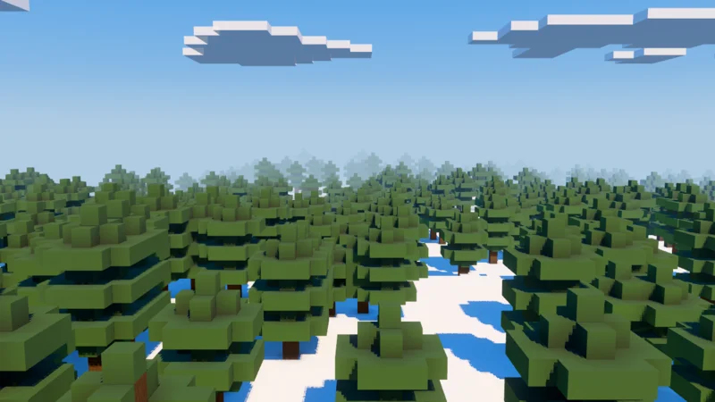</td>
</tr></table>

Two slow noises give each place a temperature and a humidity, as Minecraft's climate does, and they
choose its biome among plains with a few oaks, forests of oak and birch, birch forests, a dark
forest where it is wettest, taiga of spruce, snowy taiga and snowy plains where it is cold, flat
desert of sand over sandstone with cacti where it is hot and dry, the badlands inside it where it is
hottest and driest, the savanna beside it, the jungle where it is hot and wet, a swamp where it is
warm and wettest, a cherry grove on raised ground where it is cool and wet, and bare stone mountains
wherever the ground rises past 82 blocks, snow above 92, but where it is hot and dry, whose high
ground is the badlands, as the source's hot peaks are, so a mesa's top stands in no mountain of
stone and spruces and the badlands meet only the desert, the savanna, a river or a beach. Minecraft
chooses its biomes from six noises, temperature, humidity, continentalness, erosion, weirdness and
depth, against a table of their bands, where the game takes two of them and the ground's height, its
basins and its rivers standing in for the rest. Grass and oak leaves are gray surfaces tinted by
each biome's own color, the one Minecraft's colormaps give at that biome's fixed temperature and
downfall, the plains' grass (145, 189, 89), the forest's (121, 192, 90), the taiga's (134, 183, 131)
and the jungle's (89, 201, 60), and a place takes each biome's color as far as it is that biome, its
choice made soft over about twenty blocks about each of its bounds, so the colors change smoothly
across a biome's edge while the biome itself changes at once. Birch and spruce leaves keep a color
of their own. A hot, dry climate also flattens the land, so a desert lies flat and the hills sink as
they near it.

The land shapes some of them. A river winds where a noise is near zero, in a valley that sinks the
land most of the way to the water and cut to three blocks under the sea level where it runs, over
sand with patches of clay, fading out on high ground as Minecraft's rivers keep out of its
mountains. The valley widens with the depth it sinks, and its floor falls to the water as a bank
about a block down for two across, so a river on high ground runs between slopes rather than walls,
and steps of two blocks or more between neighbors are few, 460 over 512 blocks square about seed
1's spawn and one about its plains village. A beach of sand over sandstone lies along the sea where the basins sink the land, from a
block under the water to two over it, but where it is cold. A swamp sinks its land to a block or two
about the sea level, so pools stand among its grass, over dirt and clay. The badlands rise in mesas
whose flat tops climb in steps of five, their terracotta bare in bands of seven colors one to three
blocks high, the same for a seed, with red sand on the low ground between them.

A swamp's grass is two greens laid out by a noise and its leaves an olive, the badlands' grass and
leaves a dusty yellow, a cherry grove's grass and leaves a light green, and a dark forest's grass
halfway to a dark olive, each as Minecraft colors them, blended with the biomes around as the
others' are. The numbers, the climate's ranges, the colors and how many trees stand in a chunk, are
read from Minecraft's and from those of Terralith, the biome overhaul of the owner's modpack, as a
model and not a copy, since its license forbids handing its files out. `voxel.biome` finds the
nearest place of a biome.

## Weather

One sky stands over every biome, as the source's does, and its weather turns at the same hours
everywhere, each day at a chance of two in five, at an hour of its own and for three to twelve
hours, reckoned from the world's seed and the day alone, so a world's days bring the same weather
each time they come round and a save that keeps the hour keeps the weather. A turn comes and goes
over half an hour and runs on past midnight where it began late. While it lasts the sky is painted
toward a darker gray of its own brightness and the sun loses up to seven tenths of its light and the
moon half, and rain falls on the wet biomes, snow on the snowy plains and the snowy taiga, and
nothing on the desert, the savanna and the badlands. They fall as the source draws them, in each
column within eight blocks of the eye from fourteen blocks over it down to the column's highest
block, so none falls under a roof, two walls crossed in each column with the game's own picture of
thin pale streaks falling ten blocks a second or a dozen flakes a block and a half a second,
drifting as they go. `voxel.weather` holds the weather turned or clear, which the save keeps, or lets
it turn by its days again, and the Sky and Visuals screen turns the weather off.

While the weather has more than half turned the snow settles, a layer an eighth of a block deep on
the highest block of a column whose biome snows, where that block's top is whole or leaves and the
cell over it open, as the source's snow settles, and once the weather has cleared it melts. Sixty
columns within 48 blocks of the eye are tried a second at random, as the source ticks its blocks, so
a column near the eye is tried about once in two minutes and the snow comes and goes over minutes.
The layer is walked on and goes with the block under it.

Small things move about the world as the modpack's particles do. The rain splashes sixty times a
second on the blocks within eight of the eye where it falls, three drops leaping from each, and
spreads in rings where it meets water, flat on its top. Leaves fall four a second from the lowest of
a column's top leaves within sixteen blocks where three blocks of air lie under them, turning twice
as they fall over six seconds. Dust drifts about the eye in a cave, under the sea's level where
little of the sky's light reaches, twelve motes a second, with green spores where moss grows near
and embers rising where lava does, and the player and the mobs moving through water's top throw forty drops a second. The Particles
screen sets each from none to twice as thick. The engine steps, sorts and draws each of its
emitters whole every frame, holding particles or not, so an emitter is made as a burst needs one and
let go once its particles have died, eleven at most and none on a clear day in the open with no trees
near, and none of them meets the scene, which would cost a pass drawing the window's depth. Each
lives no longer than it takes to reach the ground instead. The profile's `particles.*` values count
what each kind keeps alive, the emitters held and the budget, the most the emitters and the rings
may hold together, 816.

## Plants, woods and colors

<table><tr>
<td>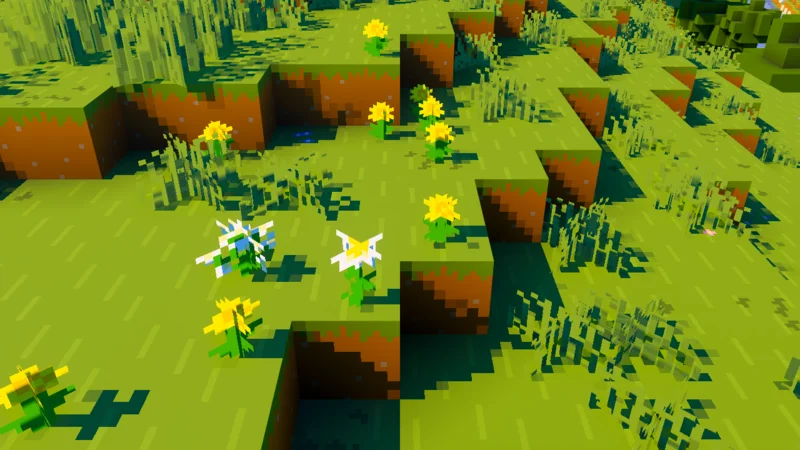</td>
<td>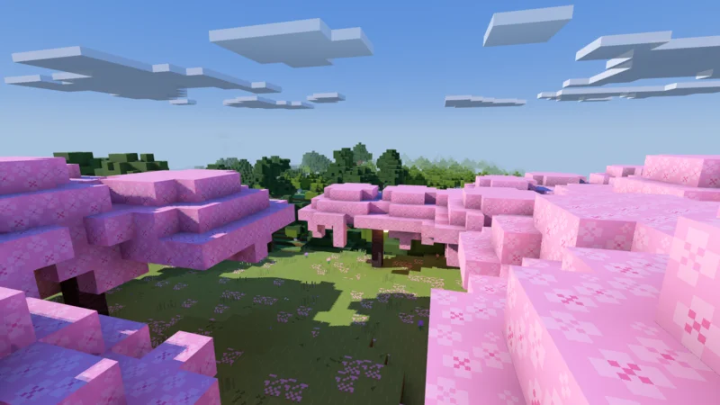</td>
</tr></table>

The ground grows Minecraft's plants by biome, short grass, tall grass two blocks high and ferns,
dandelions, poppies, cornflowers, oxeye daisies, azure bluets and tulips in the plains, blue orchids
in the swamp, brown and red mushrooms under the trees, pink petals under the cherry grove and dead
bushes on the sand. The grass and the flowers grow in the source's own patches, read from its placed
features. A chunk holds so many patches of a kind, ten of short grass on the plains and five where
the source's noise is low, two in the forests, five in the swamp, twenty in the savanna, twenty-five
in the jungle and one of ferns and grass in the taiga, and rare ones of tall grass and of flowers,
and each patch makes 32 tries, 96 for tall grass and pink petals and 64 for flowers, spread up to
seven blocks across and three up or down, so on level land most miss the ground. Grass so covers
about 22 of a hundred of the grass tops of seed 1's plains, tall grass 1 and flowers a third of one,
where the source's arithmetic gives 26, 2 and 1 on level land. A patch spreads across a chunk's
edge, each column laying out the patches of its own chunk and of the eight around it and keeping the
tries that land in it, and the mushrooms take a roll of their own at each place after the trees. The
source's flowers of the forests, lilacs, rose bushes, peonies and lilies of the valley in a patch
one chunk in 35, are not laid out, since the game has no flower two blocks high. Tall grass breaks
whole, either half taking the other with it, and is placed whole where the air over it is free. A
flower and tall grass stand off their cell's middle by up to a quarter of a block either way across,
and short grass and a fern sink by up to a fifth as well, by a hash of the place, in the sixteen
steps Minecraft offsets them by, while a sapling, a mushroom and a dead bush stand at the middle, as
there. A plant is two flat walls crossed from corner to corner of its cell, drawn from both sides
and lit as if they faced up and were seen from straight above, as Minecraft lights its plants with
no shade by the way they face, since the engine lights a face turned from the eye as its back, and a
plant above the eye's height would take the light of a face turned down, as `build/play.sh` reads on
a sapling over a pillar. Its walls are a mesh of their own in each section, cut out where their
texture is clear and casting the shadow of what the texture keeps, while global illumination holds
none of them, so the scene's distance field holds no grass. A pack's texture lies across each wall
from its own corners, so it stays whole wherever the wall stands, and where no pack has one the
game's own pixels stand in, blades of grass, a flower's stem and its petals, a sapling's crown and a
mushroom's cap, white masks tinted by each plant's own color. A plant breaks at once and falls when
the block under it is broken.

The jungle, the savanna's acacia, the dark oak and the cherry each have their log, their leaves and
their planks, and each wood its sapling, which leaves drop one time in twenty. The cherry's leaves
are its own pink and the others' the climate's green. Glass and wool come in Minecraft's sixteen
colors.

## Water, glass and ice

Wide basins sink the land under the sea level of 48, where water stands over a floor of sand near
the shore and gravel deeper, its top frozen to ice where the climate is cold, as about a fourteenth
of the land is on seed 1. The player swims in it by Minecraft's ticks, its numbers taken from the
source, sinking at half a block a second, rising while Space is held, and at the top bobbing as
Minecraft's swimmer does, its feet coming out of the water up to 0.28 over the surface and falling
back to 0.74 under it before it rises again, a jump from the bottom only where the water is no
deeper than 0.4 over the feet, and moving at a little over half speed. Pushing into a block with
room for the body raised 0.6 out of the water, as a bank level with the water's top block is from
the top of the bob, the player rises at 0.3 of a block a tick and steps out onto it, and a bank a
block higher is out of reach, as in Minecraft. It sees through a blue tint while the eye is under
the water. Glass, ice and water are drawn see-through, a second mesh of each section drawn after the
opaque ones and farthest first, each vertex's alpha its surface's, and rough, so they reflect
nothing, since the land the scene's distance field traces in a reflection is drawn in its coarse
cells, which clash with the blocks' pixels. They cast no shadow, which keeps them out of the scene's
distance field as well, since the field holds a see-through mesh as solid, so the sun's light and
indirect light come through a window of glass as through an opening, and a room lit through a
skylight reads the same with glass in it as without. Glass lets the light levels through, and water
takes a level more for each block of it, so the sky fades with depth and a lake's floor darkens as
it deepens.

Water's own faces are a third see-through mesh of each section, its top carrying the water's depth
under each corner, the mean of the four columns about it down to the first block that is not
water, to 15 blocks. The terrain shader clears and darkens the water by the way the view takes
through it, its depth over how steeply the eye looks down, so a block of water shows its bed and
five hide it under the water's own darker color, and the water clears toward its shore, where the
columns beside it hold none, so it meets the bank with no hard line. Over that it shows the sky as
the frame draws it along the view's mirror, Schlick's fresnel giving more of it the lower the eye
looks, by as much of the sky as reaches the water, so the sea pales toward the horizon and a pool
under the ground mirrors none of it. The shore and the land across the water are not mirrored,
which waits on a planar reflection the engine is asked for.

Water flows as Minecraft's does, a block every quarter second. It falls into the air under it, and
where it stands on ground or on a source it spreads sideways, a level further from its source for
each block, up to seven, each level standing lower in its cell, and it dries back when its source is
taken away. Two sources with a gap between them over ground fill it with a third. A lake the world
generates stands still until a block beside it changes, and water half flowed when a world is left
stands as it was until then.

## Torches, lanterns and end rods

<table><tr>
<td>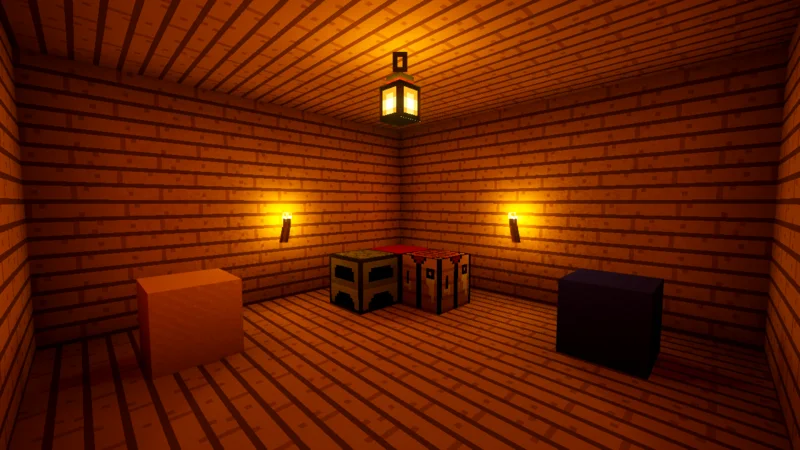</td>
<td>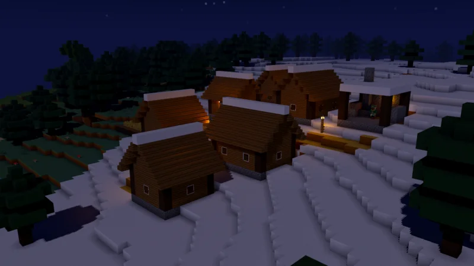</td>
</tr></table>

A torch, a lantern, an end rod, and the soul torch and soul lantern of blue fire are smaller than a
block, each a few boxes as Minecraft's models are. A torch placed on a wall's side leans out from
it, its wood up to its lit head, which alone stands upright and shows the picture's two lit rows,
a lantern placed under a block hangs from it, and an end rod points away from the face it is
placed on, and each falls when the block it holds to is broken. Light passes through them, the
player through a torch, and the crosshair meets each of their pieces, as it meets a slab's, stairs'
and a fence's, so a ray through a stair's open quarter or between a fence's rails reaches the block
behind, and the outline follows the pieces together, a stair's step and slab outlined as one shape
with the crease under the step. The emissive piece, a torch's flame, a lantern's glass or the rod,
is a lamp's cube scaled to it, so global illumination carries it as a small light by its box, and
the other pieces are faces of the section's mesh.

A small light's emissive intensity is its light over its surface, so a torch's flame, a 64th of a
block's surface, is far brighter than glowstone. Each is set so a closed room's floor takes about
three quarters of glowstone's light from a torch or an end rod, nine tenths from a lantern and two
fifths from the soul fire. A flame a quarter of a block from a wall lights a bright round pool on
it, as a light that near a wall does.

## Slabs, stairs, fences and doors

Slabs of stone, cobblestone, oak, spruce and sandstone fill the lower half of a block, or the upper
half where placed against a ceiling or on the upper half of a side, and a slab placed on the open
half of one of its kind joins it into the whole block. Stairs of cobblestone, oak, spruce, sandstone
and stone brick climb the way the player looks, turned over in the upper half, and turn into a
corner as Minecraft's do, an outer one, a quarter of the step, where stairs of the same half behind
them climb across them, and an inner one, the step and a quarter before it, where stairs before them
climb across them, each toward the side those climb to, so a ring of stairs climbing inward makes a
hip roof's corners. A fence joins the fences and the whole blocks on its four sides with two rails
each. An oak door stands two blocks high on a whole block, shut across the side away from the way
the player looked placing it, and a right click opens or shuts both its halves, whatever is held.
Breaking either half breaks the door.

The player climbs half a block and a little more without jumping, onto a slab or a stair, as
Minecraft's does. A slab, stairs, a door, a lantern, an end rod and a fence stop the player at their
own boxes, a fence's standing half a block above its post so it cannot be jumped, and a torch and
wheat are walked through. Light passes through them all, so a roof of slabs lets the sky's level
down.

## Caves and ravines

<table><tr>
<td>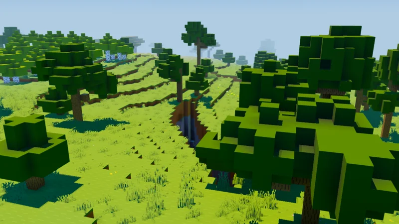</td>
<td>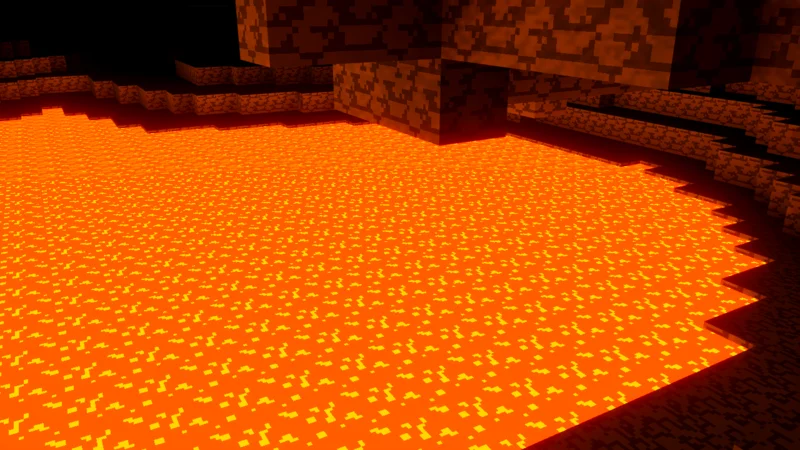</td>
</tr><tr>
<td>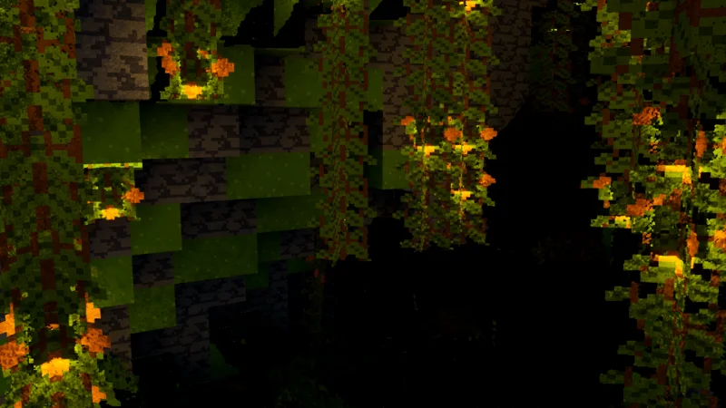</td>
</tr></table>

The world stands on Minecraft's floor of bedrock at -64, whole there and thinning out over the five
blocks above, and under 0 its stone is deepslate, as Minecraft's is, thinning out up to 8 so the two
meet in a ragged edge. Deepslate breaks into cobbled deepslate, which makes stone tools and a
furnace as cobblestone does and smelts back into deepslate. The caves are Minecraft's newer ones,
by its density functions and their numbers, cheese caves, wide and tall, where a large noise is
low, with pillars left standing where their noise holds them, spaghetti tunnels where two noises
are near zero, thinned by a third, noodles thinner still, and entrances that open them to the
ground's top. The density is worked out at the corners of Minecraft's cells, 4 blocks across and 8
high, and interpolated between, which shapes the caves smoothly and asks a tenth of the noises a
block, and the ground closes toward the floor from -40. Minecraft's terrain density, which the
caves read for how deep a place lies, is the depth under the ground's top, so only an entrance
reaches the top ten blocks, and never in the top three under water, which it would drain, nor on a
village's ground.

The caves hold Minecraft's aquifers. The ground is cut into cells 16 blocks across and 12 high, each
with a place of its own within it, and a cave's block takes the fluid of the nearest place's aquifer
under its level and air over it. Under -54 every cave holds lava, as Minecraft's do. An aquifer
whose ground lies under the sea is the sea's, to the sea level, and elsewhere a slow noise leaves it
dry, floods it to the sea level, or sets it a level of its own near the middle of its band of 40
blocks, never over the lowest ground around, so one cave holds a lake at one height and the next a
dry floor or a lake at another. A level of -10 or under is lava where a third noise has it. Between
two aquifers that differ the ground stands as a wall where the pressure of their difference
outweighs how open the cave is, so no water stands over a cave's air. Lava lights the blocks around
it to 15, a pack's lava shows twice its color whatever light reaches it, as Minecraft draws lava at
its full light, and its faces' emission lights the cave through global illumination, one draw for a
section's lava where a lamp's cube for each block would be thousands. The player swims through lava
as through water, losing 4 of health every half second. A column with its aquifers is generated in
about 17 ms against 15 to 16 without them.

Under the wettest ground, where the climate's humidity is 0.75 or more, about the wettest 7 percent
of the land as Minecraft's are, the caves from 26 to 115 blocks down are its lush caves. Moss covers
four in five blocks of their floors and roofs, three in five of the floor's moss bear short grass, a
moss carpet or tall grass, and one roof block in seven has cave vines hanging from it, most 1 to 7
blocks long, a fifth of their blocks bearing glow berries, which light the cave around them to 14
and through global illumination, by a pale light so the leaves keep their green. Each column tries
three clear pools in its floors, discs of a radius of 2 or 3 blocks whose ground turns to clay three
or four blocks down and whose top turns to water wherever the blocks beside hold it in. Vines fall
when the block they hang from is broken and give their glow berries where they bear them, and glow
berries are eaten or hang a vine where they are aimed at a block's underside. Minecraft's azaleas,
spore blossoms and dripleaves are not here yet.

A ravine cuts the ground open along a swaying line about 48 blocks long, up to seven wide at its
middle and narrowing to its ends, its floor up to 30 blocks down with a few emissive magma blocks on
it, so the sun's light falls down its walls and the magma's lights its depths at night. No ravine is
cut beside the sea, so no water stands beside its air, nor across a village's ground, where a road
or a footing laid at the ground's height would hang over it. `voxel.find ravine` gives the nearest.

## Trees and structures

<table><tr>
<td>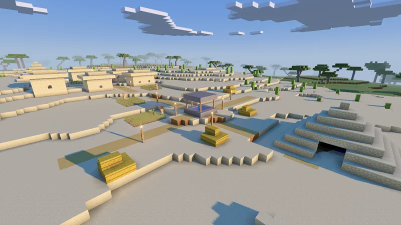</td>
<td>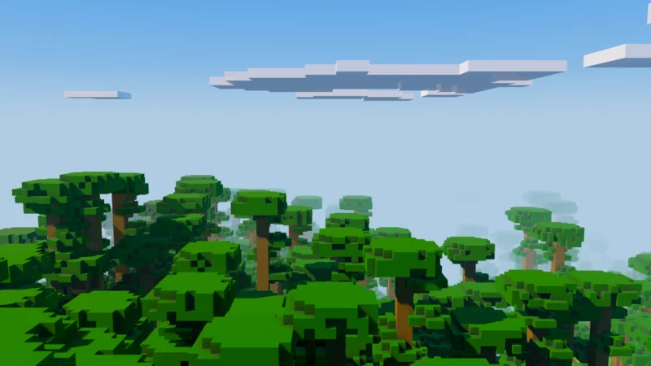</td>
</tr></table>

Each column places the trees and the structures that start in it and those that start in the columns
around it and reach into it, keeping the blocks that fall inside itself. Where one starts depends on
the seed and the ground at its start alone, which the generator can tell for a column not generated,
so a tree or a building crosses a column's edge whole although every column is generated alone on a
worker, as Minecraft places a structure's pieces chunk by chunk. The ravines are cut before the
trees, as Minecraft carves before it places its features, and a tree stands only where neither a
ravine nor a cave's entrance cuts the four blocks of ground under its trunk, a test any column can
make of a tree reaching into it from another, so no trunk stands over a cut and no crown is left in
the air. Over the forest by seed 1's first ravine the test takes a column from 16.5 ms to 18 to
generate.

The trees take Minecraft's shapes as numbers with the game's own touches. Oaks of four to six logs,
big oaks of six to fourteen with branches leaning out to balls of leaves, birches and spruces stand
in the temperate and cold biomes, acacias bending to one side under flat crowns in the savanna, dark
oaks of two logs by two under wide low crowns in the dark forest with giant brown and red mushrooms
among them, jungle trees, bushes and giant jungle trees of two by two up to thirty high with
branches in the jungle, and cherry trees forking under wide pink crowns with leaves hanging from
their edges in the cherry grove, a lantern hung under one crown in three. The crowns are a few
layers thick, as the source's, and the sky's light falling through a canopy loses a level on the way
in and one more past its first layer, a canopy five deep taking two, and keeps the rest down to the
floor, so a rain forest's floor under its layered crowns reads 13, where a level for each leaf and
for each block under the canopy would leave it at 9, and leaves take a level each from light passing
sideways through them. As many trees stand in a thousand places as the source's chunks hold, fewer
where a crown is wide, since the game's trees grow into each other where the source leaves out one
with no room.

A structure has at most one start in each cell of 64 by 64 blocks, where its chance falls and the
land at its start suits it. An igloo of snow with a shroomlight inside stands on the snowy plains, a
stepped sandstone pyramid in the desert, a dark chamber at its heart with a floor of blue and red,
and a cobblestone dungeon deep under any ground, a magma block at its middle where Minecraft's has
its spawner. The pyramid is as rare as the source's, one at most to each square of 32 chunks, at a
chunk among its first 24 each way and only where that falls in the desert, so a desert holds one or
none. `voxel.find <village|igloo|pyramid|dungeon|ravine>` gives the nearest one's place.

A village stands where the plains, the taiga, the snowy plains or the desert lie nearly level across
48 blocks, built of that biome's wood or sandstone. Villages are spaced as the source spaces them,
one to each square of 34 chunks at a chunk among its first 26 each way, so two stand at least eight
chunks apart and most a few hundred blocks. A well at its middle has a lantern hanging under its
roof, four roads of dirt path lead out from it, and beside each road stand two plots, each a small
house, a long house, a farm of wheat with a row of water through it, a forge with a hearth of magma
or a pile of hay, its front toward the road, with lamp posts along the roads, a lantern on a fence,
or a torch in the desert. A house has a shut oak door with a torch over it, lanterns hanging inside
and a roof of stairs climbing to a ridge, flat in the desert. Each road follows the ground block by
block and crosses water on planks, each building stands at its own ground's height on a footing of
stone, and no tree grows within the village. A villager lives in each house, two in a long house,
and one keeps each forge and each farm.

## Animals and villagers

<table><tr>
<td>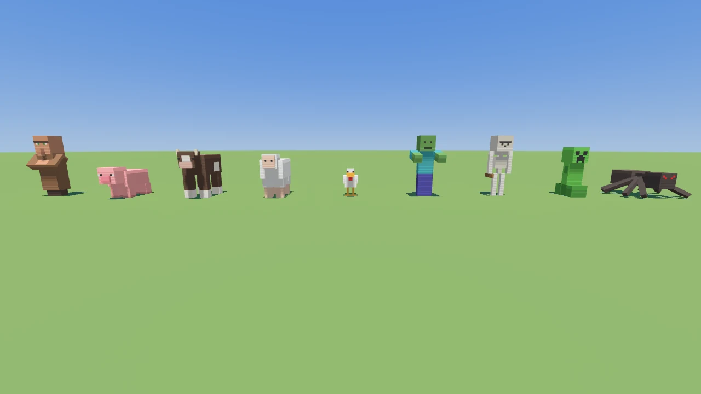</td>
<td>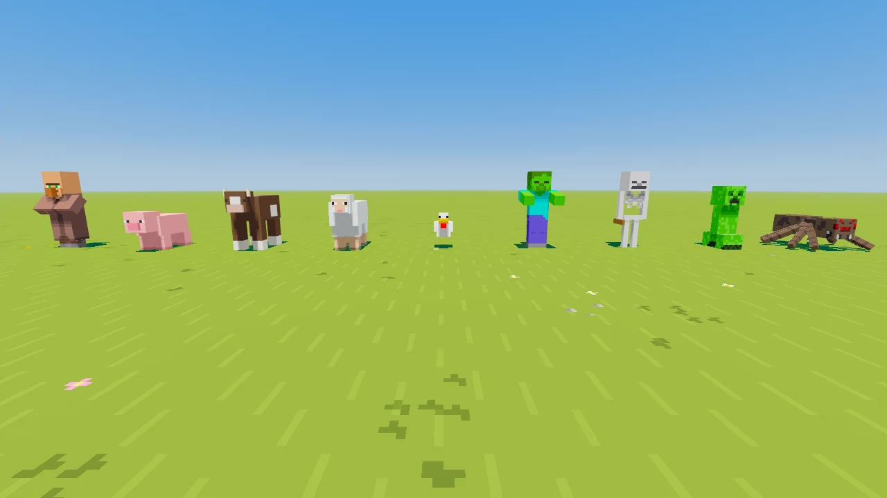</td>
</tr><tr>
<td>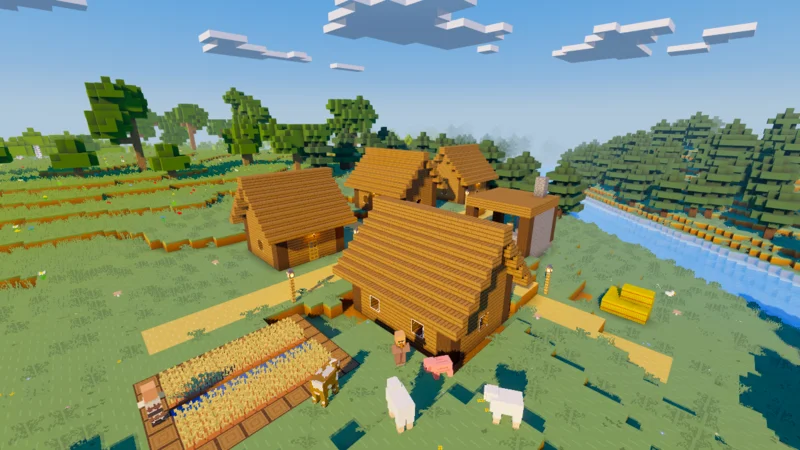</td>
<td></td>
</tr></table>

Pigs, cows, sheep and chickens graze the plains, the forests and the taiga, and sheep the mountains,
a herd of two to four of one kind in about a tenth of the columns, placed as a column is first
generated, as Minecraft places them. A sheep's wool is white, or now and then gray, black, brown or
pink, about as often as Minecraft's are born so. A villager wears a robe of its village's biome.

A mob stands a few seconds and then walks to a place up to ten blocks off, along a way found through
the blocks, which runs along the ground and around what stands in it, up a block with a jump, down
as far as three, and through water where no other way goes, the mob floating in it and climbing out
onto a bank. Now
and then one turns its head to watch the player within six blocks. A hit turns it red for half a
second, knocks it back and sends it running from place to place for five seconds, and once its
health is gone it falls onto its side and is taken away, a chicken after four hits, a sheep after
eight, a pig or a cow after ten and a villager after twenty. A villager wanders within 20 blocks of
its house by day and from six in the evening to six in the morning goes home, opening the doors in
its way and shutting them behind it. The player pushes mobs aside, they push each other apart, and
no block is placed into one.

A mob thinks and moves only while the columns around its own are loaded, so it never walks onto the
air a column not loaded reads as. The mobs standing in a column go with it when it unloads and come
back where they stood when it loads, and the save keeps them in `mobs.bin` with the columns that
have had theirs placed, so a herd or a village's villagers are placed once.

Each piece of a mob, its head, body, legs and a chicken's wings, is a few boxes, one mesh of colored
vertices drawn instanced for every mob of its kind, its legs swinging about their hips as it walks.
The boxes, their pivots and each kind's width and height are Minecraft's, taken as numbers from its
model definitions and its mobs' sizes as of 26.3, the villager drawn at the 0.9375 its layer is, and
their colors, faces and markings are the game's own. With a pack loaded, each kind but the creeper
wears the pack's picture of it, under `entity` by Minecraft's name, the newest of the names the
pig's, the cow's and the chicken's have had first. A villager's clothes of its biome, Minecraft's
picture of its type, are laid over its body's picture where they are not clear, as Minecraft cuts
its layers out, into one picture a biome, and a sheep's wool is a picture of its own on the wool's
cuboids, grown about the body's, tinted by its color. Each of the source's cuboids takes its part of
the picture from the offset its model definition gives it, read as numbers by `build/MobLayers.java`
as the boxes were, and unwrapped as Minecraft unwraps a box, the top and the bottom side by side and
the four sides below them, a mirrored cuboid's turned over. The game's own eyes and markings are
left out, a cuboid only the picture draws, a hat's layer or a skeleton's body, is added and cut out
where the picture is clear, and one the picture leaves clear throughout is left out, so its shadow
does not stand where nothing shows. The sun's shadow takes a cuboid whole, since the engine's shadow
pass reads no picture through a shader of the game's own, so a skeleton's body casts the shadow of
its cuboid between its ribs. The skeleton's bow keeps its own color, laid on a row of white below
the picture. A picture fits at the scale of its cuboids' layout or a whole multiple of it, as tall
as the layout or half as tall, as the pig's and the cow's were before Minecraft 1.21.5 doubled them
on the same offsets, a cuboid wholly below such a picture left out, so a cow on an older picture has
no muzzle, as Minecraft's had none, and a kind with no picture that fits keeps the game's own
colors. The creeper keeps its own colors whatever pack is on, drawn after Minecraft's own creeper,
which the repository cannot hold, where Bare Bones' is drawn in a style of its own. `build/play.sh`
writes a pack of one zombie's picture, red on its head's front, clear on its hat's layer and blue
elsewhere, and reads its
face red and its body blue, and `voxel.pixel` reads the last frame's color where a point in the
world lies.
The walk is Minecraft's too, a leg turning up
to 1.4 radians each way with its stride, which follows the speed, and cycling every 2.36 blocks, a
villager's half as far under its robe, a spider's legs turning and lifting by 0.4. A zombie reaches
its arms out a little under level and raises them while it hunts, and a skeleton's hang until it
aims. Each kind stands beside Minecraft's outline through the same camera, standing and mid-stride,
in `.github/assets/mobs`, which `build/mob-pairs.py` draws again from the Minecraft client on the
machine through `build/MobLayers.java`, and says so where the machine has none. A
leg swung ahead or behind is lifted by however far its foot's corner would sink, so no foot goes
below the ground. Mobs are drawn within 64 blocks, as Minecraft draws its entities, through the
game's own mob shader (`VoxelSandbox/resources/shaders/mob.slang`), which has no haze. It lights
them as the engine lights a model, global illumination's indirect light among it, keeps the sun's
share and takes the color out of the rest, the light from all around, and floors each face at
Minecraft's flat shade of the light a face turned up takes a sixteenth of a block out from it, 1 on
top, 0.8 facing north or south, 0.6 facing east or west and 0.5 underneath, out from the face so a
side face takes no bands of its own shadow, as `build/play.sh` reads down a creeper's front at noon,
and seen from straight above, since the engine lights a face turned from the eye as its back, so a
face above the eye's height is as bright as one below it, as the script reads down a zombie's face.
A white sheep's side in the shade at noon so reads 192, 194 and 195, a gray as Minecraft's does,
where it read 119, 161 and 178, the blue of the sky its light's rays met. The nine stand in a row in
daylight in `.github/assets/mobs/daylight.webp`, and wearing the default packs' pictures in
`daylight-pack.webp` beside it.
They cast shadows and hold no light for others, their materials' `BouncesLight` off, which leaves
them out of the scene's distance field, so a pig's pink does not reach the grass.

## The modes

<table><tr>
<td>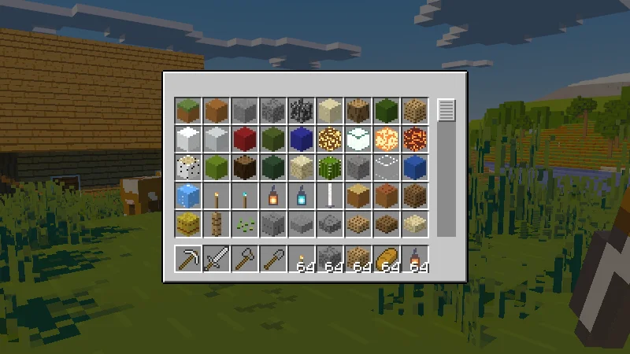</td>
<td>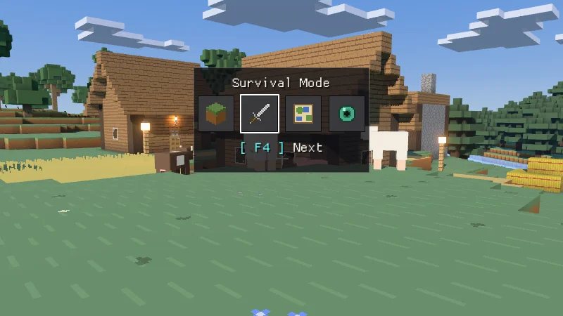</td>
</tr></table>

A world plays in creative mode, as a test of the light needs, in survival, in adventure or in
spectator, which the switcher, `voxel.mode` and the F3 window choose and the save keeps. F3
held with F4 opens the switcher over the middle of the window, the four modes' icons in boxes under
the chosen mode's name, as Minecraft's is, creative's grass block and survival's iron sword from the
items and adventure's map and spectator's eye drawn for it. It opens on the mode played before the
one now, or on survival from creative and on creative from the others where there is none, F4 steps
it to the next while F3 is held, and letting F3 go plays the mode chosen. Adventure keeps survival's
health, hunger and inventory and its doors, tables, furnaces and hits on mobs, and breaks and places
no block. Spectator flies through the blocks with nothing held and nothing touched, no crosshair,
hotbar or harm, and no mob hunts the player.

In creative every item is to hand through E, a block breaks at once and drops nothing, placing a
block uses nothing up, and Space pressed twice flies. In survival there is no flight, and a block
takes its hardness times one and a half seconds to break with the button held, as by hand in
Minecraft, cracking as it goes through Minecraft's ten stages, a pack's destroy stages or the game's
own cracks branching out from its middle where no pack has them, and throwing a bit of its side's
picture from the face hit each tick, and then drops what it leaves. The progress is kept while the
button stays held and the aim is lost for up to a second, as over a jump, so a block above reach
breaks over a few jumps, and begins again on another block. A block broken in any mode throws 64
bits, each a quarter of its side's picture tinted by the climate's grass and leaves where it stood,
as its faces are, so a grass block broken in the savanna throws the savanna's grass and leaves in a
jungle the jungle's, which fall, land and are gone within two seconds, as Minecraft's do, each lit
as its face toward the eye takes the light at its middle, which its body keeps in the open, so one
clipped into a wall takes no light through it. Grass, farmland and a path drop their dirt, stone its
cobblestone, coal ore its coal, diamond and emerald ore their gem, lapis ore four to nine lapis and
redstone ore four or five redstone, wheat its wheat and seeds, the grasses a seed one time in eight,
a dead bush up to two sticks, leaves their sapling one time in twenty, glass and ice nothing, and
any other block itself. An ore asks a pickaxe, of stone or better for iron, copper and lapis and of
iron for gold, redstone, diamond and emerald, and gives nothing to a lesser one. A torch or a
lantern that falls with the block it held to drops too, and placing a block uses one up. A block
placed into a plant's cell, a grass's, a fern's or a dead bush's, or a fire's, takes the place of
what stood there, which drops nothing, and one placed aimed at such a plant goes into the plant's
own cell, as Minecraft's grasses give way. Sand, red sand and gravel over air, water or a plant that
gives way fall as Minecraft's gravity blocks do, faster by 0.04 of a block a tick each tick and
keeping 0.98 of their speed, a column of them block by block as each under it goes, and stand where
they land, or break into their item over a block that keeps its place, as a torch or a slab in their
cell, each falling block an entity of the engine's ECS that a behavior of its own lets fall in the
engine's frame. Breaking the log a tree's trunk stands on fells the tree, its logs joined to the cut
through any of the 26 blocks about each, under the cut too, so a lower tree whose branch touches it
fells with it whole, breaking from the lowest upward a block a tick with their drops and a few bits
each, one in four falling as a block that lands, and its leaves decaying one after another over the
second from the tick the first log goes, so the crown and the falling logs are in the air together,
with bits and the source's drops, those with no log of another tree within six leaves of them, as
the source's leaves decay, so the leaves of a tree beside it stay, and a wall of logs no leaf
touches fells nothing. An axe in survival takes a use for each log the felling drops as an item,
none for one that falls as a block, so a tree of eight logs of which three drop as items takes three
besides the cut's own, and an axe that runs out mid-tree leaves the logs still to go standing, with
the leaves about them. What the player's right hand holds stands at the window's lower right as the
source draws it, the block's cube turned by 45 degrees or the item's picture a pixel deep, as the
source's item models make it, in the source's places for the right hand, a tool's picture turned
half about its handle so an axe's blade faces ahead, swinging on a hit, a break or a use and bobbing
with the walk, and an empty hand shows nothing. It is posed as the source poses it about a block
before the eye and drawn at a quarter of that size toward it, which shows it the same and keeps it
inside the player's own box, so no wall the player stands against cuts into it, and it is hidden
with the HUD. A stack on the ground of an item drawn flat is its picture a pixel deep too. A block
that gives light, a torch, a lantern or glowstone, lights the ground about the player while it is in
the hand, and about itself where it lies dropped, a point light of its own color at the player's own
place, the body's middle a third of a block under the eye, so no turn of the view swings it and no
wall the player faces takes it in, or at the stack reaching as many blocks as its level of light,
which casts shadows, so it lights no room through a wall, and which global illumination carries on
to the walls around as it carries a placed one's. The held and the nearest three dropped lights
shine, and a torch in the hand lights the ground a block off about as a torch standing there does.

The inventory holds 36 slots of up to 64 of an item, the hotbar its first nine. E opens it in
survival and adventure, where a left click takes up a stack, puts it down, joins it to a stack of
its item or swaps the two, and a right click takes up half a stack or puts down one of it. The quick
moves are Minecraft's, in that window, at a crafting table and at a furnace in any mode. Shift with
a click moves a stack between the hotbar and the rest, into a furnace by what smelts or burns, or
out of a grid or a furnace into the inventory, and on what a grid makes crafts as many as the
inventory has room for. A number key over a slot swaps it with that slot of the hotbar, a
double-click with a stack held gathers its kind onto it, and a drag over slots with a stack held
spreads it over them, evenly with the left button and one each with the right, each slot it passes
lit and showing its share and the pointer what is left until the button is let go. While a window is
open no key of the player's acts, neither walking, jumping, crouching and sprinting nor the hotbar's
number keys, as Minecraft's screens take the keyboard. Q over a slot drops one of its items and
Control with Q its stack, and a middle click on the window or R sorts the 27 slots above the hotbar,
each kind together in filled stacks, as the sorting mods do. With the window shut, Q throws one of
the chosen slot's items and Control with Q its stack. A stack on the ground is a small cube of its
block wearing its faces' pictures as the packs give them, or their colors where no pack does, or an
item's icon a pixel deep, a cube for each of its pixels shown, the pack's picture of it or the
game's own, and
falls, slides to a stop and turns slowly, and is picked up once the player comes within a block of
it, half a second after it fell or two after it was thrown, joining stacks of its item in the
inventory first. Two stacks of an item lying together join, and a stack is gone after five minutes.
The stacks on the ground are not saved with the world. Each is an entity of the engine's ECS, its
stack and its body its components, and behaviors of its own in the engine's frame make it fall and
age, put it into the inventory and join it with its kind and take it away, each a concern of its
own. A mob drops its loot as it dies, in either
mode. A pig drops porkchops, a cow leather and beef, a sheep a block of wool of its coat's color and
mutton, and a chicken feathers and its meat.

Each item shows by an icon 16 pixels square, drawn once into an atlas. A block's icon is the block
as a small cube seen from above and from two sides, cast pixel by pixel against its own boxes, so a
slab, stairs, a torch and a fence keep their shapes, and a block smaller than its cell both ways is
drawn larger to fill the icon. Each face takes its surface's color as it looks in the plains with a
fixed speckle, since the blocks have colors and not textures, and is shaded by the way it faces, the
top brightest and the right side darkest, as Minecraft's inventory shades its blocks, and an
emissive block's faces are unshaded. An item that places no block is pixel art drawn from a few
strokes and dots, outlined in a dark shade of its color, its upper left edge lit and its lower right
shaded, and each kind of tool keeps one shape, its head in the color of its material. The hotbar
and the inventory window draw the atlas as a texture sampled without filtering, each icon at twice
its size.

## The interface

<table><tr>
<td>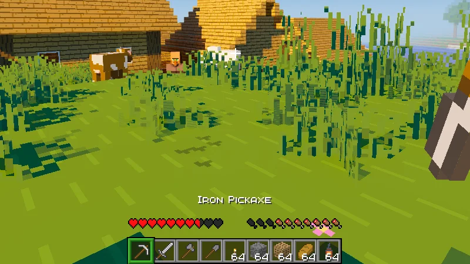</td>
<td>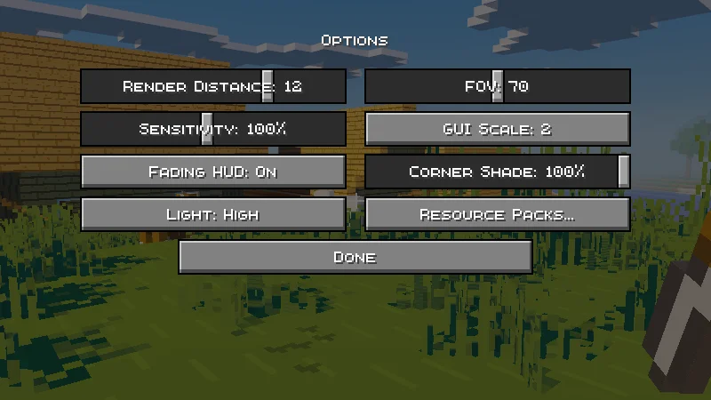</td>
</tr></table>

The interface is the game's own pictures in a flat look, a dark outline, a pixel of light above and
of shade below and plain colors, drawn at a whole number of the screen's pixels to each of its own,
the largest at which 320 by 240 of them fit the window, 3 at 1280 by 720, as Minecraft scales its
interface. The hotbar is Minecraft's nine slots 20 apart along the bottom, the chosen one framed in
green, with the name of what it holds above the hearts and the food, which sit over its two halves
as Minecraft's do. The name shows as the chosen slot or what it holds changes, stays a second and a
half and fades over half a second, as Minecraft's does. A window's panel and a button are stretched between edges that keep their size.
With resource packs loaded, their pictures, windows and font take the place of the game's own, as
the section on resource packs says.

The windows E opens are the game's own panels with Minecraft's slots at Minecraft's places, 176 by
166 of the interface's pixels, the inventory with its grid of two, a crafting table's grid of three,
and a furnace with its flame burning down and its arrow filling as it smelts, each over the
inventory's three rows and the hotbar, and in creative every item in rows of nine that the wheel
scrolls, over the hotbar, a slot of which a click chooses. The world behind darkens, the slot under
the pointer is lit and its item named in a tooltip, with a tool's uses left, and the stack taken up
follows the pointer.

Escape opens the game's menu over the darkened world, which holds the world still while it is open,
as Minecraft's does when played alone, with Back to Game, the options, Save the World, and Save and
Quit. The options are in two columns of buttons and sliders as Minecraft lays its options out, the
field of view, the mouse's sensitivity, the interface's scale, automatic or 1 to 4, whether full
rows of the HUD fade, and the zoom's key, C, V, Z, X, R or Left Alt, with a button to each screen of
settings by its area, Video Settings, Render Settings, Post Processing, Sky and Visuals and Resource
Packs. A setting's slider moves by its step, a button steps through its choices, each takes effect
at once, and Done goes back a screen. The window F3 opens is the engine's ImGui, a tool for the
developer, with what the frame holds and costs, the toggles of debugging and the world's kind, seed
and mode.

| Screen | Setting | Reach | Starts at |
|---|---|---|---|
| Video Settings | Window Mode | Windowed, Fullscreen, Borderless | Windowed |
| | Resolution, the window's size, or the monitor's mode in fullscreen | Current, the window's size as the screen was first opened or the desktop's mode, then each of the monitor's sizes, set as the slider is let go | Current |
| | Frame Limit | 10 to 250 frames a second by 10, then Unlimited | Unlimited |
| | VSync | Off, On | Off |
| Render Settings | Render Distance | 2 to 16 chunks | 12 |
| | Global Illumination | Off, Low, Medium, High | High |
| | Screen Probes | Off, On | Off |
| | Shadow Distance | 16 to 192 blocks by 8 | 64 |
| | Corner Shade | 0 to 100% by 5, the sections shaded again as it is let go | 50% |
| | Emission, what every emissive surface's light is multiplied by | 0 to 4 by 0.1 | 1 |
| | Field Cascades, the scene's distance field's | 1 to 8 | 4 |
| | Field Cell, the finest cascade's cell | 0.125 to 1 block by 0.125 | 0.25 |
| | Cascades a Frame, built again each frame | 1 to 8 | 2 |
| Post Processing | Bloom | 0 to 2 by 0.05 | 0.1 |
| | Ambient Occlusion | 0 to 1 by 0.05 | 0 |
| | Auto Exposure | Off, On | Off |
| | Exposure, while Auto Exposure is off | 0.1 to 4 by 0.05 | 1.6 |
| | Contrast | 0.5 to 2 by 0.02 | 1.12 |
| | Saturation | 0 to 2.5 by 0.05 | 1.4 |
| | Tonemap, the curve the light past 1 is brought under by | the engine's twelve by their names, from its own and ACES to Bevy's and the curve of four numbers | Curve |
| | Curve Exposure, Curve White, Curve Lower and Curve Upper, each choosing the curve as it is set | 0.1 to 3, 0.5 to 3, 0.5 to 2 and 0.5 to 2, by 0.05 | 0.9, 1.3, 1.05 and 1 |
| | Vignette | 0 to 1 by 0.05 | 0 |
| | FXAA | Off, On | Off |
| | Motion Blur | 0 to 1 by 0.05 | 0 |
| Sky and Visuals | Time | 00:00 to 24:00 by a quarter hour | the world's |
| | Daylight Cycle | Off, On | the world's |
| | Day Length | 1 to 60 minutes | 20 |
| | Moon, its phase, set by moving the days on to the next night of it | the eight phases | the world's |
| | Sun Strength and Moon Strength | 0 to 200% by 5 and 0 to 400% by 10 | 100% |
| | Weather, whether it turns | Off, On | On |
| | Clouds and Fog | Off, On | On |
| | Haze by Height, the haze thinning over land high above the sea, and Morning Haze, the haze thickening about sunrise | Off, On | On |
| Particles, from Sky and Visuals | Rain Splashes, Falling Leaves, Cave Dust and Wakes, each how thick it is | 0 to 200% by 10 | 100% |
| Sky Colors, from Sky and Visuals | Noon Sunlight, Low Sunlight, Moonlight and Night Tint, each a light by its hue | red, green and blue from 0 to 255 | the modpack's shader's |
| | Day Sky, Day Horizon, Sunset Horizon, Night Sky and Night Horizon | red, green and blue from 0 to 255 | the modpack's shader's |

A color's screen shows the color under its three sliders, with Reset, which puts it back as it
started, and the screen of the sky's colors has Reset All. A light is set by its hue, each channel a
share of the largest channel of the color it starts at, so it starts with one channel at 255, and
its strength by the Sun and Moon Strength sliders. The sky's colors are its top and its horizon by
day, at sunset and by night, and the night's tint multiplies them as far as the night has come. The
settings are kept across runs in `options.txt` beside the saves, as Minecraft keeps its own, one
line a setting, its screen, general for the options' own, and its name joined by a point and its
words by underscores, then a colon and its value, as `render.Render_Distance:12` or
`video.Window_Mode:Borderless`. The game reads it as it starts and writes it as a screen of the menu
is left, or as `voxel.options` or G changes a setting, and a line it cannot read leaves its setting
at the default above. The time, the daylight cycle and the moon are the world's, which its save
keeps, and a transient run neither reads the file nor writes it.

A world opens behind a black loading screen, with the world's name over a bar of how far its loading
has come, and under it, while the default packs are fetched, a line and a bar of their own. Half the
bar is the columns within two of the player's generated and half the sections of the player's column
and its neighbors meshed, the columns asked for only within three meanwhile, so the nearest come
first. The player is held and the world's time still until those sections stand, and then the world
is shown, a new world's player set on the highest block at the origin.

## Tools and crafting

<table><tr>
<td>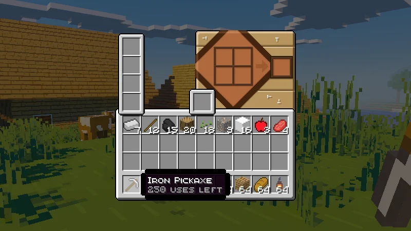</td>
<td>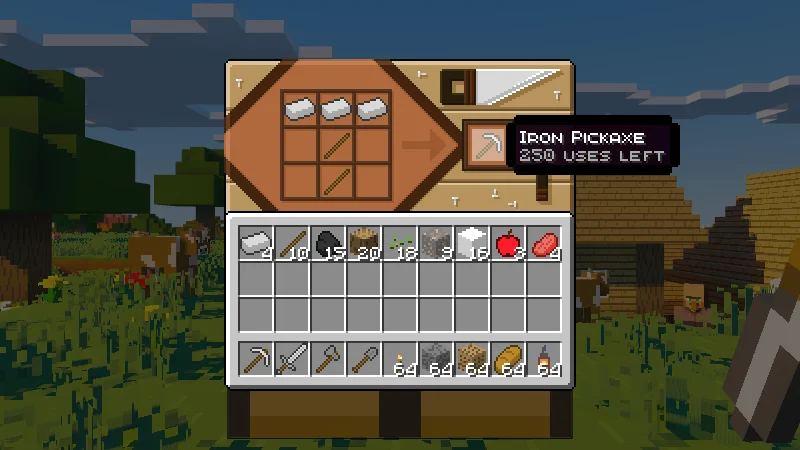</td>
</tr></table>

A pickaxe, an axe, a shovel and a sword are made of wood, stone or iron. A tool breaks the blocks
its kind is for faster than a hand, twice as fast of wood, four times of stone and six times of
iron, a pickaxe stone, cobblestone, ores, sandstone, concrete and lanterns, an axe logs, planks and
what is made of them, and a shovel dirt, grass, sand, gravel and snow. A block a pickaxe is for
takes its hardness times five seconds without one and drops nothing, as in Minecraft, so stone takes
seven and a half seconds by hand, a little over one with a wooden pickaxe and half of one with a
stone pickaxe. A tool wears by a use for each block it breaks and a sword by two, and is gone when
its 59 uses of wood, 131 of stone or 250 of iron are worn, a bar under its slot showing what is
left. A hit takes a hand's one point of a mob's health, and a sword five, six and seven of wood,
stone and iron, an axe four, five and six, a pickaxe three, four and five and a shovel two, three
and four, as Minecraft's took before its attacks had a cooldown.

The inventory has a crafting grid of two by two, and a crafting table, made of four planks, one of
three by three that a right click on it opens. A recipe matches wherever its shape lies in the grid
with the rest empty, its mirror image too, and a click on what the grid makes takes it, using one
item of each stack. A log makes four planks of its wood, two planks four sticks, a stick under coal
or charcoal four torches, eight cobblestone in a ring a furnace, planks, cobblestone or iron ingots
with sticks the tools in Minecraft's shapes, three blocks in a row six slabs, a staircase of six
blocks four stairs, planks and sticks three fences, six planks three doors, four sand a block of
sandstone, four stone four stone bricks, and nine wheat a hay bale. Ores lie in the stone and the
deepslate as Minecraft's ore features place them, so many blobs to a column at heights of an even
or a trapezoid spread, an ore of the stone in stone and its deepslate ore in deepslate, coal 30
from 136 up and 20 from 0 to 192, iron 90 from 80 to 384, 10 from -24 to 56 and 10 small ones from
the floor to 72, copper 16 from -16 to 112, gold 4 from -64 to 32 and in the badlands 50 from 32 to
256, redstone 4 from the floor to 15 and 8 peaking under it, lapis 2 from -32 to 32 and 4 buried,
diamonds peaking far under the floor up to 16, and in the mountains 100 small emerald blobs, each
in the stone's or the deepslate's color warmed or cooled by what is in it, which the walls of a
cave or a ravine show. Some blobs leave out their blocks open to a cave's air, as Minecraft's do,
so the buried lapis and diamonds lie only behind the walls. An ore in deepslate drops what its ore
in stone does and is harder to break, 4.5.

## Furnaces and iron

<table><tr>
<td>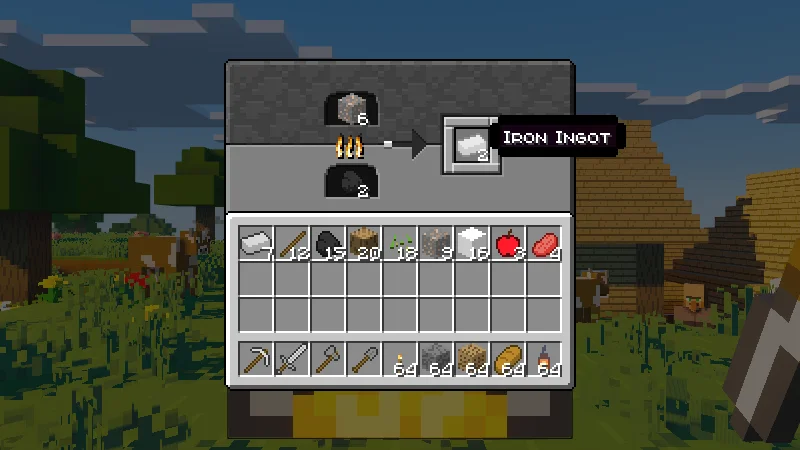</td>
</tr></table>

A furnace smelts what it is given, ten seconds an item. It cooks raw meat, porkchop and beef to
eight points of food and mutton and chicken to six, and turns sand to glass, cobblestone to stone,
iron, copper and gold ore to their ingots and a log to charcoal. It burns coal or charcoal for 80
seconds, a log, planks or a crafting table for 15, a wooden tool for 10, a slab for 7.5 and a stick
for 5, lights a new fuel only when it has something to smelt with room for what it makes, and starts
an item over when its fire goes out, as Minecraft's does. A right click opens it, what it smelts
over its fuel with the fire's bar between them, the smelting's bar, and what it made, which a click
takes up. While it burns it is emissive as a whole block and lights the blocks around it to 13. It
burns on while its column is loaded, its window shut or not, gives up what it holds when it is
broken or blown up, and is kept by the save in `furnaces.json`.

Iron ore lies in the stone in veins of six, ten to a column from 5 to 64 blocks up, pale tan against
the gray, and drops itself only to a pickaxe of stone or iron. Three ingots over two sticks make an
iron pickaxe, and the other iron tools come in their shapes.

## Health and hunger

In survival the player has Minecraft's 20 points of health and of food, drawn as ten hearts and ten
drumsticks over the hotbar, with bubbles of breath over the food while it runs short. Each row fades
out once it is full and has not changed for three seconds and shows again at once when it changes,
as HUD mods of Minecraft hide theirs, unless the settings turn the fading off. Walking, sprinting,
swimming, jumping, breaking blocks, hitting and healing tire the player, and each four points of
that exhaustion take a point of the saturation food leaves, or of the food once none is left. With
18 food or more the player heals a point every four seconds, with none starves a point every four
seconds down to one, and with six or less cannot sprint. Holding the right button with food eats it
over a second and a half while the player is hungry. Raw porkchop or beef feeds three points, raw
mutton or chicken two, an apple four and bread, three wheat in a row, five, and glow berries two. Oak
leaves drop an apple once in two hundred.

A fall of more than three blocks takes a point for each block past three, a fifth of that onto a hay
bale and none into water. Under water the player holds fifteen seconds of breath, shown as bubbles
over the food, and then drowns two points a second, and a cactus beside the player, or a block where
the eye is, takes a point every half second. A hit reddens the view, and none other harms for half a
second after it. A death spills the inventory where the player fell and offers a new life at the
world's spawn, the highest block at the origin, with full health and food. Creative mode keeps the
player from all of it.

## Hostile mobs

In survival, zombies, skeletons, spiders and creepers spawn in the dark, as Minecraft's do, on a
solid block where no emissive block's light reaches and the sky's light, less its darkening at
night, is no brighter than a roll from 0 to 7, so on the surface at night and in caves at any hour.
Four tries a second look between 24 and 64 blocks from the player for a pack of one to four of a
kind, zombies four times in ten, skeletons three, and spiders and creepers one and a half each,
while fewer than 30 are about. One more than 128 blocks off is gone at once and one more than 32 off
now and then, and a column that unloads does not keep them, nor does the save. Every mob, hostile or
not, is an entity of the engine's ECS, its mob, its body, its life and its pose, and a hostile one
its hunt besides, which behaviors of their own think and move, push apart, age and take away when
dead in the engine's frame, the hostile ones thinking apart from the rest, and the renderer draws
them by queries over the same components.

A hostile mob that sees the player within its range, 24 blocks for a zombie and 16 for the rest,
hunts the player along a way found through the blocks, and keeps on within twice that, as does one
the player hits. A zombie strikes for three points a second within reach and a spider for two, a
skeleton keeps five to ten blocks off and shoots an arrow every two seconds, aimed above the
player's chest for its drop, each arrow two points for each block a tick it flies and sometimes one
more, an entity of the engine's ECS that a behavior of its own flies in the engine's frame, and a
creeper within three blocks swells by Minecraft's numbers, wider more than taller, flashing white
over every other tenth of its fuse, and after a second and a half explodes, unless the player gets
seven blocks away. Its hiss waits for the game to have sound. Its explosion, of Minecraft's power 3,
sends rays out that break the blocks they reach by each block's blast resistance, a hollow of dirt
and little stone, drops a third of what it breaks, and harms the player and the mobs by their
distance and how much of them it sees, 43 points at its middle. Zombies and skeletons burn under the
open sky by day, a point a second. In creative mode they wander and hunt no one. TNT, made of five
gunpowder and four sand in a cross, is lit by flint and steel used on it, which is made of an iron
ingot and flint, gravel giving flint one time in ten, and wears out after 64 uses. Lit, the TNT pops
up from its cell, falls, flashes white every five ticks and swells over its last ten, and after four
seconds explodes at Minecraft's power of 4, a hollow of about a hundred dirt where a creeper's takes
fifty, and a blast that reaches TNT lights it on a fuse of half a second to a second and a half, so
a row of it goes off one after another, each lit TNT an entity of the engine's ECS that a behavior
of its own burns in the engine's frame. Each blast throws Minecraft's cloud, six puffs a tick for
eight ticks within four blocks of it, drawn unlit with the pack's sixteen pictures of an explosion,
and a flash of light for a tenth of a second, which global illumination carries onto the land
around.

They drop Minecraft's loot as they die. A zombie drops rotten flesh, which feeds four points, a
skeleton bones and arrows, a spider string and now and then an eye, and a creeper gunpowder, unless
it blew itself up. Their models are boxes of Minecraft's too, a zombie's and a skeleton's arms held
out ahead and a skeleton's bow upright in its hand, and arrows are thin shafts drawn over the frame,
which cast no shadow.

## Fire

Flint and steel used on a block's face lights a fire in the cell before it, where the block under it
is whole or a block beside it burns, as Minecraft's does, and a blast lights none, as Minecraft's
TNT and creepers light none. A fire burns by Minecraft's numbers, each an entity of the engine's ECS
that a behavior of its own burns in the engine's frame. It ticks every one and a half to two
seconds, growing older, burns away a block beside it that burns or turns it to fire, at Minecraft's
odds for planks, logs, leaves, wool, hay, TNT, which it lights, and the flowers and grasses, and
catches the air near them, up to four blocks over it and one to each side. One with nothing that
burns around it goes out once it is older than 3, about twenty seconds on stone, and one over magma
burns on. A house of planks burns down, and a hand, a block placed in its cell or a blast puts a
fire out.

Its flames are Minecraft's walls of the pack's animated `fire_0`, four leaning across the cell and
four at its sides on the ground, or toward each block beside and over it that burns where it hangs
on a wall, drawn at twice their color whatever light falls on them, as Minecraft draws fire at full
light. Its light is level 15, and global illumination takes it from a box inside the walls that
only the scene's distance field sees, so it lights a room as glowstone does, while the flames'
texture steps freely.

## Resource packs

<table><tr>
<td>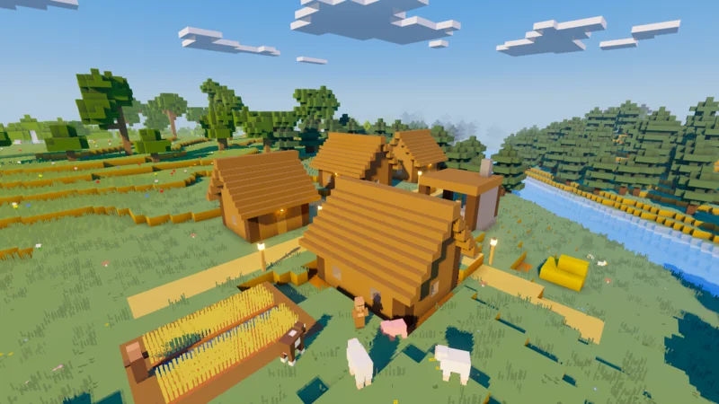</td>
<td></td>
</tr></table>

The blocks and items are drawn with the textures of the Minecraft resource packs the player has,
each a zip or a folder holding `assets/minecraft`. They are kept in the `resourcepacks` folder
beside the saves, as Minecraft keeps its own beside its worlds, and the options' Resource Packs
screen turns them on and orders them, the first over the rest, as Minecraft layers its packs, so a
texture the first lacks is read from the next that has it. A click turns a pack on over the rest or
off, the arrow beside one moves it up, and Done saves the list in `resourcepacks.txt` beside the
folder, a pack a line, by its name in the folder or by its whole path where it lies elsewhere, and
the game reads it at every start. `voxel.packs` sets the list from a terminal, `voxel.reload` and F3
with T read the packs again after one changes, and each `--pack` on the command line draws one run
with the packs given in place of the list. A transient run reads no list and writes none, so it is
drawn the same on every machine. The repository ships no pack and none of a pack's files.
`VoxelSandbox/Rendering/PackTextures.cs` names the texture each surface and item is drawn with, by
Minecraft's names, and a surface it leaves out, or one no pack has, keeps the game's own color. Each
full block's own color is the average of Bare Bones' texture of it, read from the owner's copy as
numbers by `voxel.palette`, which prints each surface's average from the packs loaded, so the world
with no pack looks as it does with the pack the game fetches. The plants keep their own colors, and
the ores theirs, since without a texture an ore shows by its color alone.

At the first start, with no list yet, the game fetches its three default packs from their makers'
own pages on Modrinth into its folder, on a task of its own while it plays with its own art, and
turns them on once all three are in, [Bare Bones](https://modrinth.com/resourcepack/bare-bones) by
RobotPants first, then [Recolourful Containers GUI +
HUD](https://modrinth.com/resourcepack/recolourful-containers-gui) by Vi_Tul and [qrafty's
Capitalized Font](https://modrinth.com/resourcepack/qraftys-capitalized-font) by qrafty and Drqad.
Each is under all rights reserved, and Bare Bones' and Recolourful's terms forbid handing them out
again, so the repository and its builds hold none of them, and the game fetches each from its
maker's page, as a Modrinth modpack names its files rather than holding them.
`VoxelSandbox/resources/packs.json` names each pack's Modrinth version and the SHA-512 of its one
file, so a file whose bytes differ is refused, and each request names the game in its user agent, as
Modrinth asks. Offline, or where a file is refused, the game plays with its own art and tries again
at the next start. The Resource Packs screen says how the fetch stands, with a switch that stops it,
saving the list as it is, or begins it where a default pack is missing. A transient run fetches
nothing.

The textures are laid out at load in one atlas with its mip levels, each tile two by two in a cell
of its own, so a smaller mip level read near a tile's edge reads the same tile, and sampled by the
nearest pixel. A face's tile is laid across it by where each point lies in its block, as Minecraft
lays a texture on a face of a block or of a smaller box within one, so a slab or a step of the
stairs shows the part of the texture its place covers. A torch's and a lantern's pieces show the
parts of the torch's and the lantern's textures the source's models give their faces, read from the
models as numbers, a lantern's handle and chain two crossed walls cut out where the texture is
clear, and its glass and a torch's flame, drawn as lamps' cubes, emit four times the color of their
bright pixels, so the iron around the glass shows as iron. Grass and oak leaves take the climate's
color over their gray textures, birch and spruce leaves and water a color of their own as Minecraft
gives them, and the grass block's side its overlay tinted over the dirt under it. The scene's
distance field reads each face as its texture's average under its tint, so the light a wall gives
back takes its texture's color. A face whose texture is clear in some pixels and wholly covered in
the rest is cut out where it is clear, as Minecraft cuts out its glass, a door's window and its
leaves, the shader dropping those pixels. Glass goes in a mesh of each section that casts no shadow,
as the see-through faces cast none, and a door's window and a pack's leaves in one that casts the
whole face's, the terrain shader's `shadowMain` cutting only the faces whose corners carry their
places on the texture, so a canopy's shade stays whole. Glass a pack draws in a frame keeps the
frame and loses the streaks the pack lays across its pane, everything inside the frame taking the
pane's most common pixel, and two panes of the same glass side by side show one frame about both, as
the modpack's connected textures draw them. The mesher packs which of a glass face's eight neighbors
in its plane are the same glass, and the terrain shader leaves out the frame toward them, running
the frame's other edge on straight past a join and keeping a corner inside an L of three panes, as
`build/play.sh` reads where two panes meet. A pack's own pieces of connected glass are not read,
since none of the packs the game fetches has them. Leaves cut out hide nothing behind them, so they
keep their faces against each other and the faces beside them, as Minecraft draws its leaves, and
the sections seen through them are drawn. Bare Bones' leaves are covered in every pixel and so stay
whole. A texture partly clear, as ice's is, blends as before. The cactus is Minecraft's model, its
top and bottom across the whole cell and each side a pixel in from its side of the cell and as wide
as the cell, so its pictures' clear edges are cut out, shadow and all, and the thorns on them stick
out past the sides beside them. Its box stops the player a pixel in at each side and a pixel short
of its top, as Minecraft's does. An emissive block's cube is drawn
with its texture, and one whose faces differ, the lit furnace, with its top's, its sides' and its
bottom's laid side by side, so it shows the furnace's top above its front, its front alone emissive
where its pixels are bright. A pack's animated texture, a strip of frames its metadata plays in an
order and for times of its own, has its frames laid in the atlas one after another, each held the
shortest frame's time and a longer frame for as many steps as it lasts, a face carrying the first
and the terrain shader stepping it by the game's ticks, twenty a second, as Minecraft steps them, up
to 16 such textures. An animated lamp's cube keeps its first frame's texture, whose average the
scene's distance field reads as its color, since a draw whose color changes is stamped again without
its light for frames, and steps the map of its emission, which shows most of what the face shows, so
a lantern's flame flickers and the light it casts holds still. `build/play.sh` writes water of a
white and a black frame and reads both in turn. An item's icon is the pack's texture for it, or a
block's cube with its faces' textures. The grass's top shows looks of the game's own in its flat
style, little blossoms of four colors, patches of clover a shade darker than the grass under them
and so tinted by the climate as it is, and pebbles, laid over a pack's grass or the game's own at
four quarter turns, the grass's own tile keeping the way it lies, since a pack draws its grass's
streaks one way, and about four blocks in five plain, a twelfth clover and a few in a hundred
flowers or stones, as the looks of the grass in the owner's modpack are weighed. A hash of the
block's place picks one, so the same block shows the same look every time. A pack gives the pictures
alone, its textures, its sprites and its font, and the game reads nothing of its block states or
models, which hold how the source draws and chooses its blocks, since how the game draws and chooses
is its own.

The interface takes a pack's pictures where Minecraft reads them, the hotbar, its frame, the hearts,
the food, the bubbles of breath and the crosshair under `gui/sprites/hud`, the buttons and sliders
under `gui/sprites/widget` and the tooltip under `gui/sprites/tooltip`, each drawn over the box
Minecraft draws it in and kept to its edges where its `.mcmeta` makes it a nine-slice. The
inventory, a crafting table, a furnace and the creative window take their textures under
`gui/container`, which hold their slots, with the furnace's flame and arrow over them from
`gui/sprites/container/furnace`, and the text takes the font of `font/ascii`, each glyph as wide as
its lit columns as Minecraft measures it. Bare Bones given first and Recolourful Containers after it
draw the HUD and the widgets as Bare Bones does and the windows as Recolourful does, since Bare
Bones has no windows of its own but an anvil's and a beacon's, and neither has a creative window, so
that one keeps the game's own.

## How the world is drawn

A section of 16 blocks a side is one mesh in one white material, each corner of a face its position
and eight packed bytes of the game's own, twenty bytes a corner on the GPU. The bytes hold the face
the corner lies on, which of the face's corners it is, its shade, its surface's tiles in the atlas
of the resource packs and the color it carries, and `VoxelSandbox/resources/shaders/terrain.slang`
unpacks them, taking the normal by table and the tile tinted by the color under the shade. The
colors go with the mesh as well for the scene's distance field, which the light is traced through,
so indirect light takes each block's color. Faces between two blocks are left out, and each face
that remains is two triangles of its own, since greedy meshing is not written yet. A section meshed
again with the same faces keeps its mesh and takes only new packed bytes, written in place.

An emissive block (glowstone, a sea lantern, shroomlight, magma) is drawn as a cube of its own, and
the emissive piece of a torch, a lantern or an end rod as that cube scaled to it, every cube of one
surface in one instanced draw, because a material's emission is one for its whole draw and a
section's one material is not emissive. The faces of the blocks against a lamp's cube stay in their
section's mesh, hidden behind the cube's, so the mesh is closed around the lamp, since the field
reads a cell whose nearest point lies on an edge only one triangle of its mesh has as open, and
would read the stone beside a lamp as the air in front of the lamp's faces.

Sections are drawn by their distance from the player and by what the eye can see, as Minecraft's
visibility graph has it. Each section knows which of its six faces its open cells join, and a flood
from the eye's section passes into the next only across faces so joined, never turning back, so the
land under the ground and behind a cave's or a closed room's walls is left out. From the eye's own
section it leaves by the faces the open cells around the eye reach. The flood is kept until the eye
enters another section or leaves it by other faces, a column comes or goes, or a block that may hide
what is behind it is set or taken, since over 24 sections a column it walks thousands and took 4.8
ms of each frame at seed 1's cherry grove at 12 columns. A section the flood leaves out is not
meshed until a flood reaches it, so the stone under the land within reach is meshed only where a
cave opens to it, which in a flight east over seed 1's cherry grove held about 4,400 sections and
took the game's update from 1.3 ms a frame to 0.7 or 0.9. `voxel.cull` and the F3 window turn
it off. Sections are not culled to the view's frustum, because a mesh left out of a frame leaves the
field, and the indirect light it reflected or blocked goes with it until the field settles again,
where the land the flood leaves out lies behind walls the field holds, so a cave lit by a glowstone
looks the same either way. Each of the engine's passes leaves out on its own the sections whose
boxes it cannot see, and the field keeps them all the same.

With the eye inside a whole opaque block, in every mode but spectator, the block's side covers the
window, its texture or its own color darkened to a tenth, repeated four times across and four down
and sliding a repeat for each 64 degrees the player turns or pitches, as Minecraft draws the inside
of a block, so a view set down in a wall shows the wall. Leaves, glass, ice, water and the blocks
smaller than their cell leave the view open, as they do in Minecraft.

## Light levels and corners

Each block holds Minecraft's two light levels from 0 to 15. The sky's is 15 under the open sky,
falls straight down without losing any and loses one for each block it goes sideways or up, and an
emissive block's loses one for each block from it, glowstone, sea lanterns, shroomlight and
lanterns giving 15, torches and end rods 14, the soul torch and soul lantern 10 and magma 3. A new
column's light is worked out on the worker that generates it, joined to its neighbors' as it
arrives, and taken back and spread again around each block placed or broken.

Each corner of a face is shaded from the four cells in front of the face that meet at it, as
Minecraft's smooth lighting is. Its light is the average of the open ones, its occlusion counts the
solid ones, and the shade darkens the block's color in the vertex, where neither the sky nor a lamp
reaches it and where blocks meet. A level keeps nearly all of the color down to a few levels from
dark and next to none at 0, because global illumination brings a lamp's falloff itself, where
Minecraft's own curve, which is its only light, dims by distance. The field reads the darkened color
too, so an unlit cave reflects nearly no indirect light. A change of light gives a mesh new colors
and keeps its vertices, which the field knows it by, so relighting leaves the meshes settled in the
field, and the field and the ray-traced scene take the new colors in the frame after, so the
indirect light off a section a lamp has lit since takes its new light. Each quad is split along the
diagonal its occlusion favors, so a shaded corner darkens one triangle softly. A corner where blocks
meet keeps 0.8, 0.62 or 0.45 of its color for one, two or three of its cells closed, both its sides
closed counted as three, as Minecraft's does, and the corner shade's strength, from 0 to 1, 0 to
100% on the Render Settings screen and through `voxel.corners`, takes each level that far from 1,
half by default, so a corner where three cells close keeps 0.725 of its color, the sections shaded
again when it changes.

Each corner also carries its sky level to the terrain shader, which keeps a face's light no less
than the sky's light from all around at the hour, as the engine lights an open face by the
environment the game gives the sky, under that level on the source's brightness curve at its default
brightness setting, so level 13 reads 0.80 of 15 on the screen. The scene's distance field holds
leaves solid, so the engine's own light leaves the floor under a canopy at noon at 20 where the
shade of a wall on open ground reads 42, and the floor lifts it to 42, as the source lights it at
13. A face at level 15 has open sky over it, which the field sees, and takes no floor, which keeps
the field's shade beside a wall, and at night the sky's light is next to nothing, so the floor holds
by day under leaves, in a cave's mouth and inside a house by its windows, as the source's levels
light them. The plants and a broken block's bits take the same floor at their cells' levels.

The F3 window turns the light levels and the shaded corners off, each on its own, to see
global illumination alone, and opens the engine's windows of what global illumination holds, of the
frame's profile, and of the effects over the frame, the tonemap, exposure, grading, vignette, FXAA,
depth of field, motion blur and bloom, each set at once as it is changed. Global illumination leaves
out the engine's screen probes, so every face reads the light of its cascades through the scene
alone, smoother and coarser, since the screen's probes spotted the light and moved it as the eye
moved, and a non-number one of them kept spread black across the frame; the Render Settings
screen turns them on.

The frame is tonemapped by the curve of the owner's modpack's shader with the owner's settings, its
exposure 0.9, white curve 1.3, lower curve 1.05 and upper 1.0, which the engine's `SetTonemapCurve`
draws. The light is raised by 1.6 before it, which keeps the middle levels within 3 of Reinhard's
curve at 1.7, the brightness of the modpack's pictures, the darks deeper by the curve's lower power
and the lights brighter, and the frame is graded, each channel pushed from the middle gray by 1.12
and the color by 1.4, so a village's roofs, its wheat and its
grass in the afternoon read as vividly as in the modpack's pictures, whose shader's warm light and
deep shade saturate them. By day the sky's light on the land is drawn through the engine's
`SetEnvironmentLight` toward a white of its own brightness, the painted sky's light on a face turned
up taken each time the sky is painted, so a shadow is the ground darker in its own color, as the
source's are and as the far shadows the cascades fade read, where the sky's blue lit the near ones
blue, a village tree's shadow on the grass at noon 48, 73, 14 where it read 6, 74, 58. The sky drawn
keeps its blue and the night its light, and since the tint scales what the sky's light reflects too,
a lake's blue is 12 levels less and the clouds' undersides white.

## Sky

<table><tr>
<td>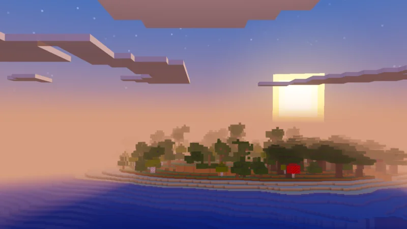</td>
<td>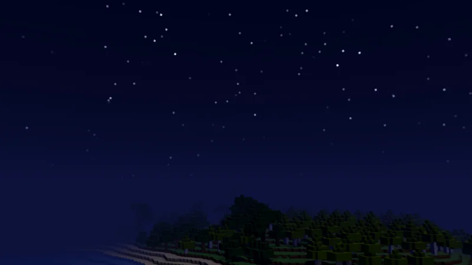</td>
</tr></table>

The sky is painted as a smooth gradient from the horizon to the zenith, blue by day, orange at the
horizon at dawn and dusk and dark blue at night, and given to the engine as the map that lights the
world from all around and is drawn behind it. The sun, the moon and the stars are drawn over it on
quads fixed on the sky, the sun and the moon pixel art sampled without filtering, so their pixels
stay square, and each star a plain square. A quad's sides run along the way the sky turns at its
place and across it, so where it stands and which way it is turned depend on the hour alone,
whichever way the player looks. The sun and the moon take the shape of Minecraft's default ones, a
square body 8 pixels across at the middle of a picture of 32, with a faint glow around it, each
added to the sky behind it as Minecraft adds its own. They are painted at four texels to each of
those pixels, as Bare Bones paints its own, so the body keeps its square pixels and the glow falls
smoothly to nothing. The sun's body is as wide against its distance as Minecraft's, 15 to 100 or
about 8.6 degrees, and the moon's 10 to 100, about 5.7 degrees. Where a resource pack has its own
sun and moon, under `environment/celestial` as Minecraft reads them now or `environment/sun` and the
sheet `environment/moon_phases` as it read them before, those are drawn in their place. The sky
turns with the hour about the axis from north to south, the sun rising in the east at 6, passing
over the south at noon and setting in the west at 18, and the moon stands opposite it. The sun
lights the world in the colors of the modpack's shader, read as numbers, a warm white at noon, (0.7,
0.55, 0.4) times 1.9 in linear light, turning orange toward the horizon, (0.64, 0.45, 0.3) to the
power of 1.5 and the share short of noon, times 5, mixed by the square root of the sun's height, and
as bright at noon as a white sun of the same luminance. By night the sky takes the shader's night
tint of the owner's settings, its colors multiplied by 1.10, 0.90 and 1.30 in linear light as far as
the day's light is gone, a violet blue, and the moon lights the world in the shader's night light,
(0.15, 0.14, 0.20), as bright as before. Its 3,000 stars are squares of 0.28 degrees, most faint and
a few bright, in a cool white, as the modpack's shader, Aurora's Shaders after Complementary, draws
its own, each as bright as 40 times the square of how far the product of three noises passes 0.7.
They are added to the sky, as the sun and the moon are, so a faint star brightens the sky behind it
and darkens none of it at dawn and dusk, which `voxel.spots` counts. They keep their places on the
turning sky, fade in as the day fades, thin out over the lowest 20 degrees above the horizon and are
gone beside the sun and the moon. The moon goes through
Minecraft's eight phases, a phase a day from the full moon of the first night, and changes while it
is down. `voxel.time` sets the hour and `voxel.day` the count of days, which a save keeps, and the
land and the clouds hide the sun, the moon and the stars.

## Clouds

A layer of blocky clouds drifts east at 120 blocks up, as Minecraft's does, in cells of 12 by 12
blocks and 4 high, which cells hold a cloud following a slow noise of the world's seed. Each cloud
is a box whose faces against a cloud beside it are left out, its top brightest and its bottom
darkest, see-through, lit by the sun and the moon, and fading into the sky at twice the render
distance. The clouds cast no shadow, which keeps them out of the scene's distance field, so they
shade neither the sun's light nor indirect light. The cells around the player are one mesh,
made again only when the player moves a cell's width against them, and their drift is the mesh's
place.

## Shadows

The sun's shadows come from the engine's shadow map, out to 64 blocks unless `voxel.shadows` sets
another distance, which keeps a village's trees' shadows in a view across it and takes a millisecond
off the frame at 1920 by 1080 against 96, 17.8 ms to 16.8 at seed 1's cherry grove, where 48 takes
two and loses the trees' shadows fifty blocks off, and are pixelated. The terrain's shader takes the
sun's shadow at each point of a face at the middle of the step it lies in, an eighth of a block on a
side, as the modpack's shader steps its shadows with the settings it is played with, two of a
texture's sixteen pixels, so a shadow's edge steps along the face rather than running slantwise
across it. The grid is the sun's alone. The rest of the light, the lamps' and global illumination's,
is taken at the point itself, so a lantern's light on the floor it stands on falls smoothly from its
glass, and `voxel.line` reads the last frame's light along a line in the world. Taking the sun's
shadow at the step's middle reads the shadow map twice more at each pixel the map holds, which over
seed 1's plains at noon at 12 columns with Bare Bones costs too little to read, the window's model
pass taking 10.73 ms against 10.71 with all of the light taken at the step's middle, the mean of
three sessions each, whose readings swing by half a millisecond. Against no stepping at all, at 1920
by 1080 over seed 1's cherry grove, the steps cost the scene pass about 1.6 ms, 12.5 and 12.7
against 10.9 and 11.2 in two sessions each, which the engine is asked to bring to one read of the
shadow by letting `litLight` take it from the shader that calls it. The engine's soft contact
shadow, traced toward the sun through the scene's distance field, is left out where the shadow map
holds a point, so no fringe lies beside a shadow's edge, and kept past the map's reach, where the
land has no other shadow of the sun.

As the day passes the light stands at the nearest of 36 steps an hour while the sun drawn on the
sky moves smoothly, so a shadow stands still between steps and jumps at once to its next place,
where the light turning every frame laid an edge near a step's boundary on either side from frame
to frame. A step turns the light by a 36th of the sky's 15 degrees an hour, so the edge of a shadow
16 blocks from what casts it jumps 0.12 of a block, under one step of the grid, and
`build/play.sh` reads across a pillar's shadow at two hours of one step and finds it the same.

The plants cast the shadows of their blades and flowers, the terrain shader's `shadowMain` cutting
each wall's shadow where its picture is clear as its fragment stage cuts the wall, and global
illumination holds none of them, so they neither send on light nor stand in its way. Glass a pack
cuts out casts no shadow, as glass the pack leaves whole casts none, and a door's window and a
pack's leaves clear between them cast the whole face's. `build/play.sh` reads across a poppy's
shadow at 8.30, where 7 of 49 points along the line are dark and the shadow of its whole walls
would darken 15. Over seed 1's plains at noon at 12 columns with Bare Bones they cost the GPU 2.3 ms
a frame, 0.8 in the sun's shadow maps, 0.7 in the depth that ambient occlusion reads, which holds
them as well, and 0.8 in the model pass, and the CPU 3.4 ms recording the maps and the depth, the
frame taking 17.2 ms against 16.8, the mean of two sessions each with no validation layer. On
lavapipe at two columns a frame takes 2.60 s against 2.55.

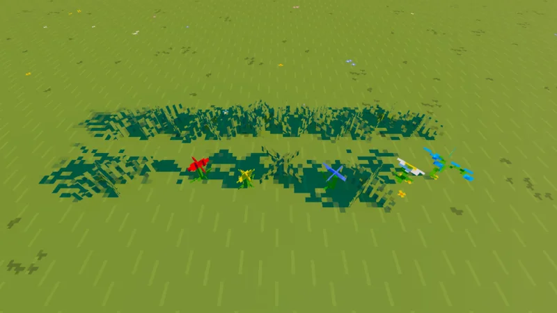

## Fog

The sections are drawn through a shader of the game's own,
`VoxelSandbox/resources/shaders/terrain.slang`, which takes the model pass's light, the sun, the
shadows, global illumination and the sky, over each vertex's color as the engine's shader for
colored meshes does, and fades the result from two thirds of the render distance to the render
distance into the sky drawn behind each point, read along the ray from the eye from the sky's image
as the engine's sky shader reads it, under the share of the dome's band below, as Minecraft's fog
hides where the world ends and as the owner's modpack's shader colors its fog by the way the eye
looks. So a mountain's top high against the sky fades into the sky's blue and the land at the
horizon into the horizon's haze. Nearer, the atmosphere hazes the land as the modpack's shader does
with the owner's settings, toward the same color by a share that grows as one less e to the minus
half a millionth of the cube of the distance in blocks, as much slower as the render distance is
past twelve columns, to 0.23 at most, its fog's strength of 0.95 less the 0.25 it keeps in clear
weather, held to 0.325 of that under its altitude of 300, so about a tenth of the land's color at
100 blocks and a fifth at 150. Its growth is taken by its density along the way from the eye, whole
at and under the sea's level and falling by e over each 40 blocks above it, so a valley holds its
haze and a peak eighty blocks over the sea about two fifths of it, and the morning thickens it as a
dawn's mist, growing two and a half times as fast at a quarter past six and back to its noon's by
nine, the Sky and Visuals screen turning each off. Under water the haze is the water's blue and
covers the view within 16 blocks. Past the last section the world ends, so a dome about the eye
below the horizon is drawn in the haze's color, as Minecraft draws what lies below its horizon in
its fog's color, fading into the sky over six degrees above the horizon. It is drawn through the
same shader beyond the haze's end, which gives it the haze's color itself, so the land's fading edge
meets it with no step at any render distance and under water, while the sky's image keeps its darker
lower half for the light it gives the world. It lies 3,600 blocks out, beyond the sun, the moon and
the stars and inside the engine's far plane, since it writes depth over its whole band, so a sun
drawn behind it would end in a line six degrees up, where its band begins clear. They are drawn over
it instead, the sun and the moon as a grid of a quad to each pixel of their pictures, and each
corner takes the share of the haze left clear at its height, so a low sun dims into the haze as the
dome blended over it would show it. `voxel.edge` reads where the drawn land ends up a column of
pixels and how it meets what lies above it. The Sky and Visuals screen turns the fog off, and the
dome with it. The lamps' cubes are drawn with the engine's own shader and take no haze.

## What is not here yet

A pack's block models and its connected textures. Slabs and
stairs that keep light out, as Minecraft's do. Greedy meshing. Saplings that grow, and vines and
cocoa on the jungle's trees. Structures read from files rather than built in code. Villagers that
trade, sleep in beds or work their farms, and animals that breed or follow food. A bed to set where
the player respawns, spiders that climb walls, and a bow and armor for the player.

## What it costs

Every section within the render distance that the eye can see is drawn each frame, so the render
distance sets most of the frame's cost. It is 12 columns by default, 192 blocks, and from 2 to 16 on
the Render Settings screen and through `voxel.distance`, the F3 window's first lines giving the
frame's time, draws and triangles, and a save keeps no distance of its own. The sections are drawn
through the terrain's own shader, which keeps the positions their meshes hold, and the game marks it
so with `SetShaderKeepsPositions`, so each of the engine's passes, the camera's, the depth's and
each of the sun's three shadow cascades', leaves out the sections whose boxes it cannot see, and the
shadows take about the same from 8 columns to 16. Over seed 1's spawn at noon, from 100 blocks up
looking north, at 1280 by 720 offscreen on the development machine's RTX 4070 Laptop GPU with the
three default packs, the frame keeps 60 a second at 8 columns and loses it at 12, where the main
thread bounds it, the game's update and drawing with the engine's render work, while the GPU's work
stays at 14 to 15 ms. The frame's time, the GPU's and the CPU's passes' in milliseconds and the
memory the game holds, one session each, the frame's time varying by up to 6 ms between sessions at
12 columns and the GPU's by under 0.5:

| columns | frame | GPU | CPU's passes | memory |
|---|---|---|---|---|
| 8 | 16.8 | 10.8 | 7.4 | 1,002 MB |
| 12 | 17.5 | 14.3 | 10.1 | 1,551 MB |
| 16 | 40.3 | 18.4 | 22.6 | 2,675 MB |

The plants are most of what a meadow draws. Over seed 1's plains at noon at 12 columns, from 20
blocks up at -288, 64 looking east, they take the frame from 1.18 million triangles to 1.64, the
window's model pass from 7.7 ms to 10.1 and the GPU's passes from 13.1 ms to 14.9, the mean of three
sessions each, and the frame keeps 60 a second. They cast no shadow and the scene's distance field
holds none of them, so the shadows and global illumination take no more for them. A column takes
about as long to generate with them.

A column's 24 sections hold 288 KB of blocks and light, and its sections of open air over the land,
most of them, share one pair of arrays until a block or a level in one of them changes, so a column
of seed 1 holds about 100 KB of its own, 69 MB over the 665 columns loaded at 12. A column's
sections from the one under its floor up, its floor being the lowest of its places' highest blocks,
are meshed and drawn wherever the column is, and its deep sections only within the render distance
of the eye in all three dimensions. Those two sections past that are packed, compressed until
something reads them, so from 230 blocks over seed 1's spawn 3,817 sections pack and the columns
hold 25 MB. Of the deep sections the flood draws only those the eye's open cells join, through a
cave's mouth, and `voxel.state` counts them, at 1920 by 1080 61 of the 1,683 draws at seed 1's
cherry grove and 149 of the 1,563 at the plains village, 4 and 10 percent of their triangles. A
column takes 11 to 16 ms to generate on a worker and 6 to 7 ms to light.

Flying east over land the stream has not loaded, the game meshes the sections and joins the columns
that come into reach on the main thread, and the frame keeps 60 a second at no distance. In three
flights of ten seconds over the same land it takes 18.3 to 18.9 ms at 8 columns, 18.4 to 20.9 at 10,
21.4 to 28.8 at 12 and 23.8 to 24.7 at 14.

On lavapipe, as the build workflow plays the game, the GPU's work is 0.49 s a frame at 4 columns,
0.82 s at 8, 1.20 s at 12 and 1.42 s at 14. Leaving the unseen sections out matters most underground.
In a cave of seed 1's hills it leaves 905 of 1,085 sections undrawn and takes the frame from 16 ms
to 4, the sun's shadows from 6.9 ms to 0.07, and in a closed room on a flat world it takes 0.3 ms
off the window's passes.

A mob's pieces take no part in global illumination, so the scene's distance field leaves them out.
Each piece of a walking mob would otherwise be a moving mesh the field stamps as a box every frame,
which over seed 1's first village with the hills at 8 columns cost the field 2.1 ms of the CPU and
1.0 ms of the GPU a frame for the 17 mobs drawn walking, and 4.0 and 3.9 ms for a crowd of 76.
The mob shader lights each of a mob's pixels twice, its own face and a face turned up. With the nine
standing in a row at noon, as in the daylight capture, the window's pass reads the same with them as
with none, within the 0.4 ms its readings swing by. With a sheep a block and a half from the eye
filling most of the window it costs 0.43 to 0.49 ms more than with none, where the engine's own
material cost 0.21 to 0.22, over four readings of 600 frames each.
