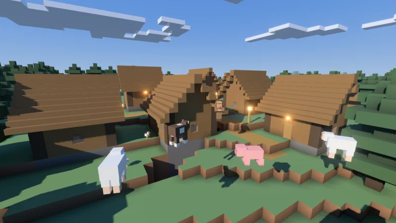
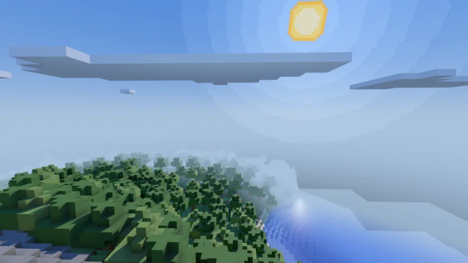

# Voxel Sandbox

A voxel game written in C# on [3DEngine](https://github.com/EggyStudio/3DEngine) through its
package on nuget.org, set in an endless generated world whose blocks are placed and broken, with its
light, its water, its mobs and the items they drop. Its first use is to test the engine's global
illumination, radiance cascades traced through the scene's distance field, with emissive blocks.
The world is held in columns of colored blocks 16 by 16 by 128, with animals that graze it,
villagers in its villages and hostile mobs where it is dark. The game has a first-person player
with Minecraft's sizes and speeds, building and breaking with an outline on the block looked at, in
creative mode or in survival with health and hunger, an inventory, tools and crafting, Minecraft's
light levels with smooth lighting and shaded corners, a sky whose sun, moon and stars cross it
behind drifting clouds, and an ImGui window of the light's settings.

<table><tr>
<td></td>
<td></td>
</tr></table>

## Running it

The game needs the .NET 10 SDK, a Vulkan device and `slangc`, which `build/fetch-slang.sh` fetches
into `build/tools` once per checkout (`build/fetch-slang.ps1` on Windows), since its terrain shader
is compiled when the game loads it.

```bash
build/fetch-slang.sh
dotnet run --project VoxelSandbox                      # the hills of seed 1
dotnet run --project VoxelSandbox -- --flat --seed 7   # a flat world to build a test on
dotnet run --project VoxelSandbox -- --world house     # a save of its own name
dotnet test VoxelSandbox.Tests                         # its light, meshes, mobs, saves and land
```

A world is saved under `~/.local/share/VoxelSandbox/saves` on Linux, and the matching local
application data folder elsewhere, in a folder named by its kind and seed, `overworld-1` or
`flat-7`, unless `--world` names it. Its mode, inventory, health and food are saved with it. It is
saved every 30 seconds, on opening another world and on quitting, and opened where it was left.
`--transient` keeps nothing on disk, as a test run scripted through `./e3d` should, so it leaves the
saves as they were. The builds made in the engine's repository saved under `3DEngine.Game/saves` in
the same folder, and a world moved from there into `VoxelSandbox/saves` opens where it was left.

`./e3d` controls the running game from a terminal through the engine's command line, run out of
the engine's checkout that `ENGINE_CHECKOUT` names, or the folder above this repository
([.github/E3D.md](.github/E3D.md)):

```bash
dotnet build VoxelSandbox.slnx
./e3d open VoxelSandbox/bin/Debug/net10.0/VoxelSandbox --hidden --transient
./e3d command voxel.state
./e3d stop
```

The pictures at the head of this file are taken by `build/pictures.sh`, each from the seed, the
place, the hour and the heading the script names, with the mobs and the clouds held where it puts
them, so running it again shows a change to how the world is drawn in the same pictures.

## Builds to play

A run of the pack workflow, started by hand, publishes the game as native code for Linux, Windows
and macOS on Apple silicon, each a zip of the program, its resources, the README and the license,
and with its `publish` input set makes a GitHub release of the three. A zip needs no .NET and no
`slangc`, since it carries every shader compiled. The game's version is `build/version.sh`'s, the
major and minor in `build/version.txt` and as the patch the commits since that file changed.

## The game this repository held before

The `legacy` branch keeps the voxel sandbox this repository held before, written on Direct3D 12,
with its history.

## Controls

| Input | Does |
|---|---|
| Mouse | Look |
| W, A, S, D | Walk |
| Space | Jump, or rise while flying or swimming. Twice quickly in creative, start or stop flying |
| Left Shift | Sneak, which keeps the player from walking off an edge, or sink while flying |
| Left Control | Sprint |
| Left button | Hit the mob looked at or break the block, at once in creative, slowly in survival |
| Right button | Place the chosen block or eat the food held, or open a door, a table or a furnace |
| Middle button | Pick the block looked at into the hotbar, in survival from the inventory |
| 1 to 9, wheel | Choose a slot of the hotbar |
| E | In creative every item, to put any of them in the chosen slot, in survival and adventure the inventory, and in spectator nothing |
| Q | Throw one of the chosen slot's items, or with Left Control its stack |
| F3 | The settings window, with what the frame holds and costs, the light, the sky and the world, opened as F3 is let go |
| F3 with F4 | The mode switcher, F4 stepping through creative, survival, adventure and spectator while F3 is held, and the mode chosen played as F3 is let go |
| G | The next quality of global illumination, Off after High |
| F1 | Hide the crosshair, the hotbar and the outline |
| Escape | Free the cursor, or hold it again |

## Commands

Each is a line of `./e3d list` and runs with `./e3d command`, so a test of the light is built and
looked at from the terminal. A closed room lit by one lamp, at night:

```bash
./e3d command voxel.world flat
./e3d command voxel.room 10 4 -22 22 11 -10 stone
./e3d command voxel.set 16 5 -16 glowstone
./e3d command voxel.tp 16.5 5 -11.8
./e3d command voxel.look 0 -20
./e3d command voxel.time 23
./e3d shot room.png
```

`voxel.state` says where the player stands and looks, what is loaded and drawn, the hour, the day
and the light. `voxel.fill`, `voxel.room` and `voxel.set` change blocks, `voxel.tp`, `voxel.look`
and `voxel.fly` move the player, `voxel.break` and `voxel.place` act as the mouse buttons do,
`voxel.time`, `voxel.day` and `voxel.cycle` set the sky, `voxel.clouds` shows or hides the clouds
and places their drift, `voxel.distance` the render distance, `voxel.light` reads a block's light
levels, `voxel.shade` turns the light levels and the shaded corners on or off, `voxel.corners` sets
how far the corners darken, `voxel.world` saves the world and opens or begins another of a kind and
seed, `voxel.save` saves at once, and `voxel.blocks` lists the blocks by number and name.
`voxel.mobs` counts the mobs and lists the nearest, `voxel.spawn` places one where the crosshair
rests, `voxel.attack` hits the one it rests on as the left button does, `voxel.still` stops them
where they stand and holds the clouds for a capture, and `voxel.kill` takes them away. `voxel.mode`
plays in creative, survival, adventure or spectator mode, `voxel.select` puts an item in the chosen
slot, `voxel.give` puts items in the inventory, `voxel.craft` makes an item from what the inventory
holds, `voxel.furnace` fills and reads a furnace, `voxel.inventory` lists what it holds,
`voxel.items` lists every item, and `voxel.throw` throws as Q does. `voxel.vitals` says or sets the
health and food, `voxel.hurt` harms the player, and `voxel.respawn` gives a new life. `voxel.gi`,
`voxel.field` and `voxel.shadows` set global illumination, the scene's distance field and the sun's
shadows, and `voxel.hud` hides what is drawn over the world for a capture. Three measure the light.
`voxel.flicker` records each frame's change in the picture around a turn or a step into a file, with
the first frame after it, the settled one and their difference beside it, `voxel.ring` reads the
last frame's light around a circle on the ground by angle, and `voxel.depth` says how far the block
under a pixel is. The engine's own `gi.*` and `field.*` commands show and measure global
illumination.

## Biomes

Two slow noises give each place a temperature and a humidity, as Minecraft's climate does, and they
choose its biome among plains with a few oaks, forests of oak and birch, birch forests, taiga of
spruce, snowy taiga and snowy plains where it is cold, flat desert of sand over sandstone with cacti
where it is hot and dry, and bare stone mountains wherever the ground rises past 82 blocks, snow
above 92. Grass and oak leaves are gray surfaces tinted by a color looked up from the two values at
the corners of Minecraft's colormaps, so their green changes smoothly across a biome's edge,
yellowing near a desert and cooling toward the snow, while the biome itself changes at once. Birch
and spruce leaves keep a color of their own. A hot, dry climate also flattens the land, so a desert
lies flat and the hills sink as they near it.

## Water, glass and ice

Wide basins sink the land under the sea level of 48, where water stands over a floor of sand near
the shore and gravel deeper, its top frozen to ice where the climate is cold, as about a fourteenth
of the land is on seed 1. The player swims in it, sinking slowly, rising while Space is held until
the head and shoulders are out and moving at a little over half speed, climbs out by walking into
a bank a block above the water, and sees through a blue tint while the eye is under it. Glass,
ice and water are drawn see-through, a second mesh of each section drawn after the opaque ones and
farthest first, each vertex's alpha its surface's. They cast no shadow, which keeps them out of the
scene's distance field as well, since the field holds a see-through mesh as solid, so the sun's
light and indirect light come through a window of glass as through an opening, and a room lit
through a skylight reads the same with glass in it as without. Glass lets the light levels through,
and water takes a level more for each block of it, so the sky fades with depth and a lake's floor
darkens as it deepens.

Water flows as Minecraft's does, a block every quarter second. It falls into the air under it, and
where it stands on ground or on a source it spreads sideways, a level further from its source for
each block, up to seven, each level standing lower in its cell, and it dries back when its source is
taken away. Two sources with a gap between them over ground fill it with a third. A lake the world
generates stands still until a block beside it changes, and water half flowed when a world is left
stands as it was until then.

## Torches, lanterns and end rods

A torch, a lantern, an end rod, and the soul torch and soul lantern of blue fire are smaller than a
block, each a few boxes as Minecraft's models are. A torch placed on a wall's side leans out from
it, a lantern placed under a block hangs from it, and an end rod points away from the face it is
placed on, and each falls when the block it holds to is broken. Light passes through them, the
player through a torch, and the crosshair meets each of their pieces, as it meets a slab's, stairs'
and a fence's, so a ray through a stair's open quarter or between a fence's rails reaches the block
behind, and the outline follows the pieces together, a stair's step and slab outlined as one shape
with the crease under the step. The emissive piece, a torch's flame, a lantern's glass or the rod,
is a lamp's cube scaled to it, so global illumination carries it as a small light by its box, and
the other pieces are faces of the section's mesh.

A small light's emissive intensity is its light over its surface, so a torch's flame, a 48th of a
block's surface, is far brighter than glowstone. Each is set so a closed room's floor takes about
three quarters of glowstone's light from a torch or an end rod, nine tenths from a lantern and two
fifths from the soul fire. A flame a quarter of a block from a wall lights a bright round pool on
it, as a light that near a wall does.

## Slabs, stairs, fences and doors

Slabs of stone, cobblestone, oak, spruce and sandstone fill the lower half of a block, or the upper
half where placed against a ceiling or on the upper half of a side, and a slab placed on the open
half of one of its kind joins it into the whole block. Stairs of cobblestone, oak, spruce, sandstone
and stone brick climb the way the player looks, turned over in the upper half, and turn into a
corner as Minecraft's do, an outer one, a quarter of the step, where stairs of the same half behind
them climb across them, and an inner one, the step and a quarter before it, where stairs before them
climb across them, each toward the side those climb to, so a ring of stairs climbing inward makes a
hip roof's corners. A fence joins the fences and the whole blocks on its four sides with two rails
each. An oak door stands two blocks high on a whole block, shut across the side away from the way
the player looked placing it, and a right click opens or shuts both its halves, whatever is held.
Breaking either half breaks the door.

The player climbs half a block and a little more without jumping, onto a slab or a stair, as
Minecraft's does. A slab, stairs, a door, a lantern, an end rod and a fence stop the player at their
own boxes, a fence's standing half a block above its post so it cannot be jumped, and a torch and
wheat are walked through. Light passes through them all, so a roof of slabs lets the sky's level
down.

## Caves and ravines

Tunnels wind under the ground where two noises are both near zero, and wide caverns open deep down
where a third is high. They stay three blocks under the ground, so they are dark until dug into, but
in patches of high ground away from the sea a tunnel that rises near the top breaks out, a mouth the
sun shines into. A ravine cuts the ground open along a swaying line about 48 blocks long, up to
seven wide at its middle and narrowing to its ends, its floor up to 30 blocks down with a few
emissive magma blocks on it, so the sun's light falls down its walls and the magma's lights its
depths at night. No ravine is cut beside the sea, so no water stands beside its air. `voxel.find
ravine` gives the nearest.

## Trees and structures

Each column places the trees and the structures that start in it and those that start in the
columns around it and reach into it, keeping the blocks that fall inside itself. Where one starts
depends on the seed and the ground at its start alone, which the generator can tell for a column
not generated, so a tree or a building crosses a column's edge whole although every column is
generated alone on a worker, as Minecraft places a structure's pieces chunk by chunk.

A structure has at most one start in each cell of 64 by 64 blocks, where its chance falls and the
land at its start suits it. An igloo of snow with a shroomlight inside stands on the snowy plains, a
stepped sandstone pyramid in the desert, a dark chamber at its heart with a floor of blue and red,
and a cobblestone dungeon deep under any ground, a magma block at its middle where Minecraft's has
its spawner. `voxel.find <village|igloo|pyramid|dungeon|ravine>` gives the nearest one's place.

A village stands where the plains, the taiga, the snowy plains or the desert lie nearly level across
48 blocks, built of that biome's wood or sandstone. A well at its middle has a lantern hanging under
its roof, four roads of dirt path lead out from it, and beside each road stand two plots, each a
small house, a long house, a farm of wheat with a row of water through it, a forge with a hearth of
magma or a pile of hay, its front toward the road, with lamp posts along the roads, a lantern on a
fence, or a torch in the desert. A house has a shut oak door with a torch over it, lanterns hanging
inside and a roof of stairs climbing to a ridge, flat in the desert. Each road follows the ground
block by block and crosses water on planks, each building stands at its own ground's height on a
footing of stone, and no tree grows within the village. A villager lives in each house, two in a
long house, and one keeps each forge and each farm.

## Animals and villagers

Pigs, cows, sheep and chickens graze the plains, the forests and the taiga, and sheep the mountains,
a herd of two to four of one kind in about a tenth of the columns, placed as a column is first
generated, as Minecraft places them. A sheep's wool is white, or now and then gray, black, brown or
pink, about as often as Minecraft's are born so. A villager wears a robe of its village's biome.

A mob stands a few seconds and then walks to a place up to ten blocks off, along a way found through
the blocks, which runs along the ground and around what stands in it, up a block with a jump, down
as far as three, and through water where no other way goes, the mob floating in it and climbing out
onto a bank. Now
and then one turns its head to watch the player within six blocks. A hit turns it red for half a
second, knocks it back and sends it running from place to place for five seconds, and once its
health is gone it falls onto its side and is taken away, a chicken after four hits, a sheep after
eight, a pig or a cow after ten and a villager after twenty. A villager wanders within 20 blocks of
its house by day and from six in the evening to six in the morning goes home, opening the doors in
its way and shutting them behind it. The player pushes mobs aside, they push each other apart, and
no block is placed into one.

A mob thinks and moves only while the columns around its own are loaded, so it never walks onto the
air a column not loaded reads as. The mobs standing in a column go with it when it unloads and come
back where they stood when it loads, and the save keeps them in `mobs.bin` with the columns that
have had theirs placed, so a herd or a village's villagers are placed once.

Each piece of a mob, its head, body, legs and a chicken's wings, is a few boxes, one mesh of colored
vertices drawn instanced for every mob of its kind, its legs swinging about their hips as it walks.
The boxes, their pivots and each kind's width and height are Minecraft's, taken as numbers from its
model definitions and its mobs' sizes as of 26.3, the villager drawn at the 0.9375 its layer is, and
their colors, faces and markings are the game's own. The walk is Minecraft's too, a leg turning up
to 1.4 radians each way with its stride, which follows the speed, and cycling every 2.36 blocks, a
villager's half as far under its robe, a spider's legs turning and lifting by 0.4. A zombie reaches
its arms out a little under level and raises them while it hunts, and a skeleton's hang until it
aims. Each kind stands beside Minecraft's outline through the same camera, standing and mid-stride,
in `.github/assets/mobs`, which `build/mob-pairs.py` draws again from the Minecraft client on the
machine through `build/MobLayers.java`, and says so where the machine has none. A
leg swung ahead or behind is lifted by however far its foot's corner would sink, so no foot goes
below the ground. Mobs are drawn within 64 blocks, as Minecraft draws its entities, through the
game's own mob shader (`VoxelSandbox/resources/shaders/mob.slang`), which has no haze. It lights
them as the engine lights a model, global illumination's indirect light among it, keeps the sun's
share and takes the color out of the rest, the light from all around, and floors each face at
Minecraft's flat shade of the light a face turned up takes there, 1 on top, 0.8 facing north or
south, 0.6 facing east or west and 0.5 underneath. A white sheep's side in the shade at noon so
reads 154, 158 and 159, a gray as Minecraft's does, where it read 119, 161 and 178, the blue of the
sky its light's rays met. The nine stand in a row in daylight in `.github/assets/mobs/daylight.webp`.
They cast shadows and hold no light for others, their materials' `BouncesLight` off, which leaves
them out of the scene's distance field, so a pig's pink does not reach the grass.

## The modes

A world plays in creative mode, as a test of the light needs, in survival, in adventure or in
spectator, which the switcher, `voxel.mode` and the settings window choose and the save keeps. F3
held with F4 opens the switcher over the middle of the window, the four modes' icons in boxes under
the chosen mode's name, as Minecraft's is, creative's grass block and survival's iron sword from the
items and adventure's map and spectator's eye drawn for it. It opens on the mode played before the
one now, or on survival from creative and on creative from the others where there is none, F4 steps
it to the next while F3 is held, and letting F3 go plays the mode chosen. Adventure keeps survival's
health, hunger and inventory and its doors, tables, furnaces and hits on mobs, and breaks and places
no block. Spectator flies through the blocks with nothing held and nothing touched, no crosshair,
hotbar or harm, and no mob hunts the player.

In creative every item is to hand through E, a block breaks at once and drops nothing, placing a
block uses nothing up, and Space pressed twice flies. In survival there is no flight, and a block
takes its hardness times one and a half seconds to break with the button held, darkening as it goes,
as by hand in Minecraft, and then drops what it leaves. Grass, farmland and a path drop their dirt,
stone its cobblestone, coal ore its coal, wheat its wheat and seeds, leaves, glass and ice nothing,
and any other block itself. A torch or a lantern that falls with the block it held to drops too, and
placing a block uses one up.

The inventory holds 36 slots of up to 64 of an item, the hotbar its first nine. E opens it in
survival and adventure, where a left click takes up a stack, puts it down, joins it to a stack of
its item or swaps the two, and a right click takes up half a stack or puts down one of it. The quick
moves are Minecraft's, in that window, at a crafting table and at a furnace in any mode. Shift with
a click moves a stack between the hotbar and the rest, into a furnace by what smelts or burns, or
out of a grid or a furnace into the inventory, and on what a grid makes crafts as many as the
inventory has room for. A number key over a slot swaps it with that slot of the hotbar, a
double-click with a stack held gathers its kind onto it, and a drag over slots with a stack held
spreads it over them, evenly with the left button and one each with the right. Q over a slot drops
one of its items and Control with Q its stack, and a middle click on the window or R sorts the 27
slots above the hotbar, each kind together in filled stacks, as the sorting mods do. With the window
shut, Q throws one of the chosen slot's items and Control with Q its stack. A stack on the ground
falls, slides to a stop and turns slowly, and is picked up once the player comes within a block of
it, half a second after it fell or two after it was thrown, joining stacks of its item in the
inventory first. Two stacks of an item lying together join, and a stack is gone after five minutes.
The stacks on the ground are not saved with the world. A mob drops its loot as it dies, in either
mode. A pig drops porkchops, a cow leather and beef, a sheep a block of wool of its coat's color and
mutton, and a chicken feathers and its meat.

Each item shows by an icon 16 pixels square, drawn once into an atlas. A block's icon is the block
as a small cube seen from above and from two sides, cast pixel by pixel against its own boxes, so a
slab, stairs, a torch and a fence keep their shapes, and a block smaller than its cell both ways is
drawn larger to fill the icon. Each face takes its surface's color as it looks in the plains with a
fixed speckle, since the blocks have colors and not textures, and is shaded by the way it faces, the
top brightest and the right side darkest, as Minecraft's inventory shades its blocks, and an
emissive block's faces are unshaded. An item that places no block is pixel art drawn from a few
strokes and dots, outlined in a dark shade of its color, its upper left edge lit and its lower right
shaded, and each kind of tool keeps one shape, its head in the color of its material. The hotbar
and the inventory window draw the atlas as a texture sampled without filtering, each icon at twice
its size.

## Tools and crafting

A pickaxe, an axe, a shovel and a sword are made of wood, stone or iron. A tool breaks the blocks
its kind is for faster than a hand, twice as fast of wood, four times of stone and six times of
iron, a pickaxe stone, cobblestone, ores, sandstone, concrete and lanterns, an axe logs, planks and
what is made of them, and a shovel dirt, grass, sand, gravel and snow. A block a pickaxe is for
takes its hardness times five seconds without one and drops nothing, as in Minecraft, so stone takes
seven and a half seconds by hand, a little over one with a wooden pickaxe and half of one with a
stone pickaxe. A tool wears by a use for each block it breaks and a sword by two, and is gone when
its 59 uses of wood, 131 of stone or 250 of iron are worn, a bar under its slot showing what is
left. A hit takes a hand's one point of a mob's health, and a sword five, six and seven of wood,
stone and iron, an axe four, five and six, a pickaxe three, four and five and a shovel two, three
and four, as Minecraft's took before its attacks had a cooldown.

The inventory has a crafting grid of two by two, and a crafting table, made of four planks, one of
three by three that a right click on it opens. A recipe matches wherever its shape lies in the grid
with the rest empty, its mirror image too, and a click on what the grid makes takes it, using one
item of each stack. A log makes four planks of its wood, two planks four sticks, a stick under coal
or charcoal four torches, eight cobblestone in a ring a furnace, planks, cobblestone or iron ingots
with sticks the tools in Minecraft's shapes, three blocks in a row six slabs, a staircase of six
blocks four stairs, planks and sticks three fences, six planks three doors, four sand a block of
sandstone, four stone four stone bricks, and nine wheat a hay bale. Veins of coal lie in the stone
from 5 to 100 blocks up, 18 to a column, darker than the stone around them, which the walls of a
cave or a ravine show.

## Furnaces and iron

A furnace smelts what it is given, ten seconds an item. It cooks raw meat, porkchop and beef to
eight points of food and mutton and chicken to six, and turns sand to glass, cobblestone to stone,
iron ore to an ingot and a log to charcoal. It burns coal or charcoal for 80 seconds, a log, planks
or a crafting table for 15, a wooden tool for 10, a slab for 7.5 and a stick for 5, lights a new
fuel only when it has something to smelt with room for what it makes, and starts an item over when
its fire goes out, as Minecraft's does. A right click opens it, what it smelts over its fuel with
the fire's bar between them, the smelting's bar, and what it made, which a click takes up. While it
burns it is emissive as a whole block and lights the blocks around it to 13. It burns on while its
column is loaded, its window shut or not, gives up what it holds when it is broken or blown up, and
is kept by the save in `furnaces.json`.

Iron ore lies in the stone in veins of six, ten to a column from 5 to 64 blocks up, pale tan against
the gray, and drops itself only to a pickaxe of stone or iron. Three ingots over two sticks make an
iron pickaxe, and the other iron tools come in their shapes.

## Health and hunger

In survival the player has Minecraft's 20 points of health and of food, drawn as ten hearts and ten
drumsticks over the hotbar. Walking, sprinting, swimming, jumping, breaking blocks, hitting and
healing tire the player, and each four points of that exhaustion take a point of the saturation food
leaves, or of the food once none is left. With 18 food or more the player heals a point every four
seconds, with none starves a point every four seconds down to one, and with six or less cannot
sprint. Holding the right button with food eats it over a second and a half while the player is
hungry. Raw porkchop or beef feeds three points, raw mutton or chicken two, an apple four and bread,
three wheat in a row, five. Oak leaves drop an apple once in two hundred.

A fall of more than three blocks takes a point for each block past three, a fifth of that onto a hay
bale and none into water. Under water the player holds fifteen seconds of breath, shown as bubbles
over the food, and then drowns two points a second, and a cactus beside the player, or a block where
the eye is, takes a point every half second. A hit reddens the view, and none other harms for half a
second after it. A death spills the inventory where the player fell and offers a new life at the
world's spawn, the highest block at the origin, with full health and food. Creative mode keeps the
player from all of it.

## Hostile mobs

In survival, zombies, skeletons, spiders and creepers spawn in the dark, as Minecraft's do, on a
solid block where no emissive block's light reaches and the sky's light, less its darkening at
night, is no brighter than a roll from 0 to 7, so on the surface at night and in caves at any hour.
Four tries a second look between 24 and 64 blocks from the player for a pack of one to four of a
kind, zombies four times in ten, skeletons three, and spiders and creepers one and a half each,
while fewer than 30 are about. One more than 128 blocks off is gone at once and one more than 32 off
now and then, and a column that unloads does not keep them, nor does the save.

A hostile mob that sees the player within its range, 24 blocks for a zombie and 16 for the rest,
hunts the player along a way found through the blocks, and keeps on within twice that, as does one
the player hits. A zombie strikes for three points a second within reach and a spider for two, a
skeleton keeps five to ten blocks off and shoots an arrow every two seconds, aimed above the
player's chest for its drop, each arrow two points for each block a tick it flies and sometimes one
more, and a creeper within three blocks hisses, swelling and flashing white, and after a second and
a half explodes, unless the player gets seven blocks away. Its explosion, of Minecraft's power 3,
sends rays out that break the blocks they reach by each block's blast resistance, a hollow of dirt
and little stone, drops a third of what it breaks, and harms the player and the mobs by their
distance and how much of them it sees, 43 points at its middle. Zombies and skeletons burn under the
open sky by day, a point a second. In creative mode they wander and hunt no one.

They drop Minecraft's loot as they die. A zombie drops rotten flesh, which feeds four points, a
skeleton bones and arrows, a spider string and now and then an eye, and a creeper gunpowder, unless
it blew itself up. Their models are boxes of Minecraft's too, a zombie's and a skeleton's arms held
out ahead and a skeleton's bow upright in its hand, and arrows are thin shafts drawn over the frame,
which cast no shadow.

## How the world is drawn

A section of 16 blocks a side is one mesh in one white material, each corner of a face its position
and eight packed bytes of the game's own, twenty bytes a corner on the GPU. The bytes hold the face
the corner lies on, which of the face's corners it is, its shade and its surface's color, and
`VoxelSandbox/resources/shaders/terrain.slang` unpacks them, taking the normal and texture
coordinate by table and the color under the shade. The colors go with the mesh as well for the
scene's distance field, which the light is traced through, so indirect light takes each block's
color. Faces between two blocks are left out, and each face that remains is two triangles of its
own, since greedy meshing is not written yet. A section meshed again with the same faces keeps its
mesh and takes only new packed bytes, written in place.

An emissive block (glowstone, a sea lantern, shroomlight, magma) is drawn as a cube of its own, and
the emissive piece of a torch, a lantern or an end rod as that cube scaled to it, every cube of one
surface in one instanced draw, because a material's emission is one for its whole draw and a
section's one material is not emissive. The faces of the blocks against a lamp's cube stay in their
section's mesh, hidden behind the cube's, so the mesh is closed around the lamp, since the field
reads a cell whose nearest point lies on an edge only one triangle of its mesh has as open, and
would read the stone beside a lamp as the air in front of the lamp's faces.

Sections are drawn by their distance from the player and by what the eye can see, as Minecraft's
visibility graph has it. Each section knows which of its six faces its open cells join, and a flood
from the eye's section passes into the next only across faces so joined, never turning back, so the
land under the ground and behind a cave's or a closed room's walls is left out. From the eye's own
section it leaves by the faces the open cells around the eye reach. `voxel.cull` and the settings
window turn it off. Sections are not culled to the view's frustum, because a mesh left out of a
frame leaves the field, and the indirect light it reflected or blocked goes with it until the field
settles again, where the land the flood leaves out lies behind walls the field holds, so a cave
lit by a glowstone looks the same either way. Each of the engine's passes leaves out on its own the
sections whose boxes it cannot see, and the field keeps them all the same.

## Light levels and corners

Each block holds Minecraft's two light levels from 0 to 15. The sky's is 15 under the open sky,
falls straight down without losing any and loses one for each block it goes sideways or up, and an
emissive block's loses one for each block from it, glowstone, sea lanterns, shroomlight and
lanterns giving 15, torches and end rods 14, the soul torch and soul lantern 10 and magma 3. A new
column's light is worked out on the worker that generates it, joined to its neighbors' as it
arrives, and taken back and spread again around each block placed or broken.

Each corner of a face is shaded from the four cells in front of the face that meet at it, as
Minecraft's smooth lighting is. Its light is the average of the open ones, its occlusion counts the
solid ones, and the shade darkens the block's color in the vertex, where neither the sky nor a lamp
reaches it and where blocks meet. A level keeps nearly all of the color down to a few levels from
dark and next to none at 0, because global illumination brings a lamp's falloff itself, where
Minecraft's own curve, which is its only light, dims by distance. The field reads the darkened color
too, so an unlit cave reflects nearly no indirect light. A change of light gives a mesh new colors
and keeps its vertices, which the field knows it by, so relighting leaves the meshes settled in the
field, and the field and the ray-traced scene take the new colors in the frame after, so the
indirect light off a section a lamp has lit since takes its new light. Each quad is split along the
diagonal its occlusion favors, so a shaded corner darkens one triangle softly. A corner where blocks
meet keeps 0.8, 0.62 or 0.45 of its color for one, two or three of its cells closed, both its sides
closed counted as three, as Minecraft's does, and the corner shade's strength, from 0 to 1 in the
settings window and through `voxel.corners`, takes each level that far from 1, 1 by default, the
sections shaded again when it changes.

The settings window turns the light levels and the shaded corners off, each on its own, to see
global illumination alone, and opens the engine's windows of what global illumination holds, of the
frame's profile, and of the effects over the frame, the tonemap, exposure, grading, vignette, FXAA,
depth of field, motion blur and bloom, each set at once as it is changed.

The frame is tonemapped by the engine's somewhat boring curve, which keeps colors as they are and
rolls the highlights off without a filmic look, so the blocks' colors and the pixel art read as
drawn. It is taken at an exposure of 1.25, which gives the day the brightness the engine's own curve
gives it at 1, and a room lit by a lamp at night 13 percent more.

## Sky

The sky is painted as a smooth gradient from the horizon to the zenith, blue by day, orange at the
horizon at dawn and dusk and dark blue at night, and given to the engine as the map that lights the
world from all around and is drawn behind it. The sun, the moon, the glow around each and the
stars are pixel art drawn over it on quads fixed on the sky, sampled without filtering, so their
pixels stay square. A quad's sides run along the way the sky turns at its place and across it, so
where it stands and which way it is turned depend on the hour alone, whichever way the player
looks. The sun is as wide against its distance as Minecraft's, 15 to 100 or about 8.6 degrees, and
the moon 10 to 100, about 5.7 degrees. The sun's glow is six rings of brightness on the sun's own
grid of pixels, their edges stepping along it, warmer and stronger at dawn and dusk, and the moon's
is the same rings on the moon's grid, dimmer and in the moonlight's color, each added to the sky
behind it. The sky turns with the hour about the axis from north to south, the sun rising in the east at 6, passing
over the south at noon and setting in the west at 18, and the moon stands opposite it. Its 500 stars
keep their places on the turning sky and fade in as the day fades and near the horizon. The moon
goes through Minecraft's eight phases, a phase a day from the full moon of the first night, and
changes while it is down. `voxel.time` sets the hour and `voxel.day` the count of days, which a save
keeps, and the land and the clouds hide the sun, the moon and the stars.

## Clouds

A layer of blocky clouds drifts east at 120 blocks up, as Minecraft's does, in cells of 12 by 12
blocks and 4 high, which cells hold a cloud following a slow noise of the world's seed. Each cloud
is a box whose faces against a cloud beside it are left out, its top brightest and its bottom
darkest, see-through, lit by the sun and the moon, and fading into the sky at twice the render
distance. The clouds cast no shadow, which keeps them out of the scene's distance field, so they
shade neither the sun's light nor indirect light. The cells around the player are one mesh,
made again only when the player moves a cell's width against them, and their drift is the mesh's
place.

## Shadows

The sun's shadows come from the engine's shadow map, out to 96 blocks unless `voxel.shadows` sets
another distance, and are pixelated. The terrain's shader takes each point of a face's light at the
middle of the block's pixel it lies in, a sixteenth of a block on a side as Minecraft's textures
have them, so a shadow's edge steps along the pixels of the blocks it crosses rather than running
slantwise across them. The lamps' light and global illumination are taken at the same points, and in
a room lit by a lamp the light shows no steps. The engine's soft contact shadow, traced toward the
sun through the scene's distance field, is left out where the shadow map holds a point, so no fringe
lies beside a shadow's edge, and kept past the map's reach, where the land has no other shadow of
the sun.

## Fog

The sections are drawn through a shader of the game's own,
`VoxelSandbox/resources/shaders/terrain.slang`, which takes the model pass's light, the sun, the
shadows, global illumination and the sky, over each vertex's color as the engine's shader for
colored meshes does, and fades the result into the sky's color at the horizon from two thirds of the
render distance to the render distance, as Minecraft's fog hides where the world ends. Under water
the haze is the water's blue and covers the view within 16 blocks. The sky below the horizon keeps
the horizon's color a while, so the haze at the world's edge meets a sky of its own color. The
settings window turns the fog off. The lamps' cubes are drawn with the engine's own shader and take
no haze.

## What is not here yet

Textures, and leaves seen through, which are solid. Slabs and stairs that keep light out, as
Minecraft's do. Greedy meshing. Light that passes through
leaves at a cost, as Minecraft's does. Structures read from files rather than built in code.
Villagers that trade, sleep in beds or work their farms, and animals that breed or follow food. A
bed to set where the player respawns, spiders that climb walls, and a bow and armor for the player.

## What it costs

Every section within the render distance that the eye can see is drawn each frame, so the render
distance sets most of the frame's cost. It is 12 columns by default, 192 blocks, and from 2 to 16 in
the settings window, whose first lines give the frame's time, draws and triangles, and through
`voxel.distance`, and a save keeps no distance of its own. The sections are drawn through the
terrain's own shader, which keeps the positions their meshes hold, and the game marks it so with
`SetShaderKeepsPositions`, so each of the engine's passes, the camera's, the depth's and each of
the sun's three shadow cascades', leaves out the sections whose boxes it cannot see, and the
shadows, which reach 96 blocks, take about the same from 8 columns to 16. Over seed 1's spawn at
noon, seen from above the forest, at 1280 by 720 on the development machine's RTX 4070 Laptop GPU,
the frame keeps 60 a second up to 14 columns, with 6.9 ms of each frame to spare at 12 and 3.2 at
14, and loses it at 16, where the main thread bounds it, the game's update and drawing with the
engine's render work, while the GPU's work stays under 13 ms. The frame's time, the GPU's and its
passes' in milliseconds, and the memory the game holds, each but the first the mean of three
sessions:

| columns | frame | GPU | shadows | depth | global illumination | memory |
|---|---|---|---|---|---|---|
| 4 | 16.7 | 5.5 | 0.6 | 0.2 | 1.8 | 599 MB |
| 8 | 16.7 | 6.6 | 1.1 | 0.7 | 1.3 | 812 MB |
| 10 | 16.7 | 8.1 | 1.2 | 1.1 | 1.4 | 1,163 MB |
| 12 | 16.7 | 9.5 | 1.2 | 1.7 | 1.4 | 1,277 MB |
| 14 | 16.8 | 11.3 | 1.2 | 2.4 | 1.4 | 1,971 MB |
| 16 | 17.5 | 12.8 | 1.2 | 2.9 | 1.5 | 2,169 MB |

Flying east over land the stream has not loaded, the game meshes the sections and joins the columns
that come into reach on the main thread, and the frame keeps 60 a second at no distance. In three
flights of ten seconds over the same land it takes 18.3 to 18.9 ms at 8 columns, 18.4 to 20.9 at 10,
21.4 to 28.8 at 12 and 23.8 to 24.7 at 14.

On lavapipe, as the build workflow plays the game, the GPU's work is 0.49 s a frame at 4 columns,
0.82 s at 8, 1.20 s at 12 and 1.42 s at 14. Leaving the unseen sections out matters most underground.
In a cave of seed 1's hills it leaves 905 of 1,085 sections undrawn and takes the frame from 16 ms
to 4, the sun's shadows from 6.9 ms to 0.07, and in a closed room on a flat world it takes 0.3 ms
off the window's passes.

A mob's pieces take no part in global illumination, so the scene's distance field leaves them out.
Each piece of a walking mob would otherwise be a moving mesh the field stamps as a box every frame,
which over seed 1's first village with the hills at 8 columns cost the field 2.1 ms of the CPU and
1.0 ms of the GPU a frame for the 17 mobs drawn walking, and 4.0 and 3.9 ms for a crowd of 76.
The mob shader lights each of a mob's pixels twice, its own face and a face turned up. With the nine
standing in a row at noon, as in the daylight capture, the window's pass reads the same with them as
with none, within the 0.4 ms its readings swing by. With a sheep a block and a half from the eye
filling most of the window it costs 0.43 to 0.49 ms more than with none, where the engine's own
material cost 0.21 to 0.22, over four readings of 600 frames each.
